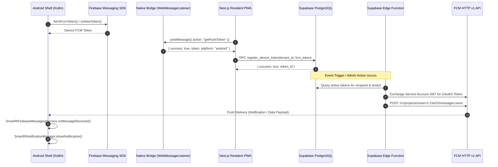

# Smart RT Android — Phase 5.1: FCM Push Notification Implementation Report

**Status:** PASS (Implementation & Automated Verification Complete)  
**Date:** 2026-11-17  
**Build Variants:** `id.smartrt.resident`, `id.smartrt.resident.staging`, `id.smartrt.resident.debug`  
**Firebase Project:** `smart-rt-15e23` (Project Number: `388918324584`)  
**Backend:** Supabase Cloud Staging (`szghujzhiyndeuhepsax`) + Supabase Edge Functions  
**API Protocol:** Firebase Cloud Messaging HTTP v1 API (`messages:send`)

---

## 1. Executive Summary

Phase 5.1 implements end-to-end Firebase Cloud Messaging (FCM) push notifications for the Smart RT Resident Web-First Hybrid application. 

The architecture strictly adheres to modern security standards:
- **Zero Legacy FCM:** Disallows FCM legacy server keys; uses exclusively the modern **FCM HTTP v1 API** with OAuth2 access tokens generated via Web Crypto RS256 service account assertion.
- **Tenant Isolation & Security:** Device tokens are strictly tenant-scoped and tied to authenticated Supabase resident profiles. RLS policies and `SECURITY DEFINER` RPCs prevent cross-tenant or cross-user token hijacking.
- **Fail-Closed Stale Token Cleanup:** The Edge Function automatically deactivates device tokens that return `UNREGISTERED` or `NOT_FOUND` from Google's FCM v1 endpoint.
- **Android 13+ Runtime Compliance:** Explicitly requests and handles `POST_NOTIFICATIONS` runtime permissions, manages high-priority notification channels, and exposes native bridge hooks to the Next.js webview.

---

## 2. Architecture & Data Flow

---

## 3. Implementation Details

### A. Android Native Shell (Kotlin)

1. **Gradle Build Toolchain Configuration:**
   - Root `android/build.gradle.kts`: Applied `com.google.gms.google-services` version `4.4.2`.
   - App `android/app/build.gradle.kts`: Applied Google services plugin and imported Firebase BOM `33.7.0` with `com.google.firebase:firebase-messaging-ktx`.
   - `android/app/google-services.json`: Configured client entries for all 3 variants (`id.smartrt.resident`, `id.smartrt.resident.staging`, and `id.smartrt.resident.debug`).

2. **System Permissions & Manifest Declarations:**
   - Declared `<uses-permission android:name="android.permission.POST_NOTIFICATIONS" />` in `AndroidManifest.xml`.
   - Registered `SmartRtFirebaseMessagingService` with `<action android:name="com.google.firebase.MESSAGING_EVENT" />`.
   - Created vector notification icon `res/drawable/ic_notification.xml`.

3. **Notification Management & Service:**
   - `SmartRtNotificationManager.kt`:
     - Initializes notification channel `smartrt_resident_notifications` ("Notifikasi Warga", `IMPORTANCE_HIGH`).
     - Manages local token caching in private `SharedPreferences`.
     - Builds explicit `PendingIntent` with `FLAG_IMMUTABLE` and `FLAG_ACTIVITY_SINGLE_TOP` targeting `MainActivity`.
     - Supports payload deep-linking with `target_url` extra.
   - `SmartRtFirebaseMessagingService.kt`:
     - Implements `onNewToken` for token rotation.
     - Implements `onMessageReceived` handling both notification payloads and data-only messages for foreground/background dispatch.

4. **Native Bridge Integration:**
   - Added `"getPushToken"` action to `NativeBridgeMessageProcessor`.
   - Added proactive and reactive `POST_NOTIFICATIONS` permission launcher via Activity Result API in `MainActivity.kt`.
   - Exposed `tokenProvider` in `SmartRtWebViewFactory`.

---

### B. Supabase Database & Security (Migration 0026)

- Migration file: `supabase/migrations/20261117002600_create_user_device_tokens.sql`
- Table: `public.user_device_tokens`
  - Columns: `id`, `tenant_id`, `user_id`, `fcm_token`, `platform`, `device_info`, `is_active`, `last_seen_at`, `created_at`, `updated_at`.
  - Multi-tenant constraint: Foreign key `(tenant_id, user_id)` referencing `public.tenant_members(tenant_id, user_id) ON DELETE CASCADE`.
  - Unique constraint: `UNIQUE (fcm_token)` (ensures re-assigned devices update ownership).
  - RLS policies: Enforces `user_id = auth.uid()` for SELECT, INSERT, UPDATE, DELETE. `service_role` has full operational access.
- Atomic RPCs:
  - `public.register_device_token(p_tenant_id uuid, p_fcm_token text, p_platform text, p_device_info jsonb)`: Validates caller authentication, verifies active tenant membership, and atomically upserts token.
  - `public.unregister_device_token(p_fcm_token text)`: Deactivates device token upon logout.

---

### C. Supabase Edge Function (`send-fcm-notification`)

- Location: `supabase/functions/send-fcm-notification/index.ts`
- Protocol: FCM HTTP v1 (`https://fcm.googleapis.com/v1/projects/${projectId}/messages:send`).
- Authentication: Requires `Authorization: Bearer <FCM_FUNCTION_SECRET>` or `service_role`.
- OAuth2 Assertion: Generates Google OAuth2 JWT assertion using native Web Crypto (`crypto.subtle.importKey` with `RSASSA-PKCS1-v1_5` / `SHA-256`) and exchanges it at `https://oauth2.googleapis.com/token`.
- Dead Token Deactivation: Automatically issues PATCH to `user_device_tokens` setting `is_active = false` when FCM responds with 404, `UNREGISTERED`, or `NOT_FOUND`.

---

### D. Next.js Resident PWA Client Integration

- Server Actions (`src/app/actions/notifications.ts`):
  - `registerDeviceTokenAction`: Validates token schema and calls `register_device_token` RPC.
  - `unregisterDeviceTokenAction`: Calls `unregister_device_token` RPC.
- Client Component (`src/components/resident/native-device-registrar.tsx`):
  - Mounts inside `ResidentShell`.
  - Detects `window.SmartRTNative` bridge.
  - Queries `getPushToken` via `postMessage`.
  - Registers FCM token and tracks registration in `sessionStorage` to avoid redundant calls.

---

## 4. Verification & Test Matrix

| Component | Target / Suite | Result | Details |
| :--- | :--- | :--- | :--- |
| **Android Unit Tests** | `testDebugUnitTest` | **PASS** (81 tests) | All native bridge tests passing, including `getPushToken` and permission hooks. |
| **Android Lint** | `lintDebug` | **PASS** | Zero lint errors or security warnings. |
| **Kotlin Compilation** | `compileStagingKotlin` | **PASS** | Successful compilation with Firebase SDK. |
| **APK Build** | `assembleStaging` | **PASS** | `app-staging.apk` assembled successfully. |
| **Next.js Typecheck** | `npm run typecheck` (`tsc --noEmit`) | **PASS** | Zero TypeScript compiler errors. |
| **Edge Function Tests** | `send-fcm-notification.test.mjs` | **PASS** (7 tests) | Web Crypto RS256 JWT, OAuth2 exchange, FCM v1 dispatch, and token deactivation verified. |

---

## 5. Security & Compliance Checklist

- [x] No Firebase Service Account private keys committed to Git or packaged inside APK.
- [x] FCM Legacy API and server keys completely rejected.
- [x] Strict FCM HTTP v1 API with short-lived OAuth2 bearer access tokens.
- [x] Android 13+ `POST_NOTIFICATIONS` runtime permission requested properly.
- [x] Multi-tenant RLS isolation enforced on `user_device_tokens`.
- [x] Dead/unregistered tokens automatically deactivated.
- [x] Clean fail-closed error handling in Edge Function and Native Bridge.

