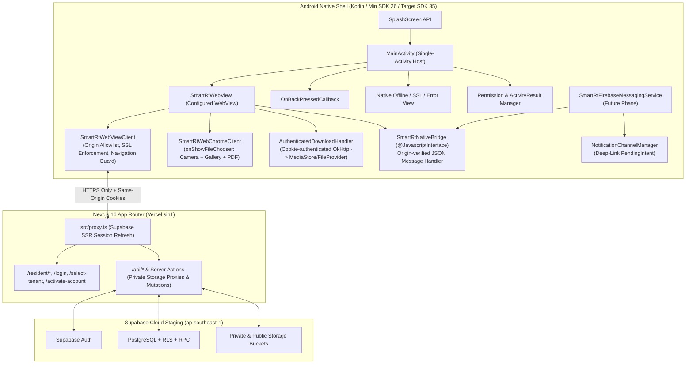
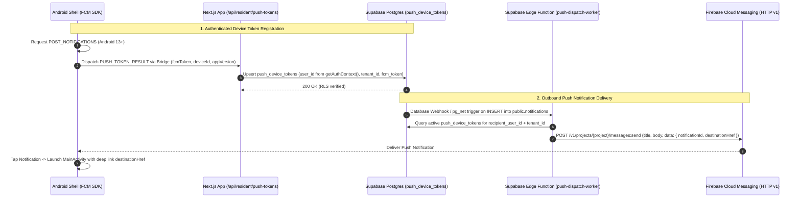

# Smart RT — Web-First Hybrid Android Architecture

**Document Status:** Phase 0 Architecture Specification  
**Application Scope:** Smart RT Resident (`id.smartrt.resident`)  
**Source of Truth:** Existing Next.js 16 App Router Resident Web Application (`/resident/*`)  
**Target Backend:** Supabase Staging (`smart-rt-staging`, Ref: `szghujzhiyndeuhepsax`, Region: `ap-southeast-1`)  
**Hosting Target:** Vercel (`sin1` Singapore region)

---

## 1. Architectural Principles & Single Source of Truth

Smart RT Resident is architected as a **Web-First Hybrid Android Application**. The existing Next.js 16 App Router application is the **single source of truth** for all resident-facing user interfaces, domain workflows, validation rules, API routes, Server Actions, and Supabase authentication/authorization.

The Android application is a **thin, security-hardened Kotlin native shell** that hosts the deployed Next.js Resident PWA inside an Android `WebView` and provides a strictly scoped native capability layer (camera/gallery file chooser, authenticated document downloads, push notifications via FCM, Android App Links / deep links, native splash screen, back-navigation handling, and offline/network error recovery).

### 1.1 Core Update Principle (Zero-APK Feature Delivery)

1. **Web Deployment Owns Feature Delivery:** All UI changes, form updates, new resident services, business logic modifications, and bug fixes are deployed via standard Next.js deployments to Vercel. Residents receive updates immediately on next navigation/load without downloading a new APK/AAB.
2. **Native Releases Reserved for Platform Changes:** A new Android APK/AAB release is required **only** when modifying:
   - Native Android permissions or `AndroidManifest.xml` declarations
   - Kotlin WebView shell or native bridge contract versions
   - Native SDK dependencies (e.g., Firebase Messaging, AndroidX SplashScreen/WebKit)
   - App Links domain verification (`assetlinks.json` signing fingerprints)
3. **Cache Invalidation Guarantee:** HTML documents, RSC payloads, Server Actions, and `/api/*` routes are never cached stale by a Service Worker or WebView HTTP cache, ensuring zero version skew between server deployments and the Android shell.

### 1.2 Responsibility Matrix (Web/PWA vs. Android Native Shell)

| Capability / Domain | Owner | Implementation Mechanism |
|---|---|---|
| Resident Dashboard (`/resident`) | **Web / Next.js** | RSC + `ResidentDashboardView` |
| Bills & Payment Proofs (`/resident/bills/*`) | **Web / Next.js** | Server Actions (`submitResidentPaymentAction`, `retryPaymentProofAction`) + `/api/payments/[id]/proof` |
| Community Feed (`/resident/feed`) | **Web / Next.js** | TanStack Query + `/api/community-feed/*` |
| Complaints (`/resident/complaints/*`) | **Web / Next.js** | TanStack Query + `/api/resident/complaints` + `/api/complaints/[id]/photo` |
| Letters & Official PDFs (`/resident/letters/*`) | **Web / Next.js** | TanStack Query + `/api/resident/letters` + `/api/letters/[id]/*` |
| Activities (`/resident/activities/*`) | **Web / Next.js** | TanStack Query + `/api/resident/activities` + `/api/activities/[id]/documents/*` |
| Ronda Schedule (`/resident/ronda/*`) | **Web / Next.js** | TanStack Query + `/api/resident/ronda` |
| Announcements (`/resident/announcements/*`) | **Web / Next.js** | RSC + `ResidentAnnouncementsViews` |
| Household & Profile (`/resident/profile`, `/resident/household`) | **Web / Next.js** | RSC + Server Actions |
| In-App Notification Center (`/resident/notifications`) | **Web / Next.js** | TanStack Query + `/api/notifications` |
| Auth, Session Refresh, Workspace Selection, RLS | **Web / Next.js + Supabase** | `@supabase/ssr` `HttpOnly`/chunked cookies + `src/proxy.ts` + PostgreSQL RLS |
| WebView Lifecycle, Insets & Splash Screen | **Android Shell** | `MainActivity`, `SplashScreen` API, `WindowInsetsCompat` |
| Camera Capture & Photo/Document Picker | **Android Shell** | `WebChromeClient.onShowFileChooser` + `FileProvider` + `ActivityResultContracts` |
| Authenticated Private File Downloads & PDF Viewing | **Android Shell** | `DownloadListener` / Authenticated HTTP fetch with `CookieManager` cookies + `MediaStore` / `FileProvider` `ACTION_VIEW` |
| Hardware/Gesture Back Navigation | **Android Shell** | `OnBackPressedCallback` delegating to `webView.canGoBack()` or root exit |
| Native Push Notifications & Permission (`POST_NOTIFICATIONS`) | **Android Shell (Future Phase)** | `FirebaseMessagingService` + Native Bridge token sync to Next.js API |
| Deep Links & Android App Links | **Android Shell** | Intent Filters (`autoVerify="true"`) + `/.well-known/assetlinks.json` |
| Offline / Network Error Fallback UI | **Android Shell + PWA** | Native retry overlay on main-frame network failure + Service Worker static shell cache |

---

## 2. Current PWA Readiness Assessment

An audit of the repository (`next.config.ts`, `src/app/layout.tsx`, `public/`, `src/components/resident/*`, and `src/lib/security/headers.ts`) establishes the current baseline:

### 2.1 What Already Exists and Is Production-Ready

1. **Mobile-First Resident Shell (`src/components/resident/*`):**
   - `ResidentShell` (`src/components/resident/resident-shell.tsx`) provides a dedicated mobile layout with sticky `ResidentHeader` (`top-0 z-[var(--z-sticky)]`) and fixed mobile bottom navigation `ResidentBottomNav` (`bottom-0 md:hidden` with 6 primary tabs: Beranda, Feed, Tagihan, Pengumuman, Layanan, Profil).
   - `ResidentBottomNav` already includes `pb-[env(safe-area-inset-bottom)]` and responsive touch targets (`min-h-[52px]`, `active:scale-[0.98]`).
   - `ResidentContainer` (`src/components/resident/resident-container.tsx`) applies `pb-24 md:pb-[var(--space-8)]` so bottom content is never obscured by the bottom navigation bar.
2. **Comprehensive Resident Route Tree (`src/app/(resident)/resident/*`):**
   - All 16 resident pages and detail routes (`/resident`, `/resident/feed`, `/resident/bills`, `/resident/bills/[id]`, `/resident/announcements`, `/resident/announcements/[id]`, `/resident/layanan`, `/resident/letters`, `/resident/letters/new`, `/resident/letters/[id]`, `/resident/complaints`, `/resident/complaints/new`, `/resident/complaints/[id]`, `/resident/activities`, `/resident/activities/my`, `/resident/activities/[id]`, `/resident/ronda`, `/resident/ronda/[id]`, `/resident/profile`, `/resident/household`, `/resident/notifications`) are implemented and mobile-responsive.
3. **Strict Server-Side Guards & Multi-Workspace Support:**
   - `requireResidentContext()` in `src/lib/auth/guards.ts` enforces authentication and resident role verification on every server render, redirecting unauthenticated users to `/login` and multi-workspace users without an active selection to `/select-tenant`.

### 2.2 Gaps to Close in Phase 1 (Web/PWA Preparation)

| Area | Current State | Phase 1 Requirement |
|---|---|---|
| **Web App Manifest** | Missing (`no manifest.ts` or `public/manifest.json`) | Add `src/app/manifest.ts` with `start_url: "/resident"`, `scope: "/"`, `display: "standalone"`, `theme_color`, `background_color`, and `192x192` / `512x512` standard + maskable icons in `public/icons/`. |
| **Viewport & Safe Area Meta** | `src/app/layout.tsx` exports `metadata` only; no `viewport` export | Export `viewport: Viewport` in `src/app/layout.tsx` with `width: "device-width"`, `initialScale: 1`, `viewportFit: "cover"`, and `themeColor` so `env(safe-area-inset-bottom)` activates on edge-to-edge screens. |
| **Service Worker** | None (`public/sw.js` absent) | Add a lightweight, network-first / hashed-asset-only Service Worker (`public/sw.js`) with explicit cache-versioning and zero caching of `/api/*`, Server Actions, or authenticated RSC/HTML payloads. |
| **PDF Preview in Android WebView** | `LetterDocumentViewer` and `ActivityDocumentPanel` render PDF `blob:` URLs inside `<iframe src={previewObjectUrl}>` | Android `WebView` lacks an inline PDF plugin for `<iframe>`. Add WebView detection or bridge hook so tapping "Pratinjau PDF" / "Unduh PDF" inside the Android shell delegates to the native authenticated download/PDF viewer handler rather than rendering a blank `<iframe>`. |
| **Android Digital Asset Links** | No `public/.well-known/assetlinks.json` | Serve `/.well-known/assetlinks.json` from Next.js so Android verifies App Links for the staging/production domain. |

---

## 3. Kotlin Android Shell Architecture

The Android project lives in a self-contained `android/` directory at the repository root (monorepo layout, completely ignored by Next.js/Vercel builds).

### 3.1 High-Level Component Architecture



### 3.2 Core Android Specifications

- **Language:** Kotlin `2.0+` (JVM Target `17`)
- **Minimum SDK:** `26` (Android 8.0 Oreo — covers >97% of active Indonesian Android devices and guarantees modern `NotificationChannel`, `autofill`, and `WebView` APIs)
- **Target / Compile SDK:** `35` (Android 15 — edge-to-edge compliant)
- **Application ID:**
  - `staging` build flavor: `id.smartrt.resident.staging`
  - `production` build flavor: `id.smartrt.resident`
- **Architecture Pattern:** Single-Activity (`MainActivity` extending `AppCompatActivity`) with `StateFlow`-backed `MainViewModel` managing loading state, connectivity status, pending deep links, and pending file-chooser callbacks across configuration changes.
- **Launch Mode:** `android:launchMode="singleTask"` on `MainActivity` so deep links and notification taps route into the existing `MainActivity` instance via `onNewIntent(intent)` without spawning duplicate WebView instances.
- **Orientation & Config Changes:** `android:configChanges="orientation|screenSize|screenLayout|keyboardHidden|uiMode"` on `MainActivity` so soft-keyboard toggles, dark-mode switches, and screen rotations never destroy and reload the active `WebView` state or interrupt an in-progress file selection.

### 3.3 WebView Configuration (`SmartRtWebViewFactory`)

```kotlin
webView.settings.apply {
    javaScriptEnabled = true
    domStorageEnabled = true // Required for TanStack Query, Next.js router state, next-themes
    databaseEnabled = true
    mediaPlaybackRequiresUserGesture = false

    // Strict file & content access lockdown
    allowFileAccess = false
    allowContentAccess = false // Web content cannot read arbitrary content:// URIs directly
    allowFileAccessFromFileURLs = false
    allowUniversalAccessFromFileURLs = false

    // HTTPS & Mixed Content lockdown
    mixedContentMode = WebSettings.MIXED_CONTENT_NEVER_ALLOW

    // Security & UX hardening
    javaScriptCanOpenWindowsAutomatically = false
    setSupportMultipleWindows(true) // Intercept target="_blank" safely in onCreateWindow
    builtInZoomControls = false
    displayZoomControls = false
    textZoom = 100 // Prevent OS font scaling from breaking dense 6-tab bottom nav layout
    cacheMode = WebSettings.LOAD_DEFAULT

    // Append custom User-Agent token for server/client capability detection
    userAgentString = "$userAgentString SmartRTAndroid/${BuildConfig.VERSION_NAME} (Build/${BuildConfig.VERSION_CODE})"
}

CookieManager.getInstance().apply {
    setAcceptCookie(true)
    setAcceptThirdPartyCookies(webView, false)
}
```

### 3.4 Android Back Navigation Architecture

Android hardware back button and predictive back gestures are handled via `OnBackPressedDispatcher`:
1. If an in-page modal/sheet or non-root route is active and `webView.canGoBack()` is `true` **and** the current URL path is not a top-level entry root (`/resident`, `/login`, `/select-tenant`, `/no-access`), call `webView.goBack()`.
2. If the current URL is `/resident` (the authenticated home screen), `/login`, or `/select-tenant`, pressing Back does **not** pop back into stale post-logout or pre-login redirect chains; instead, it either minimizes/exits the app (with optional double-back-to-exit toast on `/resident`).
3. If the native offline error overlay is visible, pressing Back exits the activity.

---

## 4. WebView Authentication & Cookie Architecture

Smart RT uses `@supabase/ssr` (`^0.12.7`) with server-managed cookie storage (`src/lib/supabase/server.ts`, `src/lib/supabase/middleware.ts`, and `src/proxy.ts`) alongside the custom `smart_rt_workspace` cookie (`src/lib/auth/cookies.ts`).

### 4.1 Cookie Inventory on the Web Origin

| Cookie Name | Attributes | Purpose |
|---|---|---|
| `sb-szghujzhiyndeuhepsax-auth-token` (or chunked `.0`, `.1`) | `Path=/; SameSite=Lax; Secure` (managed by `@supabase/ssr`) | Stores the Supabase session (access token + single-use refresh token). Read by `src/proxy.ts`, Server Components, Server Actions, and `@supabase/ssr` `createBrowserClient`. |
| `smart_rt_workspace` | `Path=/; HttpOnly; SameSite=Lax; Secure; Max-Age=2592000` | Stores the active workspace key (`resident:<tenantId>` or `admin:<tenantId>`). Validated against live DB memberships on every request in `getAuthContext()`. |

### 4.2 Critical WebView Cookie Lifecycle Rules

1. **First-Party Only:** Because the WebView loads `https://<deployment-domain>/resident` and all Supabase auth operations occur via Next.js Server Actions (`loginAction`, `logoutAction`), Route Handlers (`/auth/callback`), or same-origin requests, all auth cookies belong to the first-party Next.js origin. Third-party cookies are disabled (`setAcceptThirdPartyCookies(webView, false)`).
2. **Mandatory Disk Flush (`CookieManager.flush()`):**
   - Supabase Auth enforces **Refresh Token Rotation** (each refresh token can only be used once).
   - When `src/proxy.ts` refreshes an expired access token via `supabase.auth.getUser()`, Next.js returns new `Set-Cookie` headers with the rotated refresh token.
   - Android's `CookieManager` holds updated cookies in memory and writes them to SQLite asynchronously. If the Android process is killed before the periodic flush, the new refresh token is lost while the old one is already invalidated on Supabase's server, forcing an unexpected logout.
   - **Mitigation:** The Android shell **must** call `CookieManager.getInstance().flush()` in:
     - `SmartRtWebViewClient.onPageFinished()`
     - `MainActivity.onPause()`
     - `MainActivity.onStop()`
3. **Zero Token Exposure to Native Layer:**
   - The Android shell **never** reads, parses, or extracts the JWT access token or refresh token from `CookieManager` or `localStorage`.
   - All native-to-backend requests (such as future FCM token registration or authenticated file downloads) either pass through the authenticated WebView context or attach the opaque first-party cookie header strictly to the allowlisted Next.js HTTPS origin.
4. **Clean Logout Synchronization:**
   - When the resident triggers `logoutAction()` (which signs out on the server, clears `active_tenant_id`, deletes `smart_rt_workspace`, and redirects to `/login`), the web app (or URL transition detector on `/login` after logout) invokes the native bridge `notifyLogout()` (or the shell detects post-logout navigation) so the Android shell flushes `CookieManager`, clears any cached temporary downloaded files in `context.cacheDir/downloads/`, and (in the future FCM phase) unregisters the device push token prior to session destruction.

### 4.3 Backoffice Route Isolation inside the Resident App

What happens if a user with both `pengurus` and `warga` roles logs in inside the Android Resident App?
- On `/select-tenant` (`src/components/auth/workspace-selector.tsx`), or if a single-role admin account logs in and Next.js redirects to `/`:
- `SmartRtWebViewClient.shouldOverrideUrlLoading` inspects the target path on the trusted origin:
  - Allowed paths in the Resident Android app: `/resident`, `/resident/*`, `/login`, `/activate-account`, `/auth/callback`, `/select-tenant`, `/no-access`, `/api/*`, `/_next/*`.
  - If the WebView attempts to navigate to Backoffice-only routes (`/`, `/bills`, `/dues`, `/payments`, `/cash`, `/residents`, `/resident-invitations`, `/announcements`, `/pengaduan`, `/surat`, `/kegiatan`, `/ronda`, `/komunitas`, `/pengaturan`, `/super-admin`), the Android shell intercepts the navigation:
    - If the user has a resident membership, it redirects to `/select-tenant` (or `/resident`) with a native/web notice that Backoffice management is accessed via the web dashboard.
    - This guarantees the Resident Android app remains strictly a Resident portal without modifying any Backoffice server code.

---

## 5. PWA Caching & Instant Update Strategy

To satisfy the **Critical Update Principle** (all UI and business logic updates deploy instantly via Vercel without requiring an APK update, and without serving stale assets):

### 5.1 Three-Tier Caching Policy

| Resource Category | Path Pattern | Caching Strategy | Rationale |
|---|---|---|---|
| **Immutable Build Assets** | `/_next/static/**` | **Cache-First** (Content-hashed filenames) | Next.js hashes every JS/CSS/font chunk filename. Safe to cache indefinitely; old chunks are purged on SW activation. |
| **Static Brand Icons & Manifest** | `/icons/**`, `/favicon.ico`, `/manifest.webmanifest` | **Stale-While-Revalidate** | Instant startup icon rendering while refreshing in background. |
| **HTML Documents, RSC Payloads, API Routes, Server Actions** | `/resident/**`, `/login`, `/api/**`, `?_rsc=*`, `POST` requests | **Network-Only (Never Cached in SW)** | Prevents stale React Server Component trees, prevents Server Action ID mismatch after deploy, and ensures private tenant data is never written to SW cache storage. |

### 5.2 Preventing Next.js Deployment Skew in Long-Lived WebViews

When an Android app stays alive in background RAM across a Vercel deployment:
1. **Service Worker Lifecycle:** `public/sw.js` embeds a build version identifier (`self.skipWaiting()` on install + `clients.claim()` on activate, purging outdated `/_next/static/` cache buckets).
2. **WebView HTTP Cache Mode:** Configured to `WebSettings.LOAD_DEFAULT` (respects `Cache-Control: no-store` on Next.js dynamic routes and `/api/*`).
3. **Deployment Skew Recovery:** If Next.js detects a chunk load error (`ChunkLoadError`) or stale Server Action ID after a new Vercel deployment while the WebView was backgrounded, or when the Android shell resumes after >30 minutes in background, the client performs a clean soft reload (`window.location.reload()`) to fetch the latest HTML shell and RSC manifest.

---

## 6. Minimal, Secure Native Bridge Contract

### 6.1 Design Principles

1. **Minimal Surface Area:** Only expose capabilities that the web platform cannot natively perform inside WebView.
2. **Strict Origin Enforcement:** Before processing **any** `@JavascriptInterface` call, the Kotlin bridge verifies on the main thread that `webView.url` matches the exact allowlisted HTTPS origin (`https://<allowed-host>`) and that the frame is the main frame.
3. **Schema Validation:** Every bridge payload is a JSON string validated with `kotlinx.serialization` against a strict schema (max payload size 4 KiB, explicit enum/type validation, no arbitrary reflection or intent execution).
4. **No Token or Secret Passing:** Neither Supabase tokens nor secret keys ever cross the bridge.

### 6.2 Injected Object Name & Availability Detection

The bridge is registered only after origin validation as `window.SmartRTNative`:

```ts
// TypeScript declaration for Web/PWA progressive enhancement
export interface SmartRTNativeBridge {
  /**
   * Returns JSON string:
   * { "bridgeVersion": 1, "appVersion": "1.0.0", "buildCode": 1, "platform": "android", "sdkInt": 35 }
   */
  getAppInfo(): string

  /**
   * Requests current notification permission status ("granted" | "denied" | "prompt_required").
   * On Android 13+ (API 33+), triggers POST_NOTIFICATIONS runtime dialog if requested.
   */
  requestNotificationPermission(): void

  /**
   * Requests the current FCM registration token (Future Phase).
   * Result delivered asynchronously via CustomEvent("smartrt:native", { detail }).
   */
  requestPushToken(): void

  /**
   * Signals that the user has logged out or is about to log out,
   * so native shell flushes CookieManager and clears temp document cache.
   */
  notifyLogout(): void

  /**
   * Requests native authenticated download / native viewer for a private same-origin document path
   * (e.g., "/api/letters/<id>/issued?download=1" or "/api/activities/<id>/documents/<fileId>").
   * Path MUST be a relative path starting with "/api/".
   */
  openOrDownloadPrivateDocument(payloadJson: string): void
}
```

### 6.3 Native-to-Web Event Dispatch (`CustomEvent`)

When the native shell needs to send an asynchronous result back to the web app (such as notification permission result, FCM push token in the future phase, or download status), it dispatches a structured `CustomEvent` via `webView.evaluateJavascript`:

```ts
// Dispatched on window:
window.dispatchEvent(
  new CustomEvent("smartrt:native-event", {
    detail: {
      type: "NOTIFICATION_PERMISSION_RESULT" | "PUSH_TOKEN_RESULT" | "DOCUMENT_ACTION_RESULT",
      payload: { ... }
    }
  })
)
```

### 6.4 Bridge Input Validation Rules (Kotlin Side)

- `openOrDownloadPrivateDocument(payloadJson)`:
  - Parses `{ "path": string, "fileName": string, "mimeType": "application/pdf" | "image/jpeg" | "image/png" | "image/webp", "mode": "view" | "download" }`.
  - Rejects any `path` that does not start with `"/api/letters/"`, `"/api/activities/"`, `"/api/payments/"`, `"/api/complaints/"`, or `"/api/community-feed/media/"`.
  - Rejects any `path` containing `..`, `//`, `\`, or external hostnames.
  - Resolves `path` strictly against the configured `BuildConfig.WEB_BASE_URL` origin.
  - Sanitizes `fileName` by stripping path separators and enforcing extension matching `mimeType`.

---

## 7. File Upload & Download Integration Architecture

Smart RT has five distinct file-handling workflows across the Resident portal, all of which enforce **server-side magic-byte inspection**, **size limits**, and **filename extension checks**:

### 7.1 Audit of Existing Resident Upload & Download Touchpoints

| Feature | Upload Input `accept` | Multiple? | Max Size | Server Extension Rule | Download / Preview Mechanism |
|---|---|---|---|---|---|
| **Payment Proof** (`resident-bills-views.tsx`) | `.jpg,.jpeg,.png,.pdf,image/jpeg,image/png,application/pdf` | Single | 5 MiB | `.jpg`, `.jpeg`, `.png`, `.pdf` | `<a href="/api/payments/[id]/proof" target="_blank">` |
| **Complaint Photo** (`resident-complaint-create-form.tsx`) | `image/jpeg,image/png,image/webp` | Single | 5 MiB | **Strict:** `fileEntry.name` must end in `.jpg`, `.jpeg`, `.png`, or `.webp` | `fetch(..., { credentials: "same-origin" })` -> `` blob URL |
| **Community Feed Media** (`community-post-composer-dialog.tsx`) | `image/jpeg,image/png,image/webp` | Multiple (up to 4) | 5 MiB each | `.jpg`, `.jpeg`, `.png`, `.webp` | `` |
| **Letter Supporting Docs** (`resident-letter-create-form.tsx`) | `.jpg,.jpeg,.png,.pdf,image/jpeg,image/png,application/pdf` | Multiple (up to 5) | 5 MiB each | **Strict:** `fileEntry.name` must end in `.jpg`, `.jpeg`, `.png`, or `.pdf` | `LetterDocumentViewer`: `` or `<iframe>` blob preview + `<a download>` |
| **Issued Official Letter PDF** (`letter-document-viewer.tsx`) | *(Uploaded by Admin)* | — | 10 MiB | `.pdf` | `LetterDocumentViewer`: `<iframe>` blob preview, `<a target="_blank">`, `<a href="...?download=1">` |
| **Activity Documents** (`activity-document-panel.tsx`) | `.jpg,.jpeg,.png,.webp,.pdf,...` | Single | 10 MiB | `.jpg`, `.jpeg`, `.png`, `.webp`, `.pdf` | `ActivityDocumentPanel`: `` or `<iframe>` blob preview + `<a download>` |

### 7.2 Upload Integration (`SmartRtWebChromeClient.onShowFileChooser`)

1. **Trigger:** Any `<input type="file">` click in the Next.js app automatically invokes `WebChromeClient.onShowFileChooser(webView, filePathCallback, fileChooserParams)` in the Android shell.
2. **Intent Construction based on `fileChooserParams`:**
   - Inspect `fileChooserParams.acceptTypes` (e.g., `image/jpeg,image/png,image/webp` vs. includes `application/pdf`) and `fileChooserParams.mode` (`MODE_OPEN` vs `MODE_OPEN_MULTIPLE`).
   - Offer a chooser combining:
     - **Camera Capture Intent (`MediaStore.ACTION_IMAGE_CAPTURE`):** When `acceptTypes` includes `image/*` or `image/jpeg`. Writes to a temporary file in `context.cacheDir/camera_captures/smart_rt_<timestamp>.jpg` via `FileProvider`.
       - *Note on Permissions:* If `AndroidManifest.xml` does not declare `<uses-permission android:name="android.permission.CAMERA" />` (or declares it with runtime check), launching `MediaStore.ACTION_IMAGE_CAPTURE` delegates camera permission to the system Camera app, or we request `CAMERA` runtime permission gracefully when the user chooses Camera.
     - **Document / Gallery Picker (`Intent.ACTION_GET_CONTENT`):** Configured with `Intent.CATEGORY_OPENABLE`, `intent.type = "*/*"`, `Intent.EXTRA_MIME_TYPES = parsedMimeTypes`, and `Intent.EXTRA_ALLOW_MULTIPLE = (mode == MODE_OPEN_MULTIPLE)`.
3. **Filename & Extension Normalization (Critical for Smart RT Validators):**
   - As discovered in `src/lib/complaints/storage.ts` and `src/lib/letters/storage.ts`, Smart RT's file validators require `file.name` to have an explicit extension (`.jpg`, `.jpeg`, `.png`, `.webp`, `.pdf`) matching the magic bytes.
   - Some Android `content://` providers (e.g., certain OEM gallery pickers or cloud providers) return a display name without an extension (such as `image:100003421`).
   - **Solution in `SmartRtWebChromeClient`:** Before passing selected URIs to `filePathCallback.onReceiveValue(uris)`, the Android shell inspects `OpenableColumns.DISPLAY_NAME` and `ContentResolver.getType(uri)`. If the display name lacks a valid `.jpg/.jpeg/.png/.webp/.pdf` extension, the shell copies the stream into `context.cacheDir/upload_staging/ attachment_<uuid>.<ext>` and returns the `FileProvider` URI for that properly named file. This guarantees 100% pass rates against Smart RT's strict filename + magic-byte checks!
4. **Callback Lifecycle Safety:**
   - If a user dismisses the picker without selecting a file, `filePathCallback.onReceiveValue(null)` **must** be invoked immediately; otherwise, Android WebView permanently locks all `<input type="file">` elements on the page until reload.

### 7.3 Authenticated Download & PDF Viewing Integration

1. **Why Standard WebView Download / `<iframe>` Needs Native Handling:**
   - All private documents in Smart RT (`/api/letters/[id]/issued`, `/api/letters/[id]/attachments/[fileId]`, `/api/activities/[id]/documents/[fileId]`, `/api/payments/[id]/proof`) require the user's `HttpOnly` session cookies and return `Cache-Control: private, no-store`.
   - Android `WebView` does not render PDFs inside `<iframe src="blob:...">` or `<a target="_blank">`.
   - Passing a `blob:` URL to Android's system `DownloadManager` fails because `blob:` URLs are process-local to WebView.
2. **Unified Native Authenticated Document Handler (`AuthenticatedDocumentDownloader`):**
   - **Interception Points:**
     1. `webView.setDownloadListener { url, userAgent, contentDisposition, mimetype, _ -> ... }` (catches `<a href="/api/..." download>` and `Content-Disposition: attachment` responses).
     2. `SmartRtWebChromeClient.onCreateWindow` / `SmartRtWebViewClient.shouldOverrideUrlLoading` (catches `<a href="/api/payments/[id]/proof" target="_blank">` and `<a href="/api/letters/[id]/issued" target="_blank">`).
     3. Optional direct call via `window.SmartRTNative.openOrDownloadPrivateDocument(...)`.
   - **Execution Flow:**
     1. Verify `url` belongs to the allowlisted Smart RT HTTPS origin and starts with `/api/`.
     2. Read the current first-party cookie header from `CookieManager.getInstance().getCookie(url)`.
     3. Perform an HTTPS `GET` on `Dispatchers.IO` using `OkHttpClient` (with TLS 1.2/1.3 enforcement and cookie header attached only to the verified origin).
     4. If saving to Downloads (`?download=1` or `<a download>`): write stream via `MediaStore.Downloads` (Android 10+ API 29+, zero storage permission required) or `Environment.DIRECTORY_DOWNLOADS` and show a completion Snackbar/Toast with an **"Buka"** action.
     5. If viewing/previewing (`target="_blank"` or PDF preview): write stream to `context.cacheDir/doc_preview/<sanitized_filename>` (cleared on logout/exit), generate a `content://` URI via `FileProvider`, and launch `Intent(Intent.ACTION_VIEW).setDataAndType(uri, mimeType).addFlags(Intent.FLAG_GRANT_READ_URI_PERMISSION)`.

---

## 8. Future Phase: FCM Device Registration & Notification Delivery Architecture

> **Note:** FCM implementation is scheduled for a future phase (Phase 4). Existing database migrations (`supabase/migrations/*`) are **not** modified in Phase 0. This section defines the end-to-end architecture so the Android shell and future database migration align cleanly.

### 8.1 Current Notification Domain in Smart RT

Currently, `public.notifications` (`supabase/migrations/20261113000700_create_audit_notification_domain.sql`) stores in-app notifications per `(tenant_id, recipient_user_id)` with `title`, `body`, `type`, `reference_type`, and `reference_id`. `resolveNotificationDestination("resident", referenceType, referenceId)` in `src/lib/notifications/types.ts` maps notifications to resident routes (e.g., `/resident/announcements/[id]`, `/resident/bills/[id]`, `/resident/household`, `/resident/profile`).

### 8.2 Future Phase FCM Architecture Diagram



### 8.3 Future Database Table Design (Phase 4 Addendum — No Existing Migration Changes)

A new future migration (`supabase/migrations/<timestamp>_create_push_device_tokens.sql`) will introduce:
- Table `public.push_device_tokens`:
  - `id uuid PRIMARY KEY DEFAULT gen_random_uuid()`
  - `user_id uuid NOT NULL REFERENCES public.profiles(id) ON DELETE CASCADE`
  - `tenant_id uuid NOT NULL REFERENCES public.tenants(id) ON DELETE CASCADE`
  - `fcm_token text NOT NULL`
  - `platform text NOT NULL DEFAULT 'android' CHECK (platform IN ('android'))`
  - `app_version text NULL`
  - `is_active boolean NOT NULL DEFAULT true`
  - `last_seen_at timestamptz NOT NULL DEFAULT now()`
  - `created_at timestamptz NOT NULL DEFAULT now()`
  - `updated_at timestamptz NOT NULL DEFAULT now()`
  - `UNIQUE (user_id, fcm_token)`
- **RLS Policy:** `user_id = public.current_user_id()` — `user_id` and `tenant_id` are resolved server-side in a Next.js Route Handler (`/api/resident/push-tokens`) using `getAuthContext()`, **never** trusting client-supplied `user_id` or `tenant_id`.
- **Logout Cleanup:** On `logoutAction()` or `notifyLogout()`, the current device's `fcm_token` is deactivated/deleted before session sign-out so a shared device never receives push notifications for a previous resident after logout.

---

## 9. Deep Link & Android App Links Architecture

### 9.1 Supported Deep Link Routes

The Android shell registers **verified Android App Links** (`https://`) for the deployment domain:

| URL Path Pattern | Behaviour in Android Shell |
|---|---|
| `https://<domain>/resident` | Opens Resident Dashboard in WebView |
| `https://<domain>/resident/**` | Opens exact target resident screen (e.g., `/resident/bills/<id>`, `/resident/letters/<id>`, `/resident/complaints/<id>`, `/resident/announcements/<id>`, `/resident/activities/<id>`, `/resident/ronda/<id>`, `/resident/feed`, `/resident/notifications`) |
| `https://<domain>/activate-account?token=*` | Opens Resident Invitation Activation screen inside WebView |
| `https://<domain>/auth/callback?*` | Completes PKCE / OTP email verification inside WebView (`exchangeCodeForSession` / `verifyOtp`), setting the session cookie directly in the app's `CookieManager` |
| `https://<domain>/login` | Opens Login screen inside WebView |

> **Why `/auth/callback` and `/activate-account` App Links are Essential:** When a resident activates their account from an invitation email (`src/lib/invitations/auth-flow.ts`), the confirmation link points to `https://<domain>/auth/callback?next=%2Factivate-account%3Ftoken%3D...`. Intercepting this via Android App Links ensures the resulting Supabase session cookie is established directly inside the Android app's WebView rather than stranding the resident in an external browser tab.

### 9.2 Digital Asset Links (`/.well-known/assetlinks.json`)

Served by Next.js at `public/.well-known/assetlinks.json` (or dynamic route handler reading debug/staging SHA-256 certificate fingerprints from environment config):

```json
[
  {
    "relation": ["delegate_permission/common.handle_all_urls"],
    "target": {
      "namespace": "android_app",
      "package_name": "id.smartrt.resident.staging",
      "sha256_cert_fingerprints": [
        "<SHA256_FINGERPRINT_CONFIGURED_AT_DEPLOY>"
      ]
    }
  }
]
```

### 9.3 Deep Link Security Validation (`DeepLinkValidator`)

When `MainActivity` receives an `Intent.ACTION_VIEW` with `intent.data`:
1. Verify `uri.scheme == "https"`.
2. Verify `uri.host == BuildConfig.ALLOWED_WEB_HOST`.
3. Verify `uri.path` starts with an allowed resident/auth prefix (`/resident`, `/activate-account`, `/auth/callback`, `/login`, `/select-tenant`) and does not contain path traversal (`..`, `\`, or encoded `%2e%2e`).
4. Reconstruct a canonical URL on `BuildConfig.WEB_BASE_URL` and load it into `webView.loadUrl(canonicalUrl)`. If the user is not yet authenticated when deep-linking into `/resident/bills/123`, `src/proxy.ts` redirects to `/login`, and the shell can preserve the intended post-login `/resident/*` path.

---

## 10. Security Model & Threat Mitigation

### 10.1 Origin & Navigation Allowlist (`SmartRtWebViewClient`)

1. **Strict Origin Allowlist:**
   - Only `https://<ALLOWED_WEB_HOST>` is permitted to load inside the `WebView`.
   - Local cleartext HTTP (`http://10.0.2.2:3000`) is disabled in `staging` and `release` builds via both `BuildConfig` and `network_security_config.xml` (`cleartextTrafficPermitted="false"`). It is permitted **only** in the local `debug` build variant if explicitly targeting a local dev server.
2. **External Link Handling:**
   - Any navigation (`shouldOverrideUrlLoading`) to a non-allowlisted domain is **blocked from loading in the WebView** and instead opened safely in an external browser (`CustomTabsIntent` or `Intent.ACTION_VIEW` with `Uri` scheme check `https://`).
   - Non-HTTPS schemes (`javascript:`, `file:`, `content:`, `intent:`, `tel:`, `mailto:`) in `shouldOverrideUrlLoading` are strictly blocked or handled via safe system dialer/email intents without WebView execution.
3. **Subresource Request Inspection (`shouldInterceptRequest`):**
   - Subresources are restricted to HTTPS (`https://<ALLOWED_WEB_HOST>` and `https://szghujzhiyndeuhepsax.supabase.co` for public `tenant-logos`).

### 10.2 SSL/TLS Enforcement

- `onReceivedSslError(view, handler, error)` **always** calls `handler.cancel()` — **never** `handler.proceed()`.
- Displays the native error state overlay informing the resident that the connection is not secure.
- `network_security_config.xml` trusts only system CAs (`<certificates src="system" />`) in `staging` and `production` builds.

### 10.3 Native Bridge & WebView Surface Hardening

- **Zero Token Exposure:** `sb-szghujzhiyndeuhepsax-auth-token` is never read by JavaScript bridge code or sent to third parties.
- **No `service_role` Credentials:** Neither the Next.js app nor the Android app ever contains `SUPABASE_SERVICE_ROLE_KEY`.
- **Server-Side Authority Preserved:** Every mutation and query continues to execute through Next.js Server Actions / Route Handlers and Supabase PostgreSQL RLS (`current_user_id()`, `is_tenant_member()`, `has_tenant_role()`), never trusting client-supplied `tenant_id` or `user_id`.
- **`WebView.setWebContentsDebuggingEnabled`:** Enabled **only** when `BuildConfig.DEBUG == true`; strictly `false` in `stagingRelease` and `productionRelease` builds.

---

## 11. Proposed Android Folder Structure

The Android project will be created at `android/` in Phase 2:

```text
android/
├── build.gradle.kts
├── settings.gradle.kts
├── gradle.properties
├── gradlew
├── gradlew.bat
├── gradle/
│   ├── libs.versions.toml
│   └── wrapper/
│       ├── gradle-wrapper.jar
│       └── gradle-wrapper.properties
└── app/
    ├── build.gradle.kts
    ├── proguard-rules.pro
    └── src/
        ├── main/
        │   ├── AndroidManifest.xml
        │   ├── java/id/smartrt/resident/
        │   │   ├── SmartRtApplication.kt
        │   │   ├── ui/
        │   │   │   ├── MainActivity.kt
        │   │   │   └── MainViewModel.kt
        │   │   ├── webview/
        │   │   │   ├── SmartRtWebViewFactory.kt
        │   │   │   ├── SmartRtWebViewClient.kt
        │   │   │   ├── SmartRtWebChromeClient.kt
        │   │   │   └── WebViewCookieSyncManager.kt
        │   │   ├── bridge/
        │   │   │   ├── SmartRtNativeBridge.kt
        │   │   │   ├── BridgeMessageSchemas.kt
        │   │   │   └── NativeEventDispatcher.kt
        │   │   ├── files/
        │   │   │   ├── FileChooserCoordinator.kt
        │   │   │   ├── UploadUriNormalizer.kt
        │   │   │   └── AuthenticatedDocumentDownloader.kt
        │   │   ├── navigation/
        │   │   │   ├── OriginAllowlistPolicy.kt
        │   │   │   └── DeepLinkValidator.kt
        │   │   └── notifications/
        │   │       └── NotificationPermissionHelper.kt
        │   └── res/
        │       ├── layout/
        │       │   ├── activity_main.xml
        │       │   └── view_network_error.xml
        │       ├── values/
        │       │   ├── colors.xml
        │       │   ├── strings.xml
        │       │   └── themes.xml
        │       └── xml/
        │           ├── file_paths.xml
        │           ├── network_security_config.xml
        │           └── data_extraction_rules.xml
        ├── debug/
        │   └── res/xml/network_security_config.xml
        └── test/
            └── java/id/smartrt/resident/
                ├── navigation/OriginAllowlistPolicyTest.kt
                ├── navigation/DeepLinkValidatorTest.kt
                └── bridge/BridgeMessageSchemasTest.kt
```

---

## 12. Phased Implementation Plan

### Phase 0: Architecture Audit & Implementation Plan (Current — Complete)
- Audit existing Next.js 16 App Router PWA readiness, auth cookies, file upload/download flows, security headers, and local Android tooling.
- Produce `docs/android/web-first-hybrid-architecture.md` and `docs/android/phase-00-preflight-report.md`.
- **Gate:** Stop and await review before Phase 1.

### Phase 1: Web/PWA Enhancement & Hybrid Readiness (Next.js)
1. Add `src/app/manifest.ts` and PWA icons (`192x192`, `512x512`, maskable) in `public/icons/`.
2. Export `viewport` (`viewportFit: "cover"`, `themeColor`) in `src/app/layout.tsx`.
3. Add `public/sw.js` (caching immutable `/_next/static/*` and icons only; strictly bypassing `/api/*`, Server Actions, and HTML/RSC requests) + client registration component.
4. Add `src/lib/native-bridge/client.ts` typed helper (`isSmartRtAndroidWebView()`, `openOrDownloadPrivateDocument()`, `notifyNativeLogout()`).
5. Enhance `LetterDocumentViewer` and `ActivityDocumentPanel` so PDF preview/download in Android WebView delegates cleanly to the native authenticated document handler instead of rendering a blank `<iframe>`.
6. Add `public/.well-known/assetlinks.json` template and exclude `android/` from Next.js/Vercel/Docker contexts (`.vercelignore`, `.dockerignore`, `tsconfig.json`, `eslint.config.mjs`).

### Phase 2: Kotlin Android Shell & WebView Core (`android/`)
1. Scaffold `android/` Gradle project with Kotlin 2.0, AGP 8.7+, portable Gradle Java 17 toolchain configuration (`jvmToolchain(17)`), and `staging` / `production` product flavors.
2. Implement `MainActivity`, native `SplashScreen`, edge-to-edge `WindowInsetsCompat`, `SmartRtWebViewFactory`, `SmartRtWebViewClient` (origin allowlist, Backoffice route guard, SSL enforcement), `WebViewCookieSyncManager` (`CookieManager.flush()`), hardware Back navigation, and native offline/error screen with retry.
3. Add unit tests for `OriginAllowlistPolicy` and `DeepLinkValidator`.

### Phase 3: Native Capabilities (Camera, File Picker, Authenticated Downloads, Deep Links)
1. Implement `SmartRtWebChromeClient.onShowFileChooser` + `FileChooserCoordinator` + `UploadUriNormalizer` (camera capture via `FileProvider`, single/multi picker for JPEG/PNG/WebP/PDF, filename extension normalization for strict Smart RT validators).
2. Implement `AuthenticatedDocumentDownloader` (`DownloadListener` + `target="_blank"` interception + `SmartRtNativeBridge.openOrDownloadPrivateDocument` using `CookieManager` cookies to save to `MediaStore.Downloads` or open via native PDF/Image `Intent.ACTION_VIEW`).
3. Configure Android App Links intent filters for `/resident/*`, `/activate-account`, and `/auth/callback`.

### Phase 4: Push Notifications (FCM) & End-to-End Verification
1. Add `NotificationPermissionHelper` (`POST_NOTIFICATIONS` on Android 13+) and `SmartRtFirebaseMessagingService`.
2. Add additive database migration for `public.push_device_tokens` and Next.js endpoint `/api/resident/push-tokens` + Supabase Edge Function push dispatcher.
3. Execute full end-to-end verification across Resident login, multi-workspace selection, bills payment proof upload, complaint photo capture, community feed multi-image upload, letter PDF download/preview, offline recovery, and logout.

