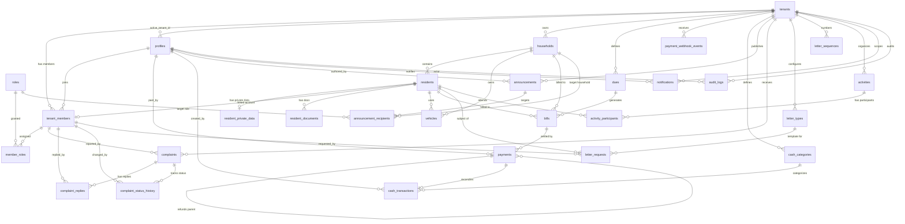

# Entity Relationship Diagram (ERD) — Smart RT (Refined v2)

Dokumen ini menampilkan relasi lengkap 28 tabel pada arsitektur database **Smart RT** (termasuk `resident_private_data`, `payment_webhook_events`, `complaint_status_history`, dan `letter_sequences`).

---

## A. Mermaid ER Diagram

---

## B. Penjelasan Relasi & Integritas Lintas-Tenant

1. **Composite Foreign Keys**: Seluruh relasi anak di dalam tenant menggunakan `(tenant_id, parent_id)` yang merujuk ke `UNIQUE (tenant_id, id)` pada tabel induk. Hal ini menjamin data dari tenant A tidak pernah dapat ditautkan ke induk milik tenant B.
2. **Pemisahan Identitas Sensitif (`1:1`)**: `residents` **1 : 0..1** `resident_private_data`. Data kependudukan non-sensitif dapat dibaca terpisah dari NIK dan tanggal lahir.
3. **Alur Keuangan (`bills` -> `payments` -> `cash_transactions`)**:
   - Satu `bill` dapat memiliki banyak `payments` (pembayaran parsial, pembayaran ditolak/gagal lalu bayar ulang, hingga refund).
   - `payments` bertipe `refund` mereferensikan `parent_payment_id` ke `payments.id` asal.
   - Setiap `payment` yang terverifikasi (`verified`) atau refund terverifikasi menghasilkan tepat satu baris `cash_transactions` melalui `UNIQUE (payment_id)`.
4. **Pemisahan Percakapan & Status Pengaduan**:
   - `complaint_replies` khusus menyimpan percakapan antara pelapor dan pengurus.
   - `complaint_status_history` khusus menyimpan log perubahan status yang bersifat *append-only* dan hanya dapat ditulis oleh pengurus berwenang.
5. **Penomoran Surat Aman Konkurensi**:
   - `letter_sequences` menyimpan counter nomor surat per `(tenant_id, year)` sehingga penerbitan `letter_requests.letter_number` aman terhadap request bersamaan.
