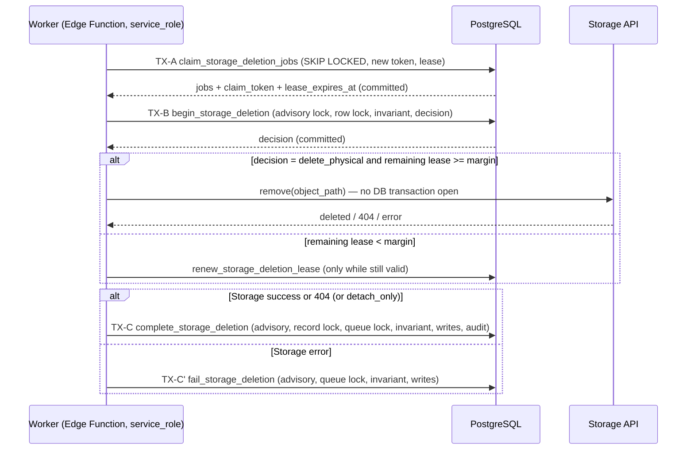

# Smart RT — Security Hardening, Atomic RPCs & Storage Architecture Plan

**Document Status:** Final Audit & Design Closure — Step 10.2.2.17 (Corrective Migration `20261114001400` Design Closure). **Migration `0013` is applied on local DB; additive corrective migration `20261114001400_security_hardening_corrections.sql` design is CLOSED (with explicit unresolved gateway-push confirmation noted) and awaiting final review before creation/application; Storage/RPC migration (post-`2026111400`) remains gated on U1 experiment.**  
**Target Migrations:**
- `20261113001300_security_hardening_guards.sql` (Migration `0013` — **APPLIED locally** on `127.0.0.1:54322`)
- `20261114001400_security_hardening_corrections.sql` (Migration `0014` Corrective — **DESIGN CLOSED, NOT CREATED**)
- `20261113001400_atomic_rpcs_and_storage_policies.sql` → scheduled after `20261114001400` & U1 (`Storage/RPC Migration`, **BLOCKED on U1**)

**Baseline (verified read-only on `127.0.0.1:54322`):** Migrations `0001`–`0013` applied; PostgreSQL 15.19; 28 public tables, RLS enabled on 28/28; 0 duplicate `(tablename, cmd)` permissive policies; `storage.buckets` = 0 rows; `storage.objects` = 0 policies; `public.storage_deletion_queue` does not exist yet.

> [!NOTE]
> The Step 10.2.2.8 and 10.2.2.9 rewrites replaced the whole document and dropped earlier sections: finance invariants, bucket access matrix, timestamp trigger matrix, and the `0013` scope list. Earlier decisions in Sections 1–20 are preserved intact; Section 21 documents the Step 10.2.2.16 audit findings and additive corrective design (`20261114001400`), which supersede conflicting `0013` details cleanly.

> [!IMPORTANT]
> Nothing in this document has been runtime-tested. Every test in Section 8 is **planned**, not executed.

---

## 1. Step 10.2.2.10 Audit Findings

| # | Finding | Severity | Resolution in this revision |
|---|---|---|---|
| F1 | `uq_storage_del_active` keyed on `(bucket_id, object_path, entity_type, entity_id)` allowed **two unfinished jobs for the same object** if two different entities requested deletion. Two workers could then run shared-reference checks and Storage calls in parallel for one object. | High | Unique per `(bucket_id, object_path)` (Section 2). |
| F2 | Stuck-`processing` recovery used a fixed 15-minute window with no claim identity. A slow worker that came back after recovery could finalize a job that a second worker had claimed. | High | Lease plus fencing token with conditional updates (Section 4). |
| F3 | The 10.2.2.9 CHECK used `split_part(object_path,'/',1)::uuid`. PostgreSQL does **not** guarantee left-to-right short-circuit evaluation of `AND` in CHECK/WHERE, so a malformed path can raise `invalid_text_representation` instead of a controlled rejection. | Medium | Text comparison against `uuid::text`; no casts (Section 6). |
| F4 | `entity_id` semantics were wrong for `resident-documents`: path segment 2 is `residents.id`, not `resident_documents.id`. "Segment 2 = entity_id" could never hold for that bucket. | Medium | `entity_id` redefined as the **path-owner record id** (segment 2). The `resident_documents` row is located via `storage_path` (UNIQUE, verified). |
| F5 | **Structural fact:** cross-record shared references are prevented by design. Every attach path binds segment 2 to the target record id, `resident_documents.storage_path` is UNIQUE, and the array-attach RPCs reject duplicates. Only `service_role` writes can create a shared reference. | Info | The shared-reference guard stays as defense-in-depth and is documented as such, not as a normal workflow. |
| F6 | `storage.objects` has versioning columns (`version`, `archived_at`, `is_delete_marker`, `is_versioned`), and current-version uniqueness is `idx_objects_current_version (bucket_id, name) WHERE archived_at IS NULL`. A plain `EXISTS (... name = p)` could match archived versions or delete markers. | Medium | Every existence check uses the current-version predicate (Section 6.3). Buckets must be created with versioning disabled. See U1. |
| F7 | Extensions installed: `pg_stat_statements`, `pgcrypto`, `plpgsql`, `supabase_vault`, `uuid-ossp`. **No `pg_cron`, no `pg_net`.** The scheduled worker cannot be triggered from inside the database locally. | Medium | See U2. |
| F8 | Path non-reuse was stated as policy, but nothing enforced it. After a physical delete, a client could re-upload an identical name. | Medium | Retired-path helper blocks re-upload and re-attach (Section 6.4). |

---

## 2. Final Unique Index: One Unfinished Job per Object

```sql
CREATE UNIQUE INDEX uq_storage_del_unfinished_object
    ON public.storage_deletion_queue (bucket_id, object_path)
    WHERE status IN ('pending', 'processing', 'failed', 'exhausted');

-- Non-unique lookup index for the retired-path helper (all statuses).
CREATE INDEX idx_storage_del_object
    ON public.storage_deletion_queue (bucket_id, object_path);
```

**Invariant:** at most one unfinished job exists for each `(bucket_id, object_path)`. `completed` rows are kept permanently (as the audit trail and the basis for path retirement) and are excluded from the unique index.

### 2.1 Request behavior when an active job already exists

Every `request_*` deletion RPC returns `TABLE (job_id uuid, outcome text, job_status text)` and **never creates a second job**:

| Situation (checked under the object advisory lock) | `outcome` | Effect |
|---|---|---|
| No unfinished job for the object | `created` | New `pending` job and `audit_logs` row, in one transaction |
| Unfinished job exists for the **same** `(entity_type, entity_id)` | `already_requested` | Returns the existing job id and status (including `failed`/`exhausted`). No writes, no audit row. |
| Unfinished job exists for a **different** entity, or an `orphan` job | `blocked_by_active_job` | Returns the existing job id. No writes. The caller retries after that job is `completed`. |

Requests are serialized per object by the advisory lock (Section 5), so a `unique_violation` race should not occur. As defense-in-depth, the RPC catches `unique_violation`, re-selects the active job, and returns `already_requested` or `blocked_by_active_job`.

### 2.2 The shared-reference scenario (defensive; see F5)

1. Record A requests deletion of object `O`. Result: `created`, job `J_A`.
2. Record B still references `O` and requests deletion before `J_A` finishes. Result: `blocked_by_active_job`, returns `J_A`, no job for B.
3. The worker processes `J_A`. The cross-domain reference count, excluding A, is ≥ 1 (B), so the decision is `detach_only`: A's reference is removed, `O` is **not** physically deleted, and `J_A` becomes `completed` with `metadata.storage_action = 'skipped_shared_reference'`.
4. B requests again. This is allowed because no unfinished job exists. Result: `created`, job `J_B`. The worker finds 0 other references, deletes `O` physically, and removes B's reference.

> [!NOTE]
> Path retirement (Section 6.4) blocks *re-upload* and *re-attach* of a path once any job exists for it. It does not block step 4, because B's reference already exists and a deletion request is not an attach.

---

## 3. Final Queue Schema (`public.storage_deletion_queue`, created in `0014`)

| Column | Type / Constraint | Purpose |
|---|---|---|
| `id` | `uuid PK DEFAULT gen_random_uuid()` | Job identity |
| `tenant_id` | `uuid NOT NULL REFERENCES public.tenants(id) ON DELETE RESTRICT` | Tenant; cannot be deleted while jobs reference it |
| `bucket_id` | `text NOT NULL` | One of the six buckets |
| `object_path` | `text NOT NULL` | Exact object name |
| `entity_type` | `text NOT NULL` | `resident_document`, `payment`, `complaint`, `letter_request`, `activity`, `orphan` |
| `entity_id` | `uuid NULL` | **Path-owner record id = path segment 2**; `NULL` only for `orphan` |
| `requested_by` | `uuid NULL REFERENCES public.profiles(id) ON DELETE SET NULL` | Actor (`NULL` for worker-created orphan jobs) |
| `reason` | `text NOT NULL CHECK (btrim(reason) <> '')` | Reason |
| `status` | `text NOT NULL DEFAULT 'pending'` | `pending`, `processing`, `failed`, `exhausted`, `completed` |
| `attempt_count` | `integer NOT NULL DEFAULT 0 CHECK (attempt_count >= 0)` | Incremented on every claim |
| `claim_token` | `uuid NULL` | Fencing token for the current claim |
| `claimed_at` | `timestamptz NULL` | Time of the current claim |
| `lease_expires_at` | `timestamptz NULL` | Lease deadline (database clock) |
| `decision` | `text NULL CHECK (decision IN ('delete_physical', 'detach_only'))` | Set at the begin phase |
| `last_error` | `text NULL` | Last failure detail |
| `requested_at` / `last_attempted_at` / `completed_at` | `timestamptz` | Lifecycle timestamps |

**Claim-state consistency CHECK:**

```sql
CHECK (
    (status = 'processing'
        AND claim_token IS NOT NULL
        AND claimed_at IS NOT NULL
        AND lease_expires_at IS NOT NULL)
 OR (status <> 'processing'
        AND claim_token IS NULL
        AND lease_expires_at IS NULL)
)
```

Every transition out of `processing` clears `claim_token`, so any later call with the old token fails the fencing condition.

**Grants:** RLS enabled with **0 policies**. `REVOKE ALL ... FROM PUBLIC, anon, authenticated`. `authenticated` never touches the table directly. `service_role` interacts **only through the worker functions in Section 4.8** (`REVOKE ALL ON TABLE ... FROM service_role` as well), so fencing cannot be bypassed by ad-hoc SQL.

---

## 4. Worker Lease, Fencing & Transaction Lifecycle

### 4.1 Lease fencing invariant

A worker holds a **valid claim** on job `J` if, and only if, the following holds **on the queue row after it has been locked**:

```sql
status = 'processing'
AND claim_token = p_claim_token
AND lease_expires_at > clock_timestamp()
```

- **Why `clock_timestamp()` and not `now()`:** `now()` is frozen at transaction start. If a worker function waits on a lock and then checks `now()`, an expired lease can look valid. `clock_timestamp()` is evaluated at the moment of the check.
- **Why the check happens after locking:** an unlocked pre-check may be used to fail fast, but it is **never authoritative**. The authoritative check always runs on the row returned by `SELECT ... FOR UPDATE` (lock by `id` only), inside the same transaction that performs the writes.
- **Why validity holds until commit:** once a valid claim is confirmed under `FOR UPDATE`, the row stays locked until commit or rollback. Reclaim uses `SKIP LOCKED` and cannot take the row, and no other caller can hold the matching token. Passing the wall-clock expiry *during* that short transaction therefore cannot let another worker in. Worker functions set `lock_timeout` (Section 4.8) so this window stays short.
- **Stale claim:** if the check fails, the function raises `stale_claim` (custom SQLSTATE, with the detail `token_mismatch`, `lease_expired` or `not_processing`). The whole transaction rolls back, so **nothing** is written: no queue change, no origin-record change, no `audit_logs` row.
- **Identity immutability:** `bucket_id`, `object_path`, `tenant_id`, `entity_type` and `entity_id` never change after insert. A `BEFORE UPDATE` trigger, `protect_storage_deletion_job_identity()`, rejects any change to them. That makes it safe to read `(bucket_id, object_path)` unlocked to compute the advisory-lock key before locking the row.

### 4.2 Worker functions and their fencing

All worker functions are `service_role`-only (Section 4.8).

| Function | Purpose | Fencing |
|---|---|---|
| `claim_storage_deletion_jobs(p_batch int, p_lease interval)` | Claim new or retryable jobs **and** reclaim jobs with expired leases | Selects candidates with `FOR UPDATE SKIP LOCKED` and repeats the candidate predicate in the `UPDATE ... WHERE` so it is re-evaluated on the locked row version. Every claimed row gets a **new** `claim_token = gen_random_uuid()`, `claimed_at = clock_timestamp()`, `lease_expires_at = clock_timestamp() + p_lease` (bounded, Section 16), and `attempt_count = attempt_count + 1`. |
| `begin_storage_deletion(p_job_id, p_claim_token)` | Decide `delete_physical` or `detach_only` | Valid-claim invariant under lock, then the reference count (Section 5.3). Stores `decision`. |
| `renew_storage_deletion_lease(p_job_id, p_claim_token, p_lease)` | Extend a lease that is still valid | Single `UPDATE ... SET lease_expires_at = clock_timestamp() + p_lease WHERE id = p_job_id AND status = 'processing' AND claim_token = p_claim_token AND lease_expires_at > clock_timestamp() RETURNING lease_expires_at`. Under READ COMMITTED, PostgreSQL re-evaluates the `WHERE` on the latest row version after acquiring the row lock. 0 rows means `renewed = false`. **An expired lease cannot be renewed**, even if the token is unchanged. |
| `complete_storage_deletion(p_job_id, p_claim_token, p_storage_result text)` | Finalize after the Storage step, with `p_storage_result IN ('deleted', 'not_found', 'skipped')` (`skipped` only valid when `decision = 'detach_only'`) | Valid-claim invariant under lock, then the completion rules (Section 4.4). |
| `fail_storage_deletion(p_job_id, p_claim_token, p_error text)` | Record a failed attempt | Valid-claim invariant under lock. Sets `failed`, or `exhausted` when `attempt_count >= storage_deletion_max_attempts()`. Stores `last_error`, clears token and lease, and leaves references untouched. Moving to `exhausted` also writes the alert row (Section 14.2). |

**Reclaim candidates** inside `claim_storage_deletion_jobs`:
- `status IN ('pending', 'failed')`, `attempt_count < storage_deletion_max_attempts()`, and the retry backoff has elapsed (Section 4.7). These are claimed.
- `status = 'processing' AND lease_expires_at <= clock_timestamp()`. These are expired leases:
  - If `attempt_count < max`, the row is reclaimed with a new token.
  - Otherwise it moves to `exhausted`, with token and lease cleared and the alert row written. It is not claimed.
- A row whose lease is still valid is never selected. A row locked by a finalizing worker is skipped by `SKIP LOCKED`.

A failed attempt is never lost when `fail_storage_deletion` itself is rejected as stale, for example because the lease had already expired. `attempt_count` is incremented at **claim** time, so the expired job is reclaimed and the attempt is already counted. Only `last_error` is lost; the worker writes the error to its own log.

### 4.3 Worker transaction lifecycle



The rules for the worker side:
1. **TX-A** (claim) commits before any network call.
2. **TX-B** (begin) commits before the Storage call. The advisory lock is released at that commit.
3. **The Storage call happens with no DB transaction open, and no row or advisory lock is held.**
4. Before sending a Storage request, the worker checks `lease_expires_at − now_db ≥ RENEW_MARGIN`, using the expiry and DB time returned by the last claim or renew. If the margin is not met, it renews first. If renewal returns `renewed = false`, it **abandons the job without calling Storage**.
5. **TX-C / TX-C'** (finalize) strictly follow the global lock order (Section 5.1): object advisory lock → origin-record row `FOR UPDATE` (for non-orphan jobs) → queue row `FOR UPDATE` (authoritative invariant check). If the invariant fails, the transaction raises `stale_claim` and rolls back both locks and all writes atomically.

### 4.4 Completion rules (TX-C, valid claim only)

Under the global lock order (`object advisory → origin record FOR UPDATE [if non-orphan] → queue row FOR UPDATE`), once the queue-row fencing invariant passes:

1. **`decision = 'delete_physical'`** with `p_storage_result IN ('deleted', 'not_found')`:
   - Re-verify that the object is absent using the current-version predicate (Section 6.3).
   - If a current version is still present, the function does **not** complete. It runs the fail path in the same transaction (`last_error = 'object_still_present'`).
2. **`decision = 'detach_only'`** with `p_storage_result = 'skipped'`: no Storage check is made.
3. Remove the requesting entity's reference from the already-locked origin record if it is still present (idempotent no-op if already removed):
   - **`resident_document`**: `DELETE FROM public.resident_documents WHERE tenant_id = v_job.tenant_id AND resident_id = v_job.entity_id AND storage_path = v_job.object_path;` (deletes **only the exact document matching `storage_path`**, never other documents belonging to the same `resident_id`).
   - All other entity types remove only `v_job.object_path` from their reference column or array (`WHERE id = v_job.entity_id AND tenant_id = v_job.tenant_id`).
4. Set `status = 'completed'` and `completed_at = clock_timestamp()`, clear `claim_token` and `lease_expires_at`, and insert exactly one `audit_logs` row: `action = 'storage_deletion.completed'`, `tenant_id = job tenant`, `actor_user_id = NULL`, and `metadata` containing `job_id`, `attempt_count`, `decision`, `storage_result`, `requested_by` and `reason`.
5. Exactly one completion can commit per job. After commit, `status = 'completed'` and `claim_token IS NULL`, so every later call fails the invariant.

### 4.5 Idempotent finalization scenarios

| # | Scenario | What happens |
|---|---|---|
| 1 | Storage delete succeeds; TX-C fails (DB error, crash, connection drop) | TX-C rolled back, so the job is still `processing` with the old token. The lease expires and the job is reclaimed with a new token. `begin` → `remove()` returns `404` → `complete(..., 'not_found')`. TX-C verifies absence, removes the reference and completes. One `audit_logs` row in total. |
| 2 | Worker loses the lease after the Storage delete succeeded | Its `complete` raises `stale_claim (lease_expired)` and writes nothing. The job is reclaimed later and finishes as in scenario 1. |
| 3 | New worker reclaims the job and Storage returns `404` | `404` counts as success. The absence check under lock is the real confirmation. |
| 4 | New worker finalizes with its new token | Valid claim, so the job completes normally. |
| 5 | Old worker returns after the new worker completed the job | The row is `completed` with `claim_token IS NULL`. Every old-token call raises `stale_claim (not_processing)`. No writes, no duplicate audit row. |
| 6 | Old worker returns while the new worker still holds the claim | Old token ≠ current token, so `stale_claim (token_mismatch)`. |

### 4.6 Storage requests in flight when the lease expires

> [!WARNING]
> **Fencing tokens cannot cancel or fence an HTTP request that has already been sent.** The Supabase Storage API does not accept our token as a precondition. A `remove()` sent by worker W1 can reach Storage *after* W1's lease expired and *after* W2 reclaimed the job.

How the design limits the impact:
1. **Prevention:** W1 sends a Storage request only if the remaining lease is at least `RENEW_MARGIN`, which is twice the HTTP client timeout. With the timeout shorter than the margin, a request either finishes or is aborted client-side before the lease ends. This narrows the window but **cannot eliminate it**: the client abort does not guarantee the server did not process the request.
2. **Containment (why a late delete is safe):** while the job is unfinished, the attach RPCs reject the path (`is_storage_object_deletion_pending`, under the object advisory lock). After completion the path is retired (`is_storage_object_path_retired`). So a late `remove()` can only hit an object the system has already committed to delete, and the second `remove()` by W2 is harmless (`404`).
3. **DB effects are fenced:** W1 can never write queue rows, origin records or `audit_logs` after losing the claim.
4. **Residual risk R1:** if W2's `begin` decides `detach_only` (a second reference exists) while W1's late request was `delete_physical`, W1 would delete an object that is still referenced. This requires a new reference to appear while a deletion job is unfinished. The attach RPCs make that impossible; only a direct `service_role` write that bypasses them could cause it. This is accepted and documented: `service_role` is restricted to the worker functions (Section 3).

### 4.7 Exhaustion, backoff & manual retry

- `storage_deletion_max_attempts()` is an `IMMUTABLE` SQL function returning the configured maximum (Section 16). Keeping it in the database, rather than in the worker, means a misconfigured worker cannot make jobs retry forever. Changing it requires a migration.
- Retry backoff: a `failed` job becomes claimable again only after `last_attempted_at + LEAST(BACKOFF_BASE * 2 ^ (attempt_count - 1), BACKOFF_MAX)`.
- `exhausted` jobs are never auto-claimed, deleted or completed. They stay inside the unique index and inside `is_storage_object_deletion_pending()`, so the object remains unreadable and un-attachable.
- `retry_storage_deletion_job(p_job_id)` (follows global lock order `object advisory → queue row FOR UPDATE`):
  - Callers: super_admin through `authenticated`, or `service_role`.
  - Allowed only from `failed` or `exhausted`.
  - Sets `status = 'pending'`, `attempt_count = 0`, clears `claim_token`, `claimed_at`, `lease_expires_at`, `decision`, and `last_error`, and writes `audit_logs` (`storage_deletion.manual_retry`, `actor_user_id = auth.uid()`).

### 4.8 Function privileges and per-function settings

- **Worker functions:** `claim_storage_deletion_jobs`, `begin_storage_deletion`, `renew_storage_deletion_lease`, `complete_storage_deletion`, `fail_storage_deletion`, `enqueue_orphan_storage_deletion`, `record_invalid_storage_path`, `count_storage_object_references`.
  - `SECURITY DEFINER`, owner `postgres`, `SET search_path = public, pg_temp`, schema-qualified references.
  - `SET lock_timeout = '5s'` on each function.
  - `REVOKE ALL FROM PUBLIC, anon, authenticated`; `GRANT EXECUTE TO service_role` only.
- **Super_admin read RPC:** `list_storage_deletion_jobs_needing_attention(p_limit int)` (Section 14.2) is `SECURITY DEFINER` with an `is_super_admin()` gate and `GRANT EXECUTE TO authenticated`.
- The `service_role` key exists only in the Edge Function's server-side environment.

### 4.9 Queue State Transition Consistency Matrix

Every transition preserves the claim-state CHECK constraint (`processing` requires `claim_token`, `claimed_at`, `lease_expires_at` NOT NULL; all other states require `claim_token IS NULL` and `lease_expires_at IS NULL`):

| Transition | Trigger / Function | `claim_token` | `claimed_at` | `lease_expires_at` | `attempt_count` | `last_attempted_at` | `completed_at` | `last_error` | `audit_logs` (atomik) |
|---|---|---|---|---|---|---|---|---|---|
| `pending → processing` | `claim_storage_deletion_jobs` | `gen_random_uuid()` | `clock_timestamp()` | `clock_timestamp() + p_lease` | `+ 1` (`1`) | `clock_timestamp()` | `NULL` | unchanged (`NULL`) | No |
| `failed → processing` | `claim_storage_deletion_jobs` (after backoff) | `gen_random_uuid()` | `clock_timestamp()` | `clock_timestamp() + p_lease` | `+ 1` | `clock_timestamp()` | `NULL` | preserved until completion/next fail | No |
| `processing → processing` | `claim_storage_deletion_jobs` (expired lease, `attempt < max`) | **new** `gen_random_uuid()` | `clock_timestamp()` | `clock_timestamp() + p_lease` | `+ 1` | `clock_timestamp()` | `NULL` | unchanged | No |
| `processing → failed` | `fail_storage_deletion` (`attempt < max`) | `NULL` | unchanged | `NULL` | unchanged | unchanged | `NULL` | `p_error` | No |
| `processing → exhausted` | `fail_storage_deletion` or expired-lease sweep (`attempt >= max`) | `NULL` | unchanged | `NULL` | unchanged | unchanged | `NULL` | `p_error` / `'lease_expired_max_attempts'` | **Yes** (`storage_deletion.exhausted`) |
| `processing → completed` | `complete_storage_deletion` | `NULL` | unchanged | `NULL` | unchanged | unchanged | `clock_timestamp()` | `NULL` (cleared) | **Yes** (`storage_deletion.completed`) |
| `failed / exhausted → pending` | `retry_storage_deletion_job` | `NULL` | `NULL` | `NULL` | `0` | unchanged | `NULL` | `NULL` | **Yes** (`storage_deletion.manual_retry`) |

---

## 5. Advisory Locks, Lock Order & Shared-Reference Check

### 5.1 Object lock and global lock order

- Object lock: `PERFORM pg_advisory_xact_lock(hashtextextended('storage:' || p_bucket_id || '/' || p_object_path, 0));`
  - Transaction-scoped and released at commit or rollback. **It is never held across the Storage call**, because steps 2, 3, and 5 run in separate transactions.
  - A 64-bit hash collision only serializes two unrelated objects. It cannot cause incorrect behavior.
- **Unified Global Lock Order** (followed strictly by every multi-lock function across Sections 4 and 5):
  1. **Object advisory lock(s)** — when acquiring multiple paths, sort strictly ascending by `(bucket_id, object_path)`.
  2. **Origin record row lock (`FOR UPDATE`)** — domain table row (`activities`, `complaints`, `letter_requests`, `payments`, or `resident_documents` / `residents`), skipped cleanly when a job is `orphan` (`entity_id IS NULL`) or queue-only.
  3. **Queue row lock (`FOR UPDATE`)** — `public.storage_deletion_queue` row.
- **Why queue-only functions (`claim_storage_deletion_jobs` and `renew_storage_deletion_lease`) cannot deadlock with `1 → 2 → 3`:**
  - `claim_storage_deletion_jobs` locks **only** queue rows using `FOR UPDATE SKIP LOCKED` (never blocks waiting on a locked queue row) and acquires neither object advisory locks nor origin record locks.
  - `renew_storage_deletion_lease` updates **a single queue row** (`WHERE id = p_job_id ...`) and acquires no subsequent locks afterwards (out-degree = 0 in the wait-for graph).
  - Every function taking more than one lock follows the strict total order `1 → 2 → 3` (or monotonic subsequences `1 → 2` / `1 → 3`), forming a directed acyclic graph (DAG) with zero backward edges. No wait-for cycle is possible.
- Record-only RPCs (`soft_delete_activity`, `cancel_letter_request`, `transition_*`) lock only the origin record and **do not** enqueue deletions. Retention-based enqueueing happens later in the scheduled scan, in its own transaction, following the global order.

### 5.2 Functions and their lock sequence

| Function | Lock category / sequence | Key checks under lock |
|---|---|---|
| `attach_*` (payment proof, complaint photo, letter supporting doc, activity doc), `issue_letter` | **1 → 2** (`object → record`) | Record status/tenant/actor, exact path format, segment 1 = record tenant, segment 2 = record id, current-version object exists, `NOT is_storage_object_deletion_pending`, `NOT is_storage_object_path_retired`, no duplicate, activity ≤ 20 files |
| `request_*` deletion RPCs | **1 → 2 → 3** (`object → record → queue`) | Tenant taken **from the locked DB record** (never from the caller), actor authorization, the record actually references the path, existing-job behavior (Section 2.1), then insert job and `audit_logs` atomically |
| `complete_storage_deletion` | **1 → 2 → 3** (`object → record [if non-orphan] → queue`) | Locks in `1 → 2 → 3` order, checks valid-claim invariant after locking queue row (rollback if `stale_claim`), absence re-check, reference re-validation & removal |
| `begin_storage_deletion` | **1 → 3** (`object → queue`) | Valid-claim invariant under lock, cross-domain reference count |
| `fail_storage_deletion` | **1 → 3** (`object → queue`) | Valid-claim invariant under lock, `failed` / `exhausted` transition |
| `enqueue_orphan_storage_deletion` | **1 → 3** (`object → queue`) | Section 7 orphan checks & insert |
| `retry_storage_deletion_job` | **1 → 3** (`object → queue`) | Super_admin gate, `failed`/`exhausted → pending`, atomic `audit_logs` |
| `claim_storage_deletion_jobs` | **Queue-only** (`FOR UPDATE SKIP LOCKED`) | Non-blocking batch claim + expired-lease reclaim; never acquires advisory or origin record locks |
| `renew_storage_deletion_lease` | **Queue-only** (single-row `UPDATE` lock) | Extends lease only if `claim_token = p_claim_token AND lease_expires_at > clock_timestamp()`; acquires no other locks |

### 5.3 Cross-domain reference count & exclusion rules

`count_storage_object_references(p_bucket_id, p_object_path, p_exclude_entity_type, p_exclude_entity_id) RETURNS integer`. Every reference column is counted **regardless of soft-delete state**: a soft-deleted record keeps its reference until its own retention job detaches it.

| Bucket | Reference query predicate | Exact exclusion predicate (when `p_exclude_entity_id IS NOT NULL`) |
|---|---|---|
| `resident-documents` | `public.resident_documents`: `storage_path = p_object_path` | Exclude only `p_exclude_entity_type = 'resident_document' AND resident_id = p_exclude_entity_id AND storage_path = p_object_path` (other documents with a different `storage_path` owned by the same `resident_id` are never matched or excluded) |
| `payment-proofs` | `public.payments`: `proof_storage_path = p_object_path` | Exclude `p_exclude_entity_type = 'payment' AND id = p_exclude_entity_id` |
| `complaints` | `public.complaints`: `photo_path = p_object_path` | Exclude `p_exclude_entity_type = 'complaint' AND id = p_exclude_entity_id` |
| `letter-requests` | `public.letter_requests`: `supporting_doc_paths ? p_object_path` | Exclude `p_exclude_entity_type = 'letter_request' AND id = p_exclude_entity_id` |
| `issued-letters` | `public.letter_requests`: `issued_file_path = p_object_path` | Exclude `p_exclude_entity_type = 'letter_request' AND id = p_exclude_entity_id` |
| `activity-docs` | `public.activities`: `documentation_paths ? p_object_path` | Exclude `p_exclude_entity_type = 'activity' AND id = p_exclude_entity_id` |

For `resident-documents`, `entity_id` on the queue row is `residents.id` (segment 2), while the target `public.resident_documents` row is uniquely identified by `storage_path` (`UNIQUE` constraint verified in live schema). Because `storage_path` is unique, the exclusion removes at most the single document row whose path is being deleted; all other documents of the same `resident_id` stay intact.

---

## 6. Queue Identity & Path Integrity

### 6.1 Validation placement: CHECK constraints vs RPC

| Invariant | Mechanism | Why |
|---|---|---|
| Path format (exactly 3 segments, lowercase canonical UUIDs, extension), segment 1 = `tenant_id`, segment 2 = `entity_id`, `entity_id` nullability, bucket ↔ entity mapping | **CHECK constraints** | Row-local and deterministic. Enforced for every writer, including `service_role` and `postgres`-owned functions. |
| Entity record exists in that tenant; the record actually references the path; actor authorization | **RPC under locks** | Cross-table checks that must run under the object and record locks to be race-free. A trigger would have to repeat the same locks; the RPCs plus `service_role`-only worker functions are the only writers. |

### 6.2 CHECK constraints (cast-free)

```sql
CONSTRAINT chk_sdq_path_format CHECK (
    object_path ~ '^[0-9a-f]{8}-[0-9a-f]{4}-[0-9a-f]{4}-[0-9a-f]{4}-[0-9a-f]{12}/[0-9a-f]{8}-[0-9a-f]{4}-[0-9a-f]{4}-[0-9a-f]{4}-[0-9a-f]{12}/[0-9a-f]{8}-[0-9a-f]{4}-[0-9a-f]{4}-[0-9a-f]{4}-[0-9a-f]{12}\.[a-z0-9]{1,8}$'
),
CONSTRAINT chk_sdq_tenant_segment CHECK (
    split_part(object_path, '/', 1) = tenant_id::text              -- applies to orphan jobs too
),
CONSTRAINT chk_sdq_entity_identity CHECK (
    (entity_type = 'orphan' AND entity_id IS NULL)
 OR (entity_type <> 'orphan'
        AND entity_id IS NOT NULL
        AND split_part(object_path, '/', 2) = entity_id::text)
),
CONSTRAINT chk_sdq_bucket_entity CHECK (
    entity_type = 'orphan'
 OR (bucket_id, entity_type) IN (
        ('resident-documents', 'resident_document'),
        ('payment-proofs',     'payment'),
        ('complaints',         'complaint'),
        ('letter-requests',    'letter_request'),
        ('issued-letters',     'letter_request'),
        ('activity-docs',      'activity')
    )
),
CONSTRAINT chk_sdq_bucket CHECK (
    bucket_id IN ('resident-documents', 'payment-proofs', 'complaints',
                  'letter-requests', 'issued-letters', 'activity-docs')
)
```

- **No `::uuid` casts.** `uuid::text` always yields lowercase canonical form (verified: `gen_random_uuid()::text` matches the canonical regex), so the text comparisons are exact, and none of these expressions can raise regardless of evaluation order.
- The regex already rejects `..`, leading `/`, uppercase, extra or missing segments, and non-UUID segments.
- `entity_id` for `resident_document` is `residents.id` (finding F4). The specific `resident_documents` row is identified by `storage_path` (UNIQUE).
- The same regex is used in the `storage.objects` INSERT policies and in the attach RPCs, so client paths must be lowercase.

### 6.3 Current-version object predicate (used everywhere)

```sql
EXISTS (
    SELECT 1
    FROM storage.objects o
    WHERE o.bucket_id = p_bucket_id
      AND o.name = p_object_path
      AND o.archived_at IS NULL
      AND o.is_delete_marker = false
)
```

All six buckets are created with versioning disabled. The exact semantics of `versioning_status`, `archived_at`, and `is_delete_marker` in this Storage version are **not yet confirmed** (U1).

### 6.4 `file_id` non-reuse (path retirement)

- Clients must generate a fresh UUID `file_id` for every upload.
- Enforcement: `public.is_storage_object_path_retired(p_bucket_id, p_object_path) RETURNS boolean` returns true if **any** queue row, in any status, exists for that path. It is `SECURITY DEFINER`, `STABLE`, owner `postgres`, `SET search_path = public, pg_temp`, `REVOKE` from `PUBLIC`/`anon`, `GRANT EXECUTE` to `authenticated`/`service_role`, and returns only a boolean.
  - `storage.objects` INSERT policies require `NOT is_storage_object_path_retired(bucket_id, name)`.
  - All `attach_*` RPCs and `issue_letter` reject retired paths.
- Consequence: `completed` queue rows **must never be purged**, or retirement stops working. Growth is one row per deleted object.

### 6.5 `is_storage_object_deletion_pending` (unchanged from 10.2.2.9)

`SECURITY DEFINER`, `STABLE`, owner `postgres`, `SET search_path = public, pg_temp`, boolean only. True for `pending`, `processing`, `failed`, `exhausted`. Used in every `storage.objects` SELECT policy and every attach RPC.

### 6.6 Tenant Deletion Lifecycle Policy (`ON DELETE RESTRICT` vs Permanent `completed` Rows)

- **Verified Live Schema & Privilege Facts (`public.tenants`):**
  - `public.tenants` has `status text NOT NULL DEFAULT 'active'` and `deleted_at timestamptz NULL`.
  - Live `table_privileges` show **both `authenticated` and `service_role` currently hold `DELETE` privilege on `public.tenants`**, while RLS policy `tenants_delete_super` permits `is_super_admin()` `DELETE`.
  - All 23 tenant-scoped domain tables (including `resident_documents`, `payments`, `complaints`, `letter_requests`, `activities`) reference `public.tenants(id)` with `ON DELETE CASCADE`, while 3 references (`profiles.active_tenant_id`, `payment_webhook_events.tenant_id`, `audit_logs.tenant_id`) use `ON DELETE SET NULL`.
- **Consequence of `storage_deletion_queue.tenant_id ON DELETE RESTRICT` + Permanent `completed` Rows**:
  - Retaining `'completed'` rows permanently in `storage_deletion_queue` with `ON DELETE RESTRICT` means **any tenant that has ever queued or completed at least one storage deletion job can never be physically deleted (`DELETE FROM public.tenants` fails with `23503 foreign_key_violation`)**, even when executed as `postgres`.
- **Explicit Policy Decision (`0013` + `0014`):**
  1. **Physical `DELETE` on `public.tenants` is unconditionally prohibited at the application and backend-API boundary (`authenticated` and `service_role`)**:
     - **Migration `0013`** must execute:
       - `DROP POLICY IF EXISTS tenants_delete_super ON public.tenants;`
       - `REVOKE DELETE ON public.tenants FROM PUBLIC, anon, authenticated, service_role;`
     - Dropping `tenants_delete_super` alone is **insufficient**, because `service_role` has `rolbypassrls = true` and would still be able to run `DELETE FROM public.tenants`.
     - Verify zero `authenticated` or `service_role` RPCs perform `DELETE FROM public.tenants`.
  2. **Tenant deactivation uses soft-delete / status updates only** (`status` + `deleted_at = now()`).
  3. **`postgres` admin boundary**: `postgres` (`rolbypassrls = true`, table owner) sits outside the application runtime trust boundary (DBA/migration maintenance only). Even for `postgres`, `storage_deletion_queue.tenant_id ON DELETE RESTRICT` prevents physical deletion once any queue history exists.
  4. **Keep `storage_deletion_queue.tenant_id ON DELETE RESTRICT` unchanged.** Because all 23 domain tables use `ON DELETE CASCADE`, any physical `DELETE` on `public.tenants` would silently destroy Storage-referencing DB rows before Storage objects are deleted (creating permanent Storage orphans) and would strip `tenant_id` context from deletion and audit history.
  5. **Audit & Path-Retirement Continuity**: Keeping `public.tenants` rows permanently (marked inactive/soft-deleted) preserves `tenant_id` on `storage_deletion_queue`, preserves `audit_logs.tenant_id`, and keeps `is_storage_object_path_retired()` enforced forever without orphan leakage.

---

## 7. Orphan Cleanup & Tenant Validation

`enqueue_orphan_storage_deletion(p_bucket_id text, p_object_path text) RETURNS text` (service_role only). Outcomes: `created`, `skipped_referenced`, `skipped_active_job`, `skipped_too_young`, `rejected_invalid_path`, `rejected_unknown_tenant`.

1. The path must match the format regex. Otherwise the function returns `rejected_invalid_path` and enqueues nothing (the CHECK would reject it anyway). The scanner logs quarantine via `record_invalid_storage_path()` (Section 15).
2. Take the object advisory lock (serializes against attach, request, begin, complete).
3. The current-version object must exist and have `created_at < now() - ORPHAN_RETENTION` (Section 16). Otherwise `skipped_too_young`.
4. `count_storage_object_references(bucket, path, NULL, NULL) = 0`. Otherwise `skipped_referenced`. Age alone never deletes anything.
5. No unfinished job for the object. Otherwise `skipped_active_job`.
6. Insert the job with `tenant_id` = segment 1 compared as text and `entity_type = 'orphan'`, `entity_id = NULL`. If the tenant row does not exist, the FK raises `foreign_key_violation`; the function catches it, records quarantine via `record_invalid_storage_path()`, and returns `rejected_unknown_tenant`.

**Retention-based enqueue** (scheduled scan; one transaction per object, global lock order): complaints with `deleted_at < now() - DELETED_RECORD_RETENTION`, letter requests with `status = 'cancelled' AND updated_at < now() - DELETED_RECORD_RETENTION`, activities with `deleted_at < now() - DELETED_RECORD_RETENTION`. Each is enqueued with the owning entity's id via the same internal path as `request_*`, with `requested_by = NULL` and `reason = 'retention_expired'`.

---

## 8. Regression Test Matrix (planned, not executed)

| # | Scenario | Expected |
|---|---|---|
| 1 | Record A and Record B request deletion of the same path (seeded via service_role to simulate a shared reference) | A: `created`; B: `blocked_by_active_job` with A's `job_id` |
| 2 | Count unfinished jobs for that path | Exactly 1 |
| 3 | A requests again | `already_requested`, same `job_id`, no new rows |
| 4 | Worker processes A's job while B still references the object | `decision = 'detach_only'`; object still present; A's reference removed; `completed` |
| 5 | B requests after A's job completes | `created`; worker deletes physically; B's reference removed |
| 6 | Worker 1 claims, then waits past `lease_expires_at` | Lease expires; row still `processing` |
| 7 | Worker 2 claims after expiry | New `claim_token`; `attempt_count` incremented |
| 8 | Worker 1 calls `renew`/`begin` with the old token | `stale_claim`, 0 rows changed |
| 9 | Worker 1 calls `complete` with the old token | `stale_claim`; no queue, reference, or `audit_logs` change |
| 10 | Worker 2 calls `complete` with the new token | Succeeds; one `audit_logs` row |
| 11 | Object removed, crash before TX-C, re-claim | `begin` → `remove()` 404 → `not_found` → TX-C verifies absence → `completed` |
| 12 | `renew` with a valid token before expiry | `lease_expires_at` extended |
| 13 | `renew` after the token was rotated | 0 rows → worker abandons |
| 14 | Insert job with `tenant_id` ≠ path segment 1 | `chk_sdq_tenant_segment` violation |
| 15 | Insert non-orphan job with segment 2 ≠ `entity_id` | `chk_sdq_entity_identity` violation |
| 16 | Insert `('complaints', 'payment')` | `chk_sdq_bucket_entity` violation |
| 17 | `enqueue_orphan_storage_deletion` with a malformed tenant segment / unknown tenant | `rejected_invalid_path` / `rejected_unknown_tenant`; no row; no SQL error escapes |
| 18 | Concurrent `attach_activity_doc` and `request_*` on the same path | Serialized; either attach rejected (job pending) or request sees the reference; never a lost reference |
| 19 | Job reaches 10 attempts | `exhausted`; still blocks SELECT and attach; `audit_logs` alert |
| 20 | `retry_storage_deletion_job` by super_admin | `pending`, `attempt_count = 0`, `audit_logs` row |
| 21 | Re-upload to a retired path | Storage INSERT policy denies |
| 22 | `authenticated` SELECT/INSERT on `storage_deletion_queue` | Permission denied |
| 23 | `service_role` direct `UPDATE` on the queue table | Permission denied (functions only) |
| 24 | Delete a tenant with unfinished jobs | Blocked by `ON DELETE RESTRICT` |
| 25 | `renew` / `begin` / `complete` / `fail` after lease expiry with original `claim_token` | `stale_claim (lease_expired)`, 0 writes |
| 26 | `fail_storage_deletion` rejects `stale_claim`; later reclaim still increments `attempt_count` | Attempt counted on reclaim; no lost attempt |
| 27 | `record_invalid_storage_path` quarantine log & deduplication | One `audit_logs` alert (`storage_deletion.invalid_path_quarantined`); object untouched |
| 28 | `list_storage_deletion_jobs_needing_attention` by `warga` vs `super_admin` | `warga` denied; `super_admin` sees `failed`/`exhausted` rows |
| 29 | Lock order consistency: `request_*` vs `complete_storage_deletion` under concurrency | Zero deadlock (`1 → 2 → 3` obeyed by both) |
| 30 | Physical `DELETE FROM public.tenants` when `'completed'` queue rows exist | Blocked (`23503 foreign_key_violation`); tenant deactivated via `status`/`deleted_at` only |
| 31 | Resident R owns Doc1 and Doc2; delete Doc1 (`complete_storage_deletion`) | Only Doc1 deleted (`storage_path = Doc1`); Doc2 intact; `count_storage_object_references` never excluded Doc2 |
| 32 | Exact exclusion check across all 6 buckets (single vs multi-record) | Each bucket excludes only `(entity_type, entity_id)` + path; active peers keep count >= 1 |
| 33 | Full 7-transition sweep (`pending→processing`, `failed→processing`, expired `processing→processing`, `→failed`, `→exhausted`, `→completed`, `failed/exhausted→pending`) | Every column & claim-state CHECK constraint passes; atomic `audit_logs` on `exhausted`, `completed`, `manual_retry` |
| 34 | Lease expires while `complete_storage_deletion` / `renew` waits on row lock | `clock_timestamp()` catches expiry after lock acquisition → `stale_claim` / `renewed = false` |
| 35 | `service_role` attempts `DELETE FROM public.tenants` (Migration `0013`+) | Permission denied (`42501 insufficient_privilege`); tenant row intact |
| 36 | `authenticated` (`super_admin`) attempts `DELETE FROM public.tenants` (Migration `0013`+) | Permission denied (`42501 insufficient_privilege`); `tenants_delete_super` policy no longer exists |
| 37 | `service_role` attempts direct `UPDATE` on domain Storage reference columns (`resident_documents.storage_path`, `payments.proof_storage_path`, `complaints.photo_path`, `letter_requests.supporting_doc_paths`, `letter_requests.issued_file_path`, `activities.documentation_paths`) (Migration `0014`+) | Permission denied (`42501`) / blocked by trigger guard |
| 38 | `service_role` payment gateway webhook inserts `payments` with `proof_storage_path IS NULL` and updates gateway status/metadata without altering `proof_storage_path` | Succeeds; attempt by `service_role` webhook to set non-null `proof_storage_path` directly is rejected |
| 39 | `service_role` attempts `INSERT` into a domain reference table specifying a pending-deletion or retired Storage path (Migration `0014`+) | Rejected by `BEFORE INSERT OR UPDATE` Storage-reference trigger guard regardless of `rolbypassrls` |
| 40 | `complete_storage_deletion` (owned by `postgres`, `SECURITY DEFINER`) invoked via `service_role` clears/detaches reference on origin domain table | Succeeds using `postgres` execution context + `SET LOCAL` guard + object advisory lock |
| 41 | `anon` or `authenticated` attempts direct `UPDATE`/`DELETE` on `storage.objects` (`anon` also `SELECT`/`INSERT`) | Permission denied (`REVOKE ALL ON storage.objects FROM anon`; no `UPDATE`/`DELETE` privilege/policy for `authenticated`) |
| 42 | `postgres` DBA attempts `DELETE FROM public.tenants` when queue rows exist (`pending`..`completed`) vs tenant deactivation (`status` + `deleted_at`) | `DELETE` blocked by `ON DELETE RESTRICT` (`23503`); soft-deactivation succeeds preserving queue & retired paths |
| 43 | `service_role` runs `SET LOCAL app.storage_ref_ctx = 'rpc_authorized'` and attempts direct Storage-reference mutation (`INSERT`/`UPDATE`/`DELETE`) | Rejected (`42501` privilege check and `SECURITY INVOKER` trigger observes `current_user = 'service_role' <> 'postgres'`) |
| 44 | `service_role` attempts direct Storage-reference mutation without setting `app.storage_ref_ctx` | Rejected (`42501` privilege check and trigger guard) |
| 45 | Approved `postgres`-owned `SECURITY DEFINER` RPC (`attach_*`, `issue_letter`, `complete_storage_deletion`) performs authorized mutation | Succeeds (`SECURITY INVOKER` trigger observes `current_user = 'postgres'` + `SET LOCAL` context marker under object advisory lock) |
| 46 | Trigger guard runs as `SECURITY INVOKER` under legitimate RPC vs direct DML | Observes `current_user = 'postgres'` during `SECURITY DEFINER` RPC DML and `'service_role'`/`'authenticated'` on direct DML |
| 47 | Negative design test: verify trigger guard is NOT `SECURITY DEFINER` (`prosecdef = false` in `pg_proc`) | Confirmed `SECURITY INVOKER` (`prosecdef = false`), preventing `service_role` direct writes from masquerading as `current_user = 'postgres'` |
| 48 | `authenticated` user calls `set_config('app.storage_ref_ctx', 'rpc_authorized', true)` and attempts direct reference mutation | Rejected (privilege check and trigger observes `current_user = 'authenticated' <> 'postgres'`) |
| 49 | `service_role` Storage API `upload()` targets a retired or pending path (design boundary check) | **Technically possible with project key because `service_role` bypasses `storage.objects` RLS** — NOT claimed as DB-blocked; prevented by worker/secret isolation & CI guard (Section 20.2) |
| 50 | `authenticated` JWT Storage API `upload()` targets a retired path (`is_storage_object_path_retired() = true`) | Denied by `storage.objects INSERT` RLS policy |
| 51 | Payment gateway (`service_role`) inserts `payments` with `proof_storage_path IS NULL` and updates status/gateway metadata (`proof_storage_path` unchanged) | Succeeds cleanly; column-scoped `UPDATE` and trigger short-circuit allow non-proof gateway workflow |
| 52 | Payment gateway (`service_role`) attempts to insert `payments` with non-null `proof_storage_path` or directly update `proof_storage_path` | Rejected (column-level `UPDATE` omitted from `payments` + trigger guard rejects `proof_storage_path` write outside `attach_payment_proof()`) |
| 53 | Storage Cleanup Worker runs `remove()` through its isolated `service_role` boundary only after `begin_storage_deletion()` returns `delete_physical` | Physically removes Storage object and finalizes via `complete_storage_deletion()` (`postgres`, `SECURITY DEFINER`) |
| 54 | Unrelated backend route or payment webhook lacks Storage Cleanup Worker credential / CI disallows `storage.from(` outside worker | Cannot perform `service_role` Storage API uploads/deletes (enforced via deployment/secret isolation & static code policy) |

The 14 lifecycle scenarios from 10.2.2.8 and the 15 queue-security scenarios from 10.2.2.9 remain in scope. Where they overlap, they are folded into the rows above.

---

## 9. Restored: Final Architecture Decisions (10.2.2.4–10.2.2.7)

- **Finance:** `verify_payment` and `refund_payment` take a mandatory `p_cash_category_id` (active, same tenant, `income` / `expense`), no fallback. Roles: `bendahara` or `ketua_rt` with active membership. `verify_payment` and `reject_payment` **never overwrite `payments.notes`**; the reviewer's note or reason goes into `audit_logs.metadata`. `reject_payment` leaves `verified_by` / `verified_at` `NULL`.
- **Net paid (exact, no `GREATEST`):** `SUM(payment, status IN ('verified','refunded')) − SUM(refund, status = 'verified')`. If the result is `< 0` or `> bill.amount`, raise an invariant error.
- **Refund quota:** child refunds with `status IN ('pending','verified')`, the same rule `validate_payment_and_refund()` uses. Parent becomes `refunded` only when verified refunds equal its amount. Lock order: parent payment, then bill.
- **Bill status:** `unpaid` (net 0, `paid_at NULL`), `partial` (`paid_at NULL`), `paid` (`paid_at` set). Never `refunded`.
- **Letters:** no edit after submit. `cancel_letter_request` only from `submitted`. `review_letter_request` requires notes when rejecting. `issue_letter` only from `approved`, verifies the `issued-letters` object (current-version predicate), and increments `letter_sequences` via `ON CONFLICT (tenant_id, period_year)`.
- **Complaints:** insert forces `priority = 'medium'`. Replies require `author_member_id = get_my_member_id(tenant_id)` for every role, and only on `open` / `in_progress` complaints. Status changes go only through `transition_complaint_status` (no reopen).
- **Activities:** direct UPDATE limited to `title, description, location, start_at, end_at`. Status, soft-delete, and documentation changes go through RPCs.

## 10. Restored: Storage Bucket Access Matrix

All buckets are private, with **no `UPDATE` and no `DELETE` policy for `authenticated`**. Every SELECT also requires `NOT is_storage_object_deletion_pending(...)`. Every INSERT also requires the path regex and `NOT is_storage_object_path_retired(...)`.

| Bucket | Size / MIME | INSERT | SELECT | Record validation |
|---|---|---|---|---|
| `resident-documents` | 5 MB; jpeg, png, pdf | Warga (own resident), `ketua_rt` / `sekretaris` | Owner resident, `ketua_rt` / `sekretaris` | `residents`: active, not deleted, same tenant |
| `payment-proofs` | 5 MB; jpeg, png, pdf | Payer while payment is `pending` | Payer / household, `bendahara` / `ketua_rt` | `payments`, same tenant |
| `complaints` | 5 MB; jpeg, png, webp | Reporter while `open` and not deleted | Reporter, `ketua_rt` / `sekretaris` / `pengurus` | `complaints`, same tenant |
| `letter-requests` | 5 MB; jpeg, png, pdf | Requester while `submitted` | Requester, `ketua_rt` / `sekretaris` | `letter_requests`, same tenant |
| `issued-letters` | 10 MB; pdf | `ketua_rt` / `sekretaris` while `approved` | Requester, `ketua_rt` / `sekretaris` | `letter_requests`, same tenant |
| `activity-docs` | 10 MB; jpeg, png, webp, pdf | `ketua_rt` / `sekretaris` / `pengurus`, activity not deleted or cancelled | Tenant members (activity not deleted) | `activities`, same tenant |

Payment proofs and completed issued letters are **never** user-deletable. Only orphan cleanup (unreferenced and older than 24 h) applies to those two buckets.

## 11. Restored: Timestamp Trigger Matrix (`enforce_server_insert_timestamps()`, `0013`)

| Table | Columns forced to `now()` for `authenticated` | `service_role` |
|---|---|---|
| `activity_participants` | `registered_at` | May supply an explicit value |
| `complaints` | `created_at`, `updated_at` | May supply an explicit value |
| `complaint_replies` | `created_at` | May supply an explicit value |
| `complaint_status_history` | `created_at` | May supply an explicit value |
| `letter_requests` | `created_at`, `updated_at` | May supply an explicit value |
| `payments` | `created_at`, `paid_at` (time of submission, **not** verification) | May supply the gateway timestamp |
| `resident_documents` | `created_at` | May supply an explicit value |

`bills.paid_at` is set only by finance reconciliation.

## 12. Migration Scope & RPC Inventory

**`0013` (`20261113001300_security_hardening_guards.sql`) — Domain Security Hardening & Non-Storage Guards ONLY:**
- `tenants`: drop `tenants_delete_super` policy and execute `REVOKE DELETE ON public.tenants FROM PUBLIC, anon, authenticated, service_role;` to prohibit physical deletion and enforce soft-deactivation (`status` + `deleted_at`) across both client and backend-API roles (Section 6.6).
- `letter_requests`: `+ 'cancelled'` in `chk_letter_requests_status`, resident ownership on insert, revoke direct `UPDATE`.
- `complaints`: column-restricted `UPDATE` without `photo_path`, priority lock (`priority = 'medium'` on insert).
- `complaint_replies`: author membership and active complaint state guard.
- `complaint_status_history`: revoke client `INSERT`.
- `payments`: `payments_insert` guards (payer/bill validation).
- `activity_participants`: RSVP-only direct write scope.
- `activities`: column-restricted `UPDATE` (`title, description, location, start_at, end_at`) + insert guards.
- `resident_documents`: revoke direct `UPDATE`, restrict `DELETE` to owner-unverified path/guard until `0014` RPC cutover, `validate_resident_document_insert()`.
- Timestamp integrity: `enforce_server_insert_timestamps()`.
- **Boundary check:** Zero `storage_deletion_queue`, zero worker functions, zero `attach_*`/`request_*` Storage RPCs, and zero `storage.objects` buckets or policies belong in `0013`.

**`0014` (`20261113001400_atomic_rpcs_and_storage_policies.sql`) — Storage Lifecycle, Deletion Queue, `service_role` Storage Reference Boundary & Atomic RPCs:**
- `storage_deletion_queue` with Sections 2, 3, and 6 constraints (`tenant_id ON DELETE RESTRICT`, permanent `completed` rows, partial unique `(bucket_id, object_path)`).
- Helpers: `is_storage_object_deletion_pending`, `is_storage_object_path_retired`.
- **`service_role` & Storage Reference Boundary Hardening (Sections 19 & 20):**
  - Apply PostgreSQL column-level `UPDATE` scoping (`REVOKE UPDATE ON <table> FROM service_role` + `GRANT UPDATE (<allowlist>)` on `payments` only; revoke direct `INSERT`/`UPDATE`/`DELETE` on `resident_documents`, `complaints`, `letter_requests`, `activities` from `service_role`).
  - Add **`SECURITY INVOKER`** `BEFORE INSERT OR UPDATE` (+ `BEFORE DELETE` on `resident_documents`) trigger guards on all 5 Storage-reference domain tables that short-circuit unrelated updates and otherwise enforce **`current_user = 'postgres'` AND `current_setting('app.storage_ref_ctx', true) = 'rpc_authorized'`** (save/restored safely inside `SECURITY DEFINER` RPCs/workers; blocks GUC forgery by `service_role` or `authenticated`).
  - Override Migration `0010`'s `ALTER DEFAULT PRIVILEGES` (`GRANT EXECUTE ON FUNCTIONS TO service_role`): explicitly `REVOKE ALL ... FROM PUBLIC, anon, authenticated, service_role` on triggers/helpers and restrict each of the 21 user RPCs to `authenticated` only, while the 8 worker functions are restricted to `service_role` only.
  - `REVOKE ALL ON storage.objects FROM anon` and revoke `UPDATE`/`DELETE` on `storage.objects` from `authenticated`.
- `authenticated` RPCs (21):
  - Finance: `verify_payment`, `reject_payment`, `refund_payment`
  - Complaints: `transition_complaint_status`, `attach_complaint_photo`, `request_delete_complaint_photo`
  - Letters: `review_letter_request`, `cancel_letter_request`, `issue_letter`, `attach_letter_supporting_doc`, `request_remove_letter_supporting_doc`
  - Resident documents: `verify_resident_document`, `request_delete_resident_document`
  - Activities: `transition_activity_status`, `soft_delete_activity`, `attach_activity_doc`, `remove_activity_doc`, `record_activity_attendance`
  - Payment proofs: `attach_payment_proof`
  - Recovery & Monitoring (`super_admin` gate): `retry_storage_deletion_job`, `list_storage_deletion_jobs_needing_attention`
- `service_role` worker & maintenance functions (8, `SECURITY DEFINER` owned by `postgres`): `claim_storage_deletion_jobs`, `begin_storage_deletion`, `renew_storage_deletion_lease`, `complete_storage_deletion`, `fail_storage_deletion`, `enqueue_orphan_storage_deletion`, `record_invalid_storage_path`, `count_storage_object_references`.
- 6 private buckets (versioning disabled) and `storage.objects` `SELECT`/`INSERT` policies (gated on U1 experiment).

---

## 13. U1 (BLOCKING before `0014`) — Storage Versioning Experiment Procedure

> [!CAUTION]
> **Status: NOT EXECUTED (BLOCKING for Migration `0014`).** No bucket or object experiment has been executed on local Supabase yet, so no runtime results are claimed.

Before writing Migration `0014`, execute the following isolated experiment on a **disposable throwaway bucket** on local Supabase (`127.0.0.1:54322`), and record observed results before cleaning up the throwaway bucket:

1. Create temporary bucket `_test_versioning_probe` (`public = false`, `versioning` disabled).
2. Upload an object using canonical UUID path `{tenant_id}/{record_id}/{file_id}.{ext}`.
3. Query `storage.objects`: record `id`, `version`, `archived_at`, `is_delete_marker`, `is_versioned`.
4. Call Storage API `remove([path])`.
5. Query `storage.objects` again: check whether the row is hard-deleted or retained with `archived_at IS NOT NULL` / `is_delete_marker = true` / `version` populated, and whether any prior versions remain.
6. Attempt re-uploading the exact same path `{tenant_id}/{record_id}/{file_id}.{ext}` via Storage API and inspect `storage.objects`.
7. Attempt `createSignedUrl()` and download against that path after `remove()`.
8. Verify whether the current-version predicate (`archived_at IS NULL AND is_delete_marker = false`) and worker absence check accurately distinguish active objects from deleted/archived versions.

---

## 14. Operational Architecture Decisions (Closing U2 & U3)

### 14.1 Scheduler Strategy (Closes U2)
- **Live extension audit**: `pg_cron` (`1.6.4`) and `pg_net` (`0.20.4`) exist in `pg_available_extensions`, but neither is installed (`installed_version IS NULL`).
- **Decision**: Trigger the Storage Cleanup Edge Function (`service_role`) via an **external/platform HTTP cron scheduler** (Supabase Scheduled Edge Functions / GitHub Actions cron / host cron invoking the Edge Function with a dedicated scheduler bearer secret; `service_role` key stays strictly inside Edge Function env).
- **Rationale**: Keeps Migrations `0013` and `0014` portable across local, staging, and production without requiring `CREATE EXTENSION pg_cron`/`pg_net` privileges inside app migrations. Overlapping cron triggers remain safe due to `FOR UPDATE SKIP LOCKED` and lease fencing.

### 14.2 Exhausted Job Alerting & Manual Recovery (Closes U3)
- **Live schema audit**: `public.audit_logs` allows nullable `tenant_id` and `actor_user_id` and `audit_logs_select` lets `is_super_admin()` read all rows. Conversely, `public.notifications` requires `tenant_id NOT NULL` and restricts `SELECT` to `is_tenant_member(tenant_id)` (non-member `super_admin` cannot read tenant notifications).
- **Decision**:
  1. When a job hits `attempt_count >= storage_deletion_max_attempts()`, `fail_storage_deletion()` or `claim_storage_deletion_jobs()` transitions it to `'exhausted'` and atomically inserts an `audit_logs` row (`tenant_id = job.tenant_id`, `actor_user_id = NULL`, `action = 'storage_deletion.exhausted'`, `entity_type = 'storage_deletion_queue'`, `entity_id = job.id`, `metadata = { bucket_id, object_path, attempt_count, last_error }`).
  2. `super_admin` monitors stuck/failed/exhausted jobs via RPC `list_storage_deletion_jobs_needing_attention(p_limit int DEFAULT 50)` (`SECURITY DEFINER`, `is_super_admin()` gate) and triggers recovery via `retry_storage_deletion_job(p_job_id)`.
  3. The Edge Function worker emits a structured JSON error event (`event: 'storage_deletion.exhausted'`) on stdout/log sink for ops alerting hooks (Slack/email/PagerDuty).

---

## 15. Invalid Path Quarantine Procedure (Closes U4)

Storage objects whose names violate the 3-segment lowercase UUID regex or reference an unknown `tenant_id` (only possible via `service_role` or legacy pre-policy uploads) cannot enter `storage_deletion_queue` due to `chk_sdq_path_format` and `tenant_id` FK:

1. Worker calls `record_invalid_storage_path(p_bucket_id text, p_object_path text, p_reason text)` (`service_role`-only, `SECURITY DEFINER`, `SET search_path = public, pg_temp`).
2. The function deduplicates recent alerts (checking recent `audit_logs` for the same `(bucket_id, object_path)`) and inserts an `audit_logs` quarantine record (`tenant_id = NULL`, `actor_user_id = NULL`, `action = 'storage_deletion.invalid_path_quarantined'`, `entity_type = 'storage_object'`, `metadata = { bucket_id, object_path, reason }`).
3. **Never auto-deleted**: the worker does not delete invalid-path objects automatically. An operator (`service_role` CLI / dashboard) reviews the quarantine alert, verifies via `count_storage_object_references()` and prefix scan that no active record references it, and removes or migrates it manually.

---

## 16. Tunable Operational Configuration (Closes U5)

Architectural invariants (fencing, lock order, `storage_deletion_max_attempts()`, `ON DELETE RESTRICT`) are fixed in SQL. The timing parameters below are **initial operational defaults** pending runtime measurement:

| Parameter | Initial Value | Bounds / Placement | Role |
|---|---|---|---|
| `DEFAULT_LEASE` | `5 minutes` | Worker input bounded to `[1 min, 15 min]` in SQL | Claim lease duration (`lease_expires_at`) |
| `STORAGE_HTTP_TIMEOUT` | `60 seconds` | Edge Function HTTP client config | Max time for a single Storage `remove()` call |
| `RENEW_MARGIN` | `2 minutes` | Worker env (`>= 2 * STORAGE_HTTP_TIMEOUT`) | Minimum lease left before starting Storage call |
| `LOCK_TIMEOUT` | `5 seconds` | Per-function `SET lock_timeout = '5s'` in SQL | Prevents long lock waits inside short DB TXs |
| `MAX_ATTEMPTS` | `10` | SQL function `storage_deletion_max_attempts()` | Threshold before `'exhausted'` |
| `BACKOFF_BASE` / `BACKOFF_MAX` | `1 minute` / `60 minutes` | `LEAST(1m * 2^(attempt-1), 60m)` in `claim` | Exponential retry delay for `'failed'` jobs |
| `ORPHAN_RETENTION` | `24 hours` | `enqueue_orphan_storage_deletion()` | Minimum age before orphan objects are queued |
| `DELETED_RECORD_RETENTION` | `7 days` | Scheduled retention scan | Retention after soft-delete / cancellation |
| `CRON_INTERVAL` | `15 minutes` | External HTTP scheduler | Worker & reconciliation cadence |

---

## 17. Changes from Step 10.2.2.11

1. **Unified Global Lock Order across Sections 4.3, 4.4, 5.1, and 5.2**: resolved the discrepancy where Section 4.3 had `object → queue → record` while Section 5.1 had `object → record → queue`; all multi-lock functions now strictly follow **`1. Object advisory lock(s) (ascending) → 2. Origin record row FOR UPDATE [if non-orphan] → 3. Queue row FOR UPDATE`**, and documented mathematically why queue-only `claim` (`SKIP LOCKED`) and `renew` (single-row out-degree 0) cannot close a deadlock cycle.
2. **Explicit Tenant Deletion Lifecycle Policy (Section 6.6)**: verified `public.tenants` schema (`status`, `deleted_at`) and 23 `ON DELETE CASCADE` domain FKs; kept `storage_deletion_queue.tenant_id ON DELETE RESTRICT` intentionally and forbade physical `DELETE` on `tenants` (deactivation/soft-delete only) to protect Storage orphans, audit logs, and retired-path history.
3. **Fixed `resident-documents` Reference Counting & Finalization (Sections 4.4 & 5.3)**: `count_storage_object_references` and `complete_storage_deletion` match and exclude **only** the specific `storage_path` row (`resident_id = p_exclude_entity_id AND storage_path = p_object_path`), guaranteeing other documents of the same resident are never excluded or deleted; verified primary-key exclusion rules across all other 5 buckets.
4. **Added Complete 7-Transition Queue State Matrix (Section 4.9)**: specified exact field values (`claim_token`, `claimed_at`, `lease_expires_at`, `attempt_count`, `last_attempted_at`, `completed_at`, `last_error`) and atomic `audit_logs` behavior preserving all CHECK constraints.
5. **Expanded Planned Regression Matrix (Section 8, #29–#34)**: added lock-order concurrency, tenant delete block with `completed` rows, multi-document resident safety, exact per-bucket exclusions, 7-transition sweep, and lock-wait expiry checks.

---

## 18. Final Unresolved Findings & Migration Readiness

| ID | Status | Summary | Gate |
|---|---|---|---|
| **U1** | **OPEN — BLOCKING for `0014`** | Storage versioning behavior (`version`, `archived_at`, `is_delete_marker`, post-remove signed URL / re-upload) has not been empirically tested on this local Storage version yet. | Must execute the Section 13 disposable-bucket experiment before finalizing/applying Migration `0014`. **Migration `0013` has zero design blockers and is ready for implementation review.** |
| **U2–U5** | **DESIGN CLOSED (Defaults Tunable)** | Scheduler, `exhausted` alerts, invalid-path quarantine, tenant soft-delete, `SECURITY INVOKER` trigger authorization rule, `service_role` Storage-key isolation boundaries, unified global lock order, and operational defaults (Section 16) are closed; timing values remain tunable after runtime measurement. | Ready for `0013` implementation and post-`0014` measurement. |

---

## 19. Step 10.2.2.13 — Final Service Role Boundary & Tenant Deletion Audit

### 19.1 Live Role Attributes & Privilege Baseline (`127.0.0.1:54322`, Pre-`0013`)

Verified read-only against `pg_roles` and `information_schema.table_privileges` / `column_privileges`:

| Role | `rolsuper` | `rolbypassrls` | Observed `public` Domain Tables (`tenants`, `resident_documents`, `payments`, `complaints`, `letter_requests`, `activities`) | Observed `storage.objects` |
|---|---|---|---|---|
| `postgres` | `false` | `true` | Full `SELECT, INSERT, UPDATE, DELETE, TRUNCATE, REFERENCES, TRIGGER` (table owner) | `SELECT, INSERT, UPDATE, DELETE, TRUNCATE, REFERENCES, TRIGGER` (granted) |
| `service_role` | `false` | `true` | Full `SELECT, INSERT, UPDATE, DELETE, TRUNCATE, REFERENCES, TRIGGER` on all 6 tables | `SELECT, INSERT, UPDATE, DELETE, TRUNCATE, REFERENCES, TRIGGER` |
| `authenticated` | `false` | `false` | `tenants` / `activities` / `resident_documents`: `SELECT, INSERT, UPDATE, DELETE`; `letter_requests`: `SELECT, INSERT, UPDATE`; `complaints`: `SELECT, INSERT` + 4 col `UPDATE`; `payments`: `SELECT, INSERT` | `SELECT, INSERT, UPDATE, DELETE` (gated only by RLS today) |
| `anon` | `false` | `false` | None observed on checked domain tables | `SELECT, INSERT, UPDATE, DELETE` (excessive base table grant) |
| `supabase_storage_admin` | `false` | `false` | None | `storage.objects` owner |

**Root Architectural Gap Identified:** Because `service_role` has **`rolbypassrls = true`** AND currently holds unrestricted `INSERT`, `UPDATE`, and `DELETE` privileges on all 5 Storage-referencing domain tables plus `DELETE` on `public.tenants`, PostgreSQL RLS policies **never** constrain `service_role`. Any backend route, Edge Function, or webhook using `service_role` directly could bypass object advisory locks, `is_storage_object_deletion_pending()`, `is_storage_object_path_retired()`, tenant/ownership validation, and `tenants_delete_super`.

### 19.2 Audit of All 7 Storage Reference Paths & Required Access Matrix

| # | Target Storage Reference Path | Required Guards (Lock / Pending / Retired / Ownership) | `authenticated` Target Access (`0014`) | `service_role` Target Access (`0014`) | `postgres` / `SECURITY DEFINER` Execution Path |
|---|---|---|---|---|---|
| 1 | `resident_documents.storage_path` | Object advisory lock + `NOT pending` + `NOT retired` + active resident & tenant ownership + file exists in `resident-documents` | `INSERT` via RLS + `validate_resident_document_insert()`; **NO** direct `UPDATE`; deletion via `request_delete_resident_document()` (legacy owner-unverified direct `DELETE` cut over) | `SELECT` only for non-worker queries; **REVOKE** direct `INSERT`/`UPDATE`/`DELETE` | `complete_storage_deletion()` (`postgres`, `SECURITY DEFINER`) deletes/clears row inside global lock order + local context guard |
| 2 | `payments.proof_storage_path` | Object advisory lock + `NOT pending` + `NOT retired` + payer owns `pending` payment & same tenant + file exists in `payment-proofs` | **NO** direct `UPDATE`/`DELETE`; set only via `attach_payment_proof()` (`proof_storage_path` enforced `NULL` or gated on direct `INSERT`) | `INSERT` allowed **only with `proof_storage_path IS NULL`** (payment gateway webhook) & non-proof status/metadata `UPDATE`; **REVOKE** direct `UPDATE` on `proof_storage_path` and **REVOKE** `DELETE` | `attach_payment_proof()` & trigger guard allow setting `proof_storage_path` only via `postgres`-owned `SECURITY DEFINER` RPC; never user-deletable |
| 3 | `complaints.photo_path` | Object advisory lock + `NOT pending` + `NOT retired` + reporter owns `open` non-deleted complaint & same tenant + file exists in `complaints` | **NO** direct `UPDATE`/`DELETE` on `photo_path` (`0013` omits `photo_path` from column `UPDATE`); attach/detach via `attach_complaint_photo()` / `request_delete_complaint_photo()` | `SELECT` + non-photo workflow updates if ever needed; **REVOKE** direct `UPDATE` on `photo_path` and **REVOKE** `DELETE` | `attach_complaint_photo()` & `complete_storage_deletion()` (`postgres`, `SECURITY DEFINER`) mutate `photo_path` inside global lock order |
| 4 | `letter_requests.supporting_doc_paths` | Object advisory lock + `NOT pending` + `NOT retired` + requester owns `submitted` request & same tenant + file exists in `letter-requests` | **NO** direct `UPDATE`/`DELETE` (`0013`); attach/remove via `attach_letter_supporting_doc()` / `request_remove_letter_supporting_doc()` | `SELECT` only; **REVOKE** direct `INSERT`/`UPDATE`/`DELETE` | `attach_letter_supporting_doc()` & `complete_storage_deletion()` (`postgres`, `SECURITY DEFINER`) mutate `supporting_doc_paths` inside global lock order |
| 5 | `letter_requests.issued_file_path` | Object advisory lock + `NOT pending` + `NOT retired` + `ketua_rt`/`sekretaris` approves request & file exists in `issued-letters` | **NO** direct `UPDATE`/`DELETE` (`0013`); set only via `issue_letter()` | `SELECT` only; **REVOKE** direct `INSERT`/`UPDATE`/`DELETE` | `issue_letter()` (`postgres`, `SECURITY DEFINER`) sets `issued_file_path` atomically with `letter_sequences` increment; never user-deletable |
| 6 | `activities.documentation_paths` | Object advisory lock + `NOT pending` + `NOT retired` + `ketua_rt`/`sekretaris`/`pengurus`, active activity + file exists in `activity-docs` | Column `UPDATE` (`0013`) excludes `documentation_paths`; attach/remove via `attach_activity_doc()` / `remove_activity_doc()` | `SELECT` only; **REVOKE** direct `INSERT`/`UPDATE`/`DELETE` | `attach_activity_doc()`, `remove_activity_doc()`, & `complete_storage_deletion()` (`postgres`, `SECURITY DEFINER`) mutate array inside global lock order |
| 7 | `storage.objects` (`INSERT` / `UPDATE` / `DELETE`) | Path regex + `NOT is_storage_object_path_retired()` (`INSERT`); `NOT is_storage_object_deletion_pending()` (`SELECT`) | `SELECT` + `INSERT` via RLS policies only; **REVOKE `UPDATE`, `DELETE`** on `storage.objects` (`anon`: **`REVOKE ALL`**) | Retained **solely** for Supabase Storage API runtime + Cleanup Edge Function worker calling `remove()` after `begin_storage_deletion()` returns `decision = 'delete_physical'` (never exposed to clients or other Edge Functions) | Storage Cleanup Worker runs claim/begin/renew/complete/fail through `postgres`-owned `SECURITY DEFINER` RPCs |

### 19.3 Defense-in-Depth Enforcement for `service_role` (Why Privileges + Trigger Guards Work Together)

1. **Privilege & Column-Level Revocation (Block Raw PostgREST/SQL Writes):**
   - Because `postgres`-owned `SECURITY DEFINER` RPCs execute with `current_user = 'postgres'`, revoking direct `INSERT`/`UPDATE`/`DELETE` (or column-level `UPDATE` on Storage-path columns) from `service_role` **never breaks** the 21 `authenticated` RPCs or 8 `service_role` worker functions, while blocking direct client/backend PostgREST mutations that bypass RPCs.
   - Payment webhook compatibility is preserved: `service_role` retains `INSERT` on `public.payments` and `UPDATE` on non-proof gateway/webhook columns, while column-level `UPDATE` on `payments.proof_storage_path` is revoked from both `authenticated` and `service_role`.
2. **Table-Level `BEFORE INSERT OR UPDATE` Storage-Reference Trigger Guard (`0014`):**
   - Triggers fire for **every role, including `service_role` (`rolbypassrls = true`)**.
   - On `resident_documents`, `payments`, `complaints`, `letter_requests`, and `activities`, whenever a Storage-path column is inserted non-empty or modified (`IS DISTINCT FROM OLD`), a trigger guard:
     - Verifies the path is neither `is_storage_object_deletion_pending()` nor `is_storage_object_path_retired()`, AND
     - For RPC-exclusive mutations (`payments.proof_storage_path`, `complaints.photo_path`, `letter_requests.supporting_doc_paths`, `letter_requests.issued_file_path`, `activities.documentation_paths`), requires a transaction-local context flag (e.g., `current_setting('app.storage_ref_ctx', true) = 'rpc_authorized'`) set exclusively with `SET LOCAL` inside the `postgres`-owned `SECURITY DEFINER` RPC or `complete_storage_deletion()`.
   - Result: even if an application bug or future script connects with `service_role`, it cannot inject pending/retired paths or detach references without acquiring the object advisory lock and queue coordination.
3. **`storage.objects` Exposure Boundary:**
   - `REVOKE ALL ON storage.objects FROM anon;` removes unnecessary `anon` table privileges on Storage metadata/objects.
   - `REVOKE UPDATE, DELETE ON storage.objects FROM authenticated;` reinforces the zero-update / zero-delete RLS posture for users.
   - `service_role` calls to Supabase Storage API (`remove()`) are permitted **only** inside the Storage Cleanup Edge Function after `begin_storage_deletion()` returns `decision = 'delete_physical'`, and are never callable from Next.js user routes or webhook handlers.

### 19.4 Complete Tenant Physical DELETE Vector Audit

Every path capable of executing physical `DELETE` against `public.tenants` was audited:

| Delete Vector | Current State (Pre-`0013`) | Hardening Action | Residual Risk / Boundary |
|---|---|---|---|
| `authenticated` RLS policy `tenants_delete_super` | Permits `is_super_admin()` `DELETE` | **Drop in `0013`** (`DROP POLICY IF EXISTS tenants_delete_super ON public.tenants`) + **`REVOKE DELETE` from `authenticated`** | Blocked by privilege (`42501`) and zero DELETE RLS policy |
| `authenticated` / `anon` / `PUBLIC` table `DELETE` grant | `authenticated` has table `DELETE` on `public.tenants` | **Revoke in `0013`** (`REVOKE DELETE ON public.tenants FROM PUBLIC, anon, authenticated`) | Blocked by `42501 insufficient_privilege` |
| `service_role` table `DELETE` grant (`rolbypassrls = true`) | `service_role` has full `DELETE` on `public.tenants` and bypasses RLS | **Revoke in `0013`** (`REVOKE DELETE ON public.tenants FROM service_role`) | Blocked by `42501 insufficient_privilege` despite `rolbypassrls = true` |
| SQL RPCs (`public.*` functions) | None currently delete from `public.tenants` | Verified 0 existing tenant-delete RPCs; any future tenant lifecycle RPC must only update `status` / `deleted_at` | Enforced by SQL review invariant |
| Cascade impact of 23 domain FKs (`ON DELETE CASCADE`) + 3 `SET NULL` FKs | Physical `DELETE` would cascade-destroy `resident_documents`, `payments`, `complaints`, `letter_requests`, `activities`, etc., leaving permanent Storage orphans | Eliminated at `0013` privilege boundary + blocked forever in `0014` for any tenant with queue rows via `storage_deletion_queue.tenant_id ON DELETE RESTRICT` | None once `0013` is applied |
| `postgres` role (DB superuser-equivalent owner, `rolbypassrls = true`) | Outside runtime application trust boundary (migrations/DBA CLI only) | Not revoked from table owner (cannot drop owner self-rights meaningfully without changing owner); protected in `0014` by `storage_deletion_queue.tenant_id ON DELETE RESTRICT` whenever any deletion history exists | Explicitly documented as DBA-only maintenance role |

---

## 20. Step 10.2.2.14 — Authorization Context & Storage Service-Key Isolation Audit

### 20.1 Custom GUC Forgery Audit & Execution-Context Matrix

- **Can ordinary PostgreSQL roles set arbitrary custom GUCs?** **Yes.** Any PostgreSQL role (`authenticated`, `service_role`, `anon`, `PUBLIC`) can set a custom placeholder GUC such as `SET LOCAL app.storage_ref_ctx = 'rpc_authorized'` (or `set_config('app.storage_ref_ctx', 'rpc_authorized', true)`) in its own session or transaction unless the GUC is registered in C with `SUSET` privileges. Therefore, **`app.storage_ref_ctx` MUST NOT be treated as a standalone security credential.** It is strictly a secondary transaction-context marker.
- **Exact `session_user` vs `current_user` behavior across execution contexts:**

| Execution Context | `session_user` | `current_user` observed inside trigger | Outcome with `SECURITY INVOKER` trigger (`current_user = 'postgres' AND GUC`) |
|---|---|---|---|
| Direct SQL / PostgREST DML as `service_role` (with or without forged GUC) | `'authenticator'` or `'service_role'` | **`'service_role'`** | **REJECTED** (`'service_role' <> 'postgres'`, even if GUC is forged) |
| Direct SQL / PostgREST DML as `authenticated` (with or without forged GUC) | `'authenticator'` | **`'authenticated'`** | **REJECTED** (`'authenticated' <> 'postgres'`) |
| DML inside approved `postgres`-owned `SECURITY DEFINER` RPC / worker (`attach_*`, `issue_letter`, `complete_storage_deletion`) | `'authenticator'` or `'service_role'` | **`'postgres'`** | **ALLOWED** (validates `current_user = 'postgres'` + `SET LOCAL` GUC under object advisory lock) |
| **Anti-pattern (FORBIDDEN):** Trigger marked `SECURITY DEFINER` (owned by `postgres`) | `'authenticator'` or `'service_role'` | **`'postgres'`** *(masquerades caller!)* | **CRITICAL VULNERABILITY — NEVER USE:** a `SECURITY DEFINER` trigger turns `current_user` into `'postgres'` even on raw `service_role` writes |

- **Final Trigger Authorization Rule (`0014`):**
  1. Trigger functions are strictly **`SECURITY INVOKER`** (`prosecdef = false`), owned by `postgres`, `SET search_path = public, pg_temp`, attached `BEFORE INSERT OR UPDATE` on `resident_documents`, `payments`, `complaints`, `letter_requests`, `activities` (plus `BEFORE DELETE` on `resident_documents`).
  2. **Selective column short-circuiting (zero impact on unrelated workflow/webhook updates):**
     - `payments`: on `INSERT`, if `NEW.proof_storage_path IS NULL`, `RETURN NEW;`; on `UPDATE`, if `NEW.proof_storage_path IS NOT DISTINCT FROM OLD.proof_storage_path`, `RETURN NEW;`.
     - `complaints`: on `INSERT`, if `NEW.photo_path IS NULL`, `RETURN NEW;`; on `UPDATE`, if `NEW.photo_path IS NOT DISTINCT FROM OLD.photo_path`, `RETURN NEW;`.
     - `letter_requests`: on `INSERT`, if `NEW.supporting_doc_paths = '[]'::jsonb AND NEW.issued_file_path IS NULL`, `RETURN NEW;`; on `UPDATE`, if both columns are `NOT DISTINCT FROM OLD`, `RETURN NEW;`.
     - `activities`: on `INSERT`, if `NEW.documentation_paths = '[]'::jsonb`, `RETURN NEW;`; on `UPDATE`, if `NEW.documentation_paths IS NOT DISTINCT FROM OLD.documentation_paths`, `RETURN NEW;`.
     - `resident_documents`: on `INSERT`, `authenticated` inserts go through `resident_documents_insert` RLS + `validate_resident_document_insert()` (enhanced in `0014` with advisory lock, current-version object check, `NOT pending`, `NOT retired`, tenant/resident segment match), while `current_user = 'service_role'` is rejected outright; on `UPDATE` or `DELETE`, no short-circuit — requires authorized `postgres` execution context (`complete_storage_deletion()` only for `DELETE`).
  3. **Authoritative dual check when a Storage reference is inserted/mutated (or `resident_documents` deleted):**
     - Require **`current_user = 'postgres'`** (enforced by database role transition rules; unforgeable via `SECURITY INVOKER`) **AND** **`current_setting('app.storage_ref_ctx', true) = 'rpc_authorized'`**.
     - Also reject any new/added path failing `NOT is_storage_object_deletion_pending()` or `NOT is_storage_object_path_retired()`.
- **Pooler & Intra-Transaction Hygiene + Default Execute Audit:**
  - `set_config('app.storage_ref_ctx', 'rpc_authorized', true)` (`SET LOCAL`) is scoped to the current transaction and automatically reset on `COMMIT`/`ROLLBACK`, eliminating any cross-transaction or Supavisor/PgBouncer pool leakage. Inside each `postgres`-owned `SECURITY DEFINER` RPC/worker, capture prior `v_prev_ctx := current_setting('app.storage_ref_ctx', true)` before setting and restore it cleanly (including in any `EXCEPTION` handler) after the Storage DML completes so subsequent statements in the same transaction cannot inherit elevated context.
  - **Existing & planned function audit:** Inspected all existing functions in Migrations `0008` and `0010`: zero existing functions mutate Storage references. However, Migration `0010` ran `ALTER DEFAULT PRIVILEGES FOR ROLE postgres IN SCHEMA public GRANT EXECUTE ON FUNCTIONS TO service_role;`. Therefore, Migration `0014` MUST explicitly execute `REVOKE ALL ON FUNCTION ... FROM PUBLIC, anon, authenticated, service_role;` on every trigger/helper and grant `EXECUTE` **exclusively to `authenticated`** on the 21 user RPCs and **exclusively to `service_role`** on the 8 worker functions.

### 20.2 Storage `service_role` Key Isolation Architecture

- **Codebase Reality Audit (`src/`, `supabase/`, `.env.example`):**
  - Inspected entire repository: currently there are **zero** Next.js API Route Handlers (`route.ts`), **zero** Server Actions, **zero** Supabase Edge Functions (`supabase/functions/` does not exist), and both client/server Supabase helpers (`src/lib/supabase/client.ts`, `src/lib/supabase/server.ts`, `src/lib/supabase/config.ts`) accept only `NEXT_PUBLIC_SUPABASE_URL` and `NEXT_PUBLIC_SUPABASE_ANON_KEY`. No `service_role` key is wired yet.
- **Explicit Platform Fact & Honesty Guarantee:**
  - **`service_role` bypasses `storage.objects` RLS completely.** Any Storage API upload (`storage.from(bucket).upload(...)`) or delete called with `SUPABASE_SERVICE_ROLE_KEY` **will NOT be blocked** by `storage.objects INSERT/SELECT` RLS policies (`is_storage_object_path_retired()`, `is_storage_object_deletion_pending()`, canonical UUID path checks, or ownership checks), nor does Storage API take a DB object advisory lock.
  - In standard Supabase Edge Functions, `SUPABASE_SERVICE_ROLE_KEY` is injected as a **project-wide default environment secret** — Supabase does **not** natively scope that key per Edge Function or per Storage bucket.
- **Defensible Isolation Strategy (4-Layer Boundary Model):**

| Layer | Control Type | Guarantees & Enforcement Mechanism | What It Does NOT Guarantee |
|---|---|---|---|
| **1. PostgreSQL Engine (`0013` + `0014`)** | **Database-enforced** | Table/column ACL revocations (`tenants DELETE` revoked from `authenticated` & `service_role`; `payments` column-scoped `UPDATE`; `resident_documents`/`complaints`/`letter_requests`/`activities` direct writes revoked from `service_role`), **`SECURITY INVOKER`** trigger guards (`current_user = 'postgres' AND GUC`), object advisory locks (`1 → 2 → 3`), queue CHECKs, `ON DELETE RESTRICT`, explicit per-function `EXECUTE` grants | Cannot stop a process holding project-wide `SUPABASE_SERVICE_ROLE_KEY` from calling HTTP Storage API `upload()`/`remove()` directly |
| **2. Storage RLS (`0014`, post-U1)** | **Storage RLS (`authenticated` JWT)** | Every client upload (`INSERT`) & download (`SELECT`) uses authenticated user JWT (`anon` key + session); enforces canonical 3-segment UUID path, tenant/record ownership, `NOT is_storage_object_deletion_pending()`, `NOT is_storage_object_path_retired()`, MIME/size limits; `REVOKE UPDATE, DELETE` from `authenticated` + `REVOKE ALL` from `anon` | **Does NOT constrain `service_role` Storage API calls** |
| **3. Worker & Secret Isolation** | **Deployment, Secret Management & CI** | Deploy the **Storage Cleanup Worker** as a **separately isolated worker service/container** (outside Next.js and separate from user/webhook Edge Functions) with dedicated KMS/secret access to `SUPABASE_SERVICE_ROLE_KEY`; worker calls Storage `remove()` **only** after `begin_storage_deletion()` returns `decision = 'delete_physical'`. Payment webhooks and Next.js routes never receive the cleanup worker's `service_role` Storage capability (if webhooks run in Node/external runtime, connect via narrow DB role or non-Storage webhook path; if hosted as Edge Functions on the same Supabase project, forbid `storage.*` calls + custom Edge Function secret hygiene via mandatory CI/lint/code-review gates because project-wide `SUPABASE_SERVICE_ROLE_KEY` cannot be stripped from Edge Functions by Supabase config alone) | Relies on deployment isolation, IAM/secret scoping, and CI/review gates rather than SQL RLS |
| **4. DBA Administration** | **DBA-only (`postgres`)** | `postgres` (`rolbypassrls = true`, table owner) excluded from runtime apps/workers; still blocked by `storage_deletion_queue.tenant_id ON DELETE RESTRICT` once deletion queue history exists | Explicit maintenance break-glass role |

### 20.3 Revised `service_role` Domain Privilege Matrix (`0014`)

Note on PostgreSQL ACL semantics: because Migration `0010` granted table-level `ALL` to `service_role`, column-level restriction on `payments` MUST be applied as `REVOKE UPDATE ON public.payments FROM service_role; GRANT UPDATE (<allowlist>) ON public.payments TO service_role;` (not `REVOKE UPDATE (proof_storage_path)`, which does not subtract from a table-level `UPDATE` grant).

| Table & Reference Column | Table Privileges Retained by `service_role` | Column-Level `UPDATE` Privileges for `service_role` | `INSERT` Permitted? | Unrelated `UPDATE` Permitted? | `DELETE` Permitted? | `SECURITY INVOKER` Trigger Guard? | Only Authorized Reference Mutation Path |
|---|---|---|---|---|---|---|---|
| `public.resident_documents` (`storage_path`) | `SELECT` only (`REVOKE INSERT, UPDATE, DELETE, TRUNCATE`) | None (all `UPDATE` revoked) | **No** (`service_role` blocked by ACL + trigger; `authenticated` uses RLS + `validate_resident_document_insert()`) | **No** (verify via `verify_resident_document()` RPC) | **No** (`service_role` & `authenticated` blocked by ACL + trigger) | Yes (`BEFORE INSERT OR UPDATE OR DELETE`) | `authenticated` INSERT via `validate_resident_document_insert()`; DELETE solely via `complete_storage_deletion()` (`postgres`, `SECURITY DEFINER`) |
| `public.payments` (`proof_storage_path`) | `SELECT`, `INSERT` (`REVOKE DELETE, TRUNCATE, UPDATE`) | `GRANT UPDATE (status, gateway_provider, gateway_reference, idempotency_key, notes, paid_at)` — excludes `proof_storage_path` | **Yes — ONLY with `proof_storage_path IS NULL`** (gateway webhook; non-null rejected by trigger) | **Yes** (gateway status/metadata allowlist; trigger short-circuits when `proof_storage_path` unchanged) | **No** (`REVOKE DELETE`) | Yes (`BEFORE INSERT OR UPDATE`) | `attach_payment_proof()` (`postgres`, `SECURITY DEFINER`); proofs are never user-deletable |
| `public.complaints` (`photo_path`) | `SELECT` only (`REVOKE INSERT, UPDATE, DELETE, TRUNCATE`) | None (or future non-photo allowlist excluding `photo_path`; currently `SELECT` only) | **No** (`authenticated` creates via `complaints_insert` RLS) | **No** via raw DML (mutations go via `transition_complaint_status()`, etc.; trigger short-circuits if `photo_path` unchanged) | **No** (`REVOKE DELETE`) | Yes (`BEFORE INSERT OR UPDATE`) | `attach_complaint_photo()` & `complete_storage_deletion()` (`postgres`, `SECURITY DEFINER`) |
| `public.letter_requests` (`supporting_doc_paths`, `issued_file_path`) | `SELECT` only (`REVOKE INSERT, UPDATE, DELETE, TRUNCATE`) | None (excludes both `supporting_doc_paths` and `issued_file_path`) | **No** (`authenticated` creates via `letter_requests_insert` RLS with empty paths) | **No** via raw DML (review/cancel/issue go via RPCs; trigger short-circuits if both path columns unchanged) | **No** (`REVOKE DELETE`) | Yes (`BEFORE INSERT OR UPDATE`) | `attach_letter_supporting_doc()`, `issue_letter()`, & `complete_storage_deletion()` (`postgres`, `SECURITY DEFINER`); issued letters never user-deletable |
| `public.activities` (`documentation_paths`) | `SELECT` only (`REVOKE INSERT, UPDATE, DELETE, TRUNCATE`) | None (excludes `documentation_paths`) | **No** (`authenticated` creates via `activities_insert` RLS with `'[]'::jsonb`) | **No** via `service_role` (status/soft-delete via RPCs; trigger short-circuits if `documentation_paths` unchanged) | **No** (`REVOKE DELETE`) | Yes (`BEFORE INSERT OR UPDATE`) | `attach_activity_doc()`, `remove_activity_doc()`, & `complete_storage_deletion()` (`postgres`, `SECURITY DEFINER`) |

### 20.4 Tenant Deletion Boundary Revalidation (10.2.2.13 Confirmed Intact)

All Step 10.2.2.13 protections remain strictly enforced with zero relaxation:
- `tenants_delete_super` dropped in **`0013`**.
- `DELETE` on `public.tenants` revoked from `PUBLIC`, `anon`, `authenticated`, and `service_role` in **`0013`**.
- Zero `authenticated` or `service_role` RPCs physically delete a tenant; tenant lifecycle deactivation exclusively updates `status` and `deleted_at`.
- `storage_deletion_queue.tenant_id ON DELETE RESTRICT` (`0014`) permanently blocks physical tenant deletion whenever any deletion queue history exists (including `completed` rows).
- `postgres` stays outside runtime application flows as an explicitly documented DBA/migration boundary.

### 20.5 Remaining Limitations, Trust Assumptions & Readiness Summary

- **Remaining database/platform limitations:**
  1. **U1 (BLOCKING for `0014`):** `storage.objects` delete/versioning behavior on local Supabase Storage (`127.0.0.1:54322`) has not yet been tested using the Section 13 disposable-bucket experiment.
  2. **Project-wide `SUPABASE_SERVICE_ROLE_KEY` scope:** Supabase Storage RLS cannot inspect or block `service_role` Storage API uploads (`upload()`/`remove()`). Enforcing zero unauthorized `service_role` uploads relies on deploying the Storage Cleanup Worker in an isolated service/credential boundary (Section 20.2) plus CI/code review prohibiting `service_role` Storage calls outside the worker.
  3. **In-flight HTTP Storage calls during lease expiry (R1):** Documented residual window mitigated by `RENEW_MARGIN >= 2 * STORAGE_HTTP_TIMEOUT` and non-blocking `enqueue` + `attach` exclusion under object advisory locks (Section 4.6).
- **Explicit Migration Readiness:**
  - **Migration `0013` (`20261113001300_security_hardening_guards.sql`):** **READY FOR IMPLEMENTATION REVIEW.** Zero design blockers; U1 does not block `0013`.
  - **Migration `0014` (`20261113001400_atomic_rpcs_and_storage_policies.sql`):** **DESIGN COMPLETE, BLOCKED ON U1.** Must complete the Section 13 disposable-bucket experiment before writing/applying `0014`.

---

## 21. Step 10.2.2.16 — Migration 0013 Security Corrections Audit & Design

**Target Corrective Migration (DESIGN ONLY — NOT CREATED):** `supabase/migrations/20261114001400_security_hardening_corrections.sql`  
**Audit Target:** Local Supabase PostgreSQL 15.19 (`127.0.0.1:54322`), post-Migration `0013` (`20261113000100`–`20261113001300` applied).  
**Sequence Note:** `20261114001400_security_hardening_corrections.sql` is an **additive corrective migration** layered on top of `0013` (`0001`–`0013` remain strictly immutable). The previously designed Storage/RPC migration (referred to as `0014` in Sections 1–20) will be sequenced **after** `20261114001400` and remains **blocked on U1**.

### 21.1 Audit Blocker A — Tenant `TRUNCATE` Boundary

- **Live SQL / ACL Evidence (`public.tenants`):**
  - `pg_class.relacl` on `public.tenants`: `{postgres=arwdDxt/postgres,service_role=arwDxt/postgres,authenticated=arw/postgres}` (`D` = `TRUNCATE`, `d` = `DELETE`).
  - Migration `0013` revoked `DELETE` (`d`), but `service_role` still retains **`TRUNCATE` (`D`)**. `PUBLIC`, `anon`, and `authenticated` have no `TRUNCATE` on `public.tenants`; however, `pg_default_acl` (`postgres` in `public` from Migration `0010` + `supabase_admin` default ACLs) grants `ALL` (including `TRUNCATE`) on future tables to `service_role`.
  - In PostgreSQL, **`TRUNCATE` bypasses RLS completely and does NOT fire row-level `BEFORE/AFTER DELETE` triggers**. `TRUNCATE public.tenants CASCADE` would destroy tenant rows and cascade-truncate all 23 tenant-scoped tables without trigger or RLS checks.
  - Verified `pg_proc` in `public`: zero existing RPCs execute `DELETE` or `TRUNCATE` on `public.tenants`.
- **Corrective Design (`20261114001400`):**
  - Execute: `REVOKE TRUNCATE ON public.tenants FROM PUBLIC, anon, authenticated, service_role;`
  - Preserve `postgres` DBA/table-owner rights untouched; preserve `tenants_select_member_or_super`, `tenants_insert_super`, and `tenants_update_super` so tenant soft-deactivation (`status`, `deleted_at`) continues to function.

### 21.2 Audit Blocker B — `activities` Physical `DELETE`

- **Live SQL / ACL Evidence (`public.activities`):**
  - `pg_class.relacl` on `public.activities`: `{postgres=arwdDxt/postgres,service_role=arwdDxt/postgres,authenticated=ard/postgres}` — `authenticated` still retains **`DELETE` (`d`)** from Migration `0010`.
  - Active RLS policy: `activities_delete` (`FOR DELETE TO authenticated`, `USING (has_tenant_role(tenant_id, ARRAY['ketua_rt', 'sekretaris', 'pengurus']))`).
  - Downstream FK cascade: `activity_participants.fk_activity_participants_activity` references `public.activities (tenant_id, id)` with **`ON DELETE CASCADE`**. Physical deletion destroys attendance/RSVP history directly and orphans `activities.documentation_paths` in Storage.
  - Workflow check: Sections 9 & 12 establish that activities use **`soft_delete_activity()` (`deleted_at = now()`)**; physical deletion is never required in any workflow.
- **Corrective Design (`20261114001400`):**
  - Execute: `DROP POLICY IF EXISTS activities_delete ON public.activities;`
  - Execute: `REVOKE DELETE ON public.activities FROM PUBLIC, anon, authenticated;` (optional: leave `fk_activity_participants_activity` `ON DELETE CASCADE` unchanged to avoid breaking schema expectations if a DBA ever archives/cleans test tenants).
  - Soft deletion remains scoped to `soft_delete_activity()` in the post-U1 Storage/RPC migration.

### 21.3 Audit Blocker C — Payment Proof Trusted Execution Context (`public.guard_payments_proof_path()`)

- **Live SQL Defect Found in Migration `0013`:**
  - Actual `guard_payments_proof_path()` checks:
    `v_is_postgres_ctx := (current_user = 'postgres' AND v_jwt_role NOT IN ('authenticated', 'anon'));`
  - **Incompatibility with `attach_payment_proof()`:** When an `authenticated` user calls the future `postgres`-owned `SECURITY DEFINER` RPC `attach_payment_proof()` via PostgREST, PostgreSQL switches `current_user` to `'postgres'`, **but `request.jwt.claim.role` remains `'authenticated'`**. Consequently, `v_is_postgres_ctx` evaluates to **`FALSE`** and blocks the legitimate RPC!
  - Furthermore, checking `current_user = 'postgres'` alone without a narrow operation marker would grant a broad bypass to any unrelated `postgres`-owned function.
- **Corrective Design (`20261114001400` — Supersedes `0013` `guard_payments_proof_path()`):**
  - Keep `guard_payments_proof_path()` strictly **`SECURITY INVOKER`** (`prosecdef = false`), owned by `postgres`, `SET search_path = public, pg_temp`.
  - Keep selective non-storage short-circuits:
    1. On `INSERT`: if `NEW.proof_storage_path IS NULL`, `RETURN NEW;` (allows client pending payment INSERT and valid `service_role` webhook INSERT).
    2. On `UPDATE`: if `NEW.proof_storage_path IS NOT DISTINCT FROM OLD.proof_storage_path`, `RETURN NEW;` (allows gateway metadata/status updates and `verify_payment`/`reject_payment`/`refund_payment` without touching any Storage context).
  - When `proof_storage_path` is inserted non-null or modified, require **BOTH**:
    - `current_user = 'postgres'`, **AND**
    - `current_setting('app.storage_ref_ctx', true) = 'attach_payment_proof'`
    *(Do **not** reject `request.jwt.claim.role = 'authenticated'` inside this dual check, because PostgREST retains that JWT claim inside `SECURITY DEFINER` RPCs for `auth.uid()`/`is_tenant_member()` checks).*
- **Security Boundaries & Honesty Statement:**
  - **Custom GUC is NOT unforgeable:** Any PostgreSQL role can execute `SET LOCAL app.storage_ref_ctx = 'attach_payment_proof'`. Security against direct `authenticated` or `service_role` DML comes primarily from **`SECURITY INVOKER` + `current_user = 'postgres'`** (neither `authenticated` nor `service_role` direct DML runs with `current_user = 'postgres'`) layered over table/column privilege revocations (`authenticated` has no `UPDATE`, `service_role` has column-scoped `UPDATE` omitting `proof_storage_path`).
  - **Role of the specific GUC flag:** Prevents unrelated `postgres`-owned `SECURITY DEFINER` functions or accidental raw `postgres` DBA DML from mutating `proof_storage_path` without entering `attach_payment_proof()`'s object advisory lock and validation flow.
  - **Rollback & Exception Safety:** `attach_payment_proof()` must save prior GUC (`v_prev := current_setting('app.storage_ref_ctx', true)`), set it transaction-locally (`set_config('app.storage_ref_ctx', 'attach_payment_proof', true)`), and restore `COALESCE(v_prev, '')` both after the `UPDATE` and in an `EXCEPTION` handler; `SET LOCAL` automatically clears on `ROLLBACK`/`COMMIT`.

### 21.4 Audit Blocker D — Payment Webhook `INSERT` Boundary (`public.payments`)

- **Live Schema, Privileges & Triggers Audited:**
  - `payments` columns (18): `id, tenant_id, bill_id, payment_type, parent_payment_id, paid_by_user_id, amount, payment_method, proof_storage_path, gateway_provider, gateway_reference, idempotency_key, status, notes, verified_by, verified_at, paid_at, created_at`.
  - Current `service_role` ACL (`0013`): `SELECT, INSERT, REFERENCES, TRIGGER, TRUNCATE` + `UPDATE (status, gateway_provider, gateway_reference, idempotency_key, notes, paid_at)`.
  - Current `BEFORE INSERT/UPDATE` triggers: `trg_payments_enforce_insert_timestamps`, `trg_payments_guard_proof_path`, `trg_payments_validate_refund`, `trg_payments_validate_paid_by` (`member_only`), `trg_payments_validate_verified_by` (`allow_super_admin`).
  - **Gap Identified:** Because `service_role` retains table-level `INSERT` and bypasses RLS, none of those triggers prevent `service_role` from directly inserting a payment with `status = 'verified'` (skipping `bills.paid_amount`, `cash_transactions`, and `audit_logs`), `payment_type = 'refund'`, arbitrary `verified_by`/`verified_at`, or fake amounts. Also, `service_role`'s `UPDATE (status)` allowlist currently does not block flipping `status` directly to `'verified'`/`'refunded'` without atomic finance reconciliation.
- **Alternative Evaluation & Workflow Evidence:**
  - **Observed workflow evidence:** `docs/database/business-flow.md` (Section 4.2) documents gateway `idempotency_key` (`uq_payments_idempotency`) and `payment_webhook_events (provider, event_id)` for `midtrans`/`xendit`. However, **no gateway route handlers or Edge Functions exist in `src/` or `supabase/functions/` yet**, so whether webhooks update pre-created checkout `pending` rows or push-create new `pending` gateway rows is not yet locked in application code.
  - **Alternative A (Webhook UPDATE Only):** `REVOKE INSERT ON public.payments FROM service_role;` checkout flow creates `'pending'` row first; webhook reconciles via `UPDATE` (or `SECURITY DEFINER` RPC). Eliminates `service_role` `INSERT` risk completely, but breaks push-payment webhooks (e.g., static VA/QRIS where provider sends webhook without prior DB row) and contradicts Step 10.2.2.15 Section 5's `INSERT` compatibility test.
  - **Alternative B (Restricted Webhook INSERT — Selected for `20261114001400`, with Open Confirmation Gate):**
    1. Keep `service_role` webhook `INSERT` strictly bounded using **column-level allowlist + `BEFORE INSERT` guard trigger** (`guard_payments_webhook_writes()`, `SECURITY INVOKER`):
       - `REVOKE INSERT ON public.payments FROM service_role;`
       - `GRANT INSERT (id, tenant_id, bill_id, paid_by_user_id, amount, payment_method, gateway_provider, gateway_reference, idempotency_key, notes, paid_at) ON public.payments TO service_role;` *(or enforce via guard trigger if PostgREST passes explicit `proof_storage_path: null` / `status: 'pending'` in JSON keys — see note below!)*.
       - Note on PostgREST JSON compatibility: Because PostgREST issues `INSERT INTO payments (..., proof_storage_path, status)` when callers send `{ proof_storage_path: null, status: 'pending' }`, keeping table-level `INSERT` **plus** a comprehensive `BEFORE INSERT` `SECURITY INVOKER` guard trigger when `current_user = 'service_role'` enforcing ALL of the following is safer against PostgREST key serialization while remaining identically strict:
         - `NEW.payment_type = 'payment'` AND `NEW.parent_payment_id IS NULL`
         - `NEW.status = 'pending'` (cannot create `'verified'` or `'refunded'` directly!)
         - `NEW.proof_storage_path IS NULL`
         - `NEW.verified_by IS NULL` AND `NEW.verified_at IS NULL`
         - `NEW.payment_method = 'gateway'` AND `NEW.gateway_provider IS NOT NULL` AND `NEW.gateway_reference IS NOT NULL`
         - Referenced `bills` row exists in `NEW.tenant_id`, has `status NOT IN ('paid', 'cancelled', 'refunded')`, and `NEW.amount > 0` AND `NEW.amount <= (bill.amount - bill.paid_amount)`.
    2. Restrict `service_role` direct `UPDATE (status)` transition so `service_role` cannot directly set `status IN ('verified', 'refunded')` (must use finance reconciliation RPC so `bills` & `cash_transactions` never drift), while allowing `'pending' → 'failed'` or gateway reference/metadata updates.
    3. **Open Decision:** Once Midtrans/Xendit initiation flow is built, if checkout always pre-creates the `'pending'` payment row before redirect, tighten to **Alternative A** (`REVOKE INSERT ON public.payments FROM service_role`).

### 21.5 Additional Security Audit Findings (Post-`0013` Inspection)

| Domain | Observed Post-`0013` State | Gap Identified | Corrective Action in `20261114001400` |
|---|---|---|---|
| **Resident Documents** | `chk_resident_docs_size` (`> 0`), `mime_type NOT NULL`, `validate_resident_document_insert()` (`SECURITY DEFINER`) checks active resident, canonical UUID path, mime in `(jpeg, png, pdf)`, size `<= 5242880`. Warga transitional `DELETE` unverified own docs active. | 1. **No MIME ↔ extension pairing check** (`file.pdf` with `image/jpeg` passes).<br>2. `IF NEW.mime_type NOT IN (...)` skips check if NULL were ever passed in a BEFORE trigger.<br>3. Missing table-level upper bound `CHECK (file_size_bytes > 0 AND file_size_bytes <= 5242880)`.<br>4. Warga transitional direct `DELETE` must be retired in Storage/RPC migration. | Update `validate_resident_document_insert()` with explicit `IS NULL` guard + strict extension↔MIME mapping (`jpg`/`jpeg` ↔ `image/jpeg`, `png` ↔ `image/png`, `pdf` ↔ `application/pdf`); tighten `chk_resident_docs_size CHECK (file_size_bytes > 0 AND file_size_bytes <= 5242880)`. Keep transitional warga unverified `DELETE` until Storage/RPC migration replaces it with `request_delete_resident_document()`. |
| **Activity Participants** | `UPDATE` limited to `(rsvp_status)`. `registered_at` forced on insert. Warga restricted to `invited`/`attending`. | 1. **Staff INSERT branch lacks `a.deleted_at IS NULL AND a.status IN ('scheduled', 'ongoing')`** (staff can add participants to `completed`, `cancelled`, or deleted activities).<br>2. **Warga UPDATE `WITH CHECK` lacks `a.status IN ('scheduled', 'ongoing')`** (warga can toggle RSVP on `completed`/`cancelled` activities).<br>3. Staff UPDATE lacks `a.deleted_at IS NULL AND a.status <> 'cancelled'`. | Tighten `activity_participants_insert` (require `a.deleted_at IS NULL AND a.status IN ('scheduled', 'ongoing')` for **both** staff and warga) and `activity_participants_update` (warga only when `a.deleted_at IS NULL AND a.status IN ('scheduled', 'ongoing')`; staff only when `a.deleted_at IS NULL AND a.status <> 'cancelled'`, preserving attendance recording until `record_activity_attendance()` replaces it). |
| **Activities** | `UPDATE` restricted to `(title, description, location, start_at, end_at)`; `activities_insert` locks `status = 'scheduled'`, `deleted_at IS NULL`, `documentation_paths = '[]'`, `created_by = auth.uid()`, `created_at = now()`, `updated_at = now()`. | Blocker B (`activities_delete` + `DELETE` ACL still active); `activities_update` still permits editing metadata on `completed`/`cancelled` activities. | Drop `activities_delete` + revoke `DELETE` from `PUBLIC, anon, authenticated`; tighten `activities_update` to `deleted_at IS NULL AND status IN ('scheduled', 'ongoing')`. |
| **`enforce_server_insert_timestamps()`** | `SECURITY INVOKER`; `v_is_backend_trusted := current_user IN ('postgres','supabase_admin','service_role') AND v_jwt_role NOT IN ('authenticated','anon')`. | `authenticated`/`anon` **cannot** spoof timestamps via `request.jwt.claim.role` because `SECURITY INVOKER` observes `current_user = 'authenticated'`/`'anon'`. However, `service_role` exemption currently covers all 7 tables rather than only `payments.paid_at` (gateway timestamp). | Keep `SECURITY INVOKER` + dual `current_user`/`v_jwt_role` check; document `service_role` exemption scope clearly (optionally narrow `service_role` explicit timestamp allowance strictly to `payments.paid_at` once seeding/test fixtures confirm no other table needs backfill overrides). |

### 21.6 Complete Corrective Migration Design (`20261114001400_security_hardening_corrections.sql`)

- **DDL Execution Order (`BEGIN; ... COMMIT;`):**
  1. **Blocker A (`tenants`):** `REVOKE TRUNCATE ON public.tenants FROM PUBLIC, anon, authenticated, service_role;`
  2. **Blocker B (`activities`):** `DROP POLICY IF EXISTS activities_delete ON public.activities;` `REVOKE DELETE ON public.activities FROM PUBLIC, anon, authenticated;` + update `activities_update` (`status IN ('scheduled', 'ongoing')`).
  3. **Blocker C (`guard_payments_proof_path()`):** `CREATE OR REPLACE FUNCTION public.guard_payments_proof_path()` (`SECURITY INVOKER`, owner `postgres`, `SET search_path = public, pg_temp`) requiring `current_user = 'postgres' AND current_setting('app.storage_ref_ctx', true) = 'attach_payment_proof'` when `proof_storage_path` is inserted non-null or modified; `REVOKE ALL ON FUNCTION ... FROM PUBLIC, anon, authenticated, service_role;`.
  4. **Blocker D (`payments` webhook guard):** Create `public.guard_payments_webhook_writes()` (`SECURITY INVOKER`, owner `postgres`, `SET search_path = public, pg_temp`, `REVOKE ALL ...`) attached `BEFORE INSERT OR UPDATE` on `public.payments` validating Alternative B invariants whenever `current_user = 'service_role'` (INSERT must be `payment_type = 'payment'`, `status = 'pending'`, `parent_payment_id IS NULL`, `proof_storage_path IS NULL`, `verified_by IS NULL`, `verified_at IS NULL`, `payment_method = 'gateway'`, non-null gateway fields, valid bill & amount <= remaining balance; UPDATE cannot directly transition `status` into `'verified'` or `'refunded'`).
  5. **Resident Documents (`chk_resident_docs_size` + `validate_resident_document_insert()`):** Drop/re-add `chk_resident_docs_size CHECK (file_size_bytes > 0 AND file_size_bytes <= 5242880)`; update `validate_resident_document_insert()` with explicit `NULL` MIME guard + strict MIME↔extension consistency.
  6. **Activity Participants (`activity_participants_insert` & `activity_participants_update`):** Drop & recreate both policies with unified `activities.deleted_at IS NULL` + status lifecycle enforcement.
- **Backward Compatibility & Workflow Impact:** Zero breaking change to legitimate `authenticated` flows (warga payment submission, RSVP, complaint/letter creation, document upload, tenant deactivation) or legitimate `service_role` gateway webhooks creating `'pending'` gateway records and updating gateway references/failed state. Any caller expecting `service_role` to directly mark `payments.status = 'verified'` without reconciling `bills`/`cash_transactions` is intentionally blocked (must use finance reconciliation).
- **Migration Risk & Rollback Strategy:** Single transactional migration (`BEGIN ... COMMIT`). Low lock footprint (`ACCESS EXCLUSIVE` briefly on `resident_documents` constraint & `payments`/`activities` trigger/policy swap). Rollback strategy: additive forward-fix migration restoring prior trigger/policy/grant definitions (do not run `db reset`).

### 21.7 Step 10.2.2.16 Regression Test Matrix

Statuses reflect **exact verified state today (`0013` live)** vs design target (`20261114001400` not yet applied):

| # | Scenario | Status (`0013` Live / Current) | Post-`20261114001400` Target | Notes / Evidence |
|---|---|---|---|---|
| 1 | Tenant `TRUNCATE` rejected for `authenticated` and `service_role` | **FAIL** (`service_role` holds `D` / `TRUNCATE` in `relacl`) | **PASS** (designed) | `authenticated` already lacks `TRUNCATE`; `20261114001400` revokes `service_role` |
| 2 | Tenant `DELETE` remains rejected (`authenticated` & `service_role`) | **PASS** | **PASS** | Verified runtime in `10.2.2.15` (`42501`) + ACL |
| 3 | Tenant soft-deactivation (`status` + `deleted_at`) works | **PASS** | **PASS** | Verified runtime in `10.2.2.15` (`tenants_update_super`) |
| 4 | `activities` `DELETE` rejected for staff & `super_admin` | **FAIL** (`authenticated` holds `d` + `activities_delete`) | **PASS** (designed) | Closed by `20261114001400` |
| 5 | `activities` soft-delete via official RPC later | **DESIGN ONLY** | **DESIGN ONLY** | `soft_delete_activity()` scoped to post-U1 Storage/RPC migration |
| 6 | Direct `authenticated` `proof_path` INSERT rejected | **PASS** | **PASS** | Verified runtime in `10.2.2.15` |
| 7 | Direct `authenticated` `proof_path` UPDATE rejected | **NOT TESTED** (ACL audit confirms no `UPDATE` grant) | **PASS** (designed) | `authenticated` holds only `SELECT, INSERT` on `payments` |
| 8 | Direct `service_role` `proof_path` INSERT/UPDATE rejected | **PASS** | **PASS** | Verified runtime in `10.2.2.15` (`42501`) |
| 9 | Authorized `SECURITY DEFINER` `attach_payment_proof()` succeeds | **FAIL** (`0013` trigger rejects `jwt.claim.role = 'authenticated'`) | **DESIGN ONLY** | Fixed in `20261114001400` (`current_user = 'postgres' AND GUC`); RPC lands post-U1 |
| 10 | Gateway non-storage `UPDATE` succeeds (`status`/`notes`/ref) | **PASS** | **PASS** (for non-verified updates) | Verified runtime in `10.2.2.15`; direct `'verified'` blocked in `20261114001400` |
| 11 | `service_role` cannot directly create `verified` payment | **FAIL** (`0013` permits `service_role` table `INSERT` with `status='verified'`) | **PASS** (designed) | Blocked by `guard_payments_webhook_writes()` in `20261114001400` |
| 12 | Payment webhook `INSERT` obeys approved allowlist | **DESIGN ONLY** | **PASS** (designed) | Alternative B in `20261114001400` |
| 13 | `resident_documents` rejects negative / `<= 0` size | **NOT TESTED** (`chk_resident_docs_size > 0` exists in `0003`) | **PASS** (designed) | `20261114001400` adds explicit `<= 5242880` to `CHECK` |
| 14 | `resident_documents` rejects NULL or unsupported MIME | **NOT TESTED** (`NOT NULL` in `0003`) | **PASS** (designed) | `20261114001400` adds explicit `IS NULL` check inside trigger |
| 15 | `resident_documents` MIME and path extension must match | **FAIL** (`0013` checks format & MIME separately) | **PASS** (designed) | `20261114001400` adds extension↔MIME pairing |
| 16 | Warga cannot change RSVP to `attended` or `absent` | **PASS** (`attended` runtime-tested; `absent` SQL-verified) | **PASS** | Enforced by `activity_participants_update` (`rsvp_status IN ('invited','attending')`) |
| 17 | Staff participant changes respect approved activity lifecycle | **FAIL** (`0013` staff policy lacks `deleted_at`/`status` guard) | **PASS** (designed) | `20261114001400` adds lifecycle guards for both INSERT and UPDATE |
| 18 | `authenticated` cannot spoof timestamps | **PASS** | **PASS** | Verified runtime across all 7 tables + `activities` in `10.2.2.15` |
| 19 | Other Migration `0010` privileges remain intact | **PASS** | **PASS** | Audited via `information_schema.table_privileges` |
| 20 | RLS enabled on all 28 public tables | **PASS** | **PASS** | Verified `28 / 28` via `pg_tables` |
| 21 | Zero duplicate permissive policies | **PASS** | **PASS** | Verified `0` duplicates via `pg_policies` |

### 21.8 Open Decisions & Final Migration Status (`10.2.2.16`)

- **Open Decisions Requiring Confirmation:**
  1. **Gateway Payment Initiation vs Push Webhook (Blocker D):** Confirm whether Midtrans/Xendit always pre-creates a `'pending'` `payments` row before checkout (enabling stricter **Alternative A** — revoke `INSERT` from `service_role`) or needs webhook-initiated `INSERT` (**Alternative B** default in `20261114001400`).
  2. **`service_role` Timestamp Exemption Scope:** Confirm whether `enforce_server_insert_timestamps()` should restrict `service_role` custom timestamps strictly to `payments.paid_at` (gateway settlement time) or retain backfill flexibility across all 7 tables.
  3. **Metadata Edits on `completed`/`cancelled` Activities:** Confirm restricting `activities_update` strictly to `status IN ('scheduled', 'ongoing')`.
- **Migration Status:**
  - **`20261113001300_security_hardening_guards.sql` (Migration `0013`):** Applied locally; immutable; exhibits Blockers A–D & 3 additional medium gaps documented above.
  - **`20261114001400_security_hardening_corrections.sql` (Corrective Migration):** Fully designed and ready for review; **NOT created or applied**.
  - **Storage / Atomic RPC Migration (`20261113001400` / post-`2026111400`):** **BLOCKED on U1** (Section 13 experiment not yet executed).

---

## 22. Step 10.2.2.17 — Final Corrective Migration Design Closure

Section 22 closes the additive corrective design for planned migration `supabase/migrations/20261114001400_security_hardening_corrections.sql` prior to SQL authoring, building on Section 21 (preserved intact above) and verified against read-only inspections of local PostgreSQL (`127.0.0.1:54322`), migrations `0001`–`0013`, [schema.md](file:///Users/iqbalsahrizal/Documents/CODING/Personal Project/smart-rt/docs/database/schema.md), and [business-flow.md](file:///Users/iqbalsahrizal/Documents/CODING/Personal Project/smart-rt/docs/database/business-flow.md). **No SQL migrations were created or modified, and no DDL, DML, privilege changes, or U1 experiments were executed in this step.**

### 22.1 Closed `activities` `service_role` & `authenticated` Boundary

Live `pg_class.relacl` on `public.activities` (after `0013`) remains `{postgres=arwdDxt/postgres,service_role=arwdDxt/postgres,authenticated=ard/postgres}`, `service_role` holds `rolbypassrls = t`, and `activities_delete` remains active for `authenticated`. Because `activities.documentation_paths` is a Storage-reference column, leaving `service_role` with full table DML plus `BYPASSRLS` violates the Step 10.2.2.14 Storage-reference boundary.

- **Exact `20261114001400` Privilege & Policy Closure:**
  1. `REVOKE DELETE ON public.activities FROM PUBLIC, anon, authenticated;`
  2. `DROP POLICY IF EXISTS activities_delete ON public.activities;`
  3. `REVOKE INSERT, UPDATE, DELETE, TRUNCATE ON public.activities FROM service_role;`
  4. Preserve `GRANT SELECT ON public.activities TO service_role;` (or ensure `SELECT` stays intact) and retain `postgres` DBA ownership (`arwdDxt/postgres`).
- **Database Reference & Function Audit (Read-Only Verified):**
  - `pg_proc` search across functions matching `activities` or `documentation_paths` returned **0 rows** — no existing DB functions mutate `activities` or `activities.documentation_paths`.
  - The only foreign key referencing `public.activities` is `activity_participants.fk_activity_participants_activity FOREIGN KEY (tenant_id, activity_id) REFERENCES activities(tenant_id, id) ON DELETE CASCADE`, so revoking client/`service_role` `DELETE` on `activities` also prevents bypassed cascade wipes of `activity_participants`.
- **`pg_default_acl` Risk & Rule for Future Migrations:**
  - `pg_default_acl` confirms Migration `0010` executed `ALTER DEFAULT PRIVILEGES FOR ROLE postgres IN SCHEMA public GRANT ALL ON TABLES TO service_role;` (alongside `supabase_admin` default ACLs in `public`).
  - Therefore, any new table created by `postgres` in future migrations (including `storage_deletion_queue` in the Storage/RPC migration) automatically inherits full `service_role` DML/`TRUNCATE` privileges and **must explicitly run** `REVOKE ALL ON TABLE public.<new_table> FROM PUBLIC, anon, authenticated, service_role;` inside its creation migration.

### 22.2 Final `guard_payments_proof_path()` Context Lifecycle & Boundary

- **Function Contract:** `public.guard_payments_proof_path()` stays `SECURITY INVOKER`, owned by `postgres`, with `SET search_path = public, pg_temp`.
- **Short-Circuit & Enforcement Logic:**
  - On `INSERT`: allow when `NEW.proof_storage_path IS NULL`.
  - On `UPDATE`: allow when `NEW.proof_storage_path IS NOT DISTINCT FROM OLD.proof_storage_path`.
  - On any attempt to set/modify/clear `proof_storage_path`: require BOTH `current_user = 'postgres'` AND `current_setting('app.storage_ref_ctx', true) = 'attach_payment_proof'`.
- **Exact RPC Context Lifecycle (Future `attach_payment_proof()`, `SECURITY DEFINER`, Owner `postgres`):**
  1. **Save:** `v_prev_ctx := current_setting('app.storage_ref_ctx', true);`
  2. **Set (Transaction-Local):** `PERFORM set_config('app.storage_ref_ctx', 'attach_payment_proof', true);`
  3. **Execute Single Mutation:** run the single intended `UPDATE public.payments SET proof_storage_path = ... WHERE ...;`.
  4. **Restore on Normal & Error Paths:** execute `PERFORM set_config('app.storage_ref_ctx', COALESCE(v_prev_ctx, ''), true);` immediately after the `UPDATE` AND inside an `EXCEPTION WHEN OTHERS THEN ... RAISE;` block; additionally, `is_local = true` guarantees PostgreSQL discards the GUC on `COMMIT` or `ROLLBACK`.
- **Nested Call Safety & Un-restored Risk:**
  - Saving and restoring `v_prev_ctx` across both normal return and `EXCEPTION` paths preserves an outer `SECURITY DEFINER` caller's context cleanly without clobbering or leaking state.
  - **Risk if un-restored:** if a `postgres`-owned `SECURITY DEFINER` function forgets to restore `app.storage_ref_ctx`, any later SQL statement in the same RPC transaction running under `current_user = 'postgres'` would still pass `guard_payments_proof_path()` and could mutate `proof_storage_path` unintentionally.
- **Authorization Reality vs Direct DML:**
  - Custom GUCs (`app.*`) are **not** unforgeable in PostgreSQL (any session can invoke `set_config`). Security rests on combining `SECURITY INVOKER` + `current_user = 'postgres'` + strict `REVOKE ALL` / `GRANT EXECUTE` ACLs on `attach_payment_proof()`.
  - Direct client (`anon`, `authenticated`) and `service_role` SQL `INSERT`/`UPDATE` run with `current_user <> 'postgres'` and therefore cannot set or change `payments.proof_storage_path`; mutation is exclusively reachable through `attach_payment_proof()`.

### 22.3 Final Webhook Guard Contract & Unresolved Gateway Confirmation

Schema inspection of `20261113000400_create_finance_domain.sql` and live `public.payments` confirms:
- `chk_payments_method` explicitly allows `('transfer', 'qris', 'cash', 'gateway')` — `'gateway'` is valid.
- Existing indexes include `payments_pkey`, `uq_payments_tenant_id`, `uq_payments_idempotency` (`UNIQUE (tenant_id, idempotency_key) WHERE idempotency_key IS NOT NULL`), `idx_payments_bill`, and `idx_payments_tenant_status`.
- [business-flow.md](file:///Users/iqbalsahrizal/Documents/CODING/Personal Project/smart-rt/docs/database/business-flow.md) (Section 4.2) specifies `idempotency_key`, `payment_webhook_events (provider, event_id)`, and gateway settlement updating `payments.status = 'verified'`, `bills.paid_amount`, and `cash_transactions`. No gateway Edge Functions or Next.js route handlers currently exist in `src/` or `supabase/functions/`.

- **`20261114001400` Constrained `service_role` Webhook Guard (`Alternative B`):**
  - **`INSERT` Invariants (all 13 required when `current_user = 'service_role'`):**
    1. `NEW.payment_type = 'payment'`
    2. `NEW.payment_method = 'gateway'`
    3. `NEW.status = 'pending'`
    4. `NEW.proof_storage_path IS NULL`
    5. `NEW.gateway_provider IS NOT NULL AND length(btrim(NEW.gateway_provider)) > 0`
    6. `NEW.gateway_reference IS NOT NULL AND length(btrim(NEW.gateway_reference)) > 0`
    7. `NEW.idempotency_key IS NOT NULL AND length(btrim(NEW.idempotency_key)) > 0` (matching `uq_payments_idempotency`)
    8. `NEW.verified_by_user_id IS NULL`
    9. `NEW.verified_at IS NULL`
    10. `NEW.bill_id IS NOT NULL` referencing a `public.bills` row `b` in the same `NEW.tenant_id` (`b.tenant_id = NEW.tenant_id`)
    11. `b.status IN ('unpaid', 'partial', 'overdue')` (cannot insert against `'paid'`, `'cancelled'`, or `'void'` bills)
    12. `NEW.amount > 0 AND NEW.amount <= (b.amount - b.paid_amount)`
    13. Actor/ownership validity: `NEW.paid_by_user_id IS NULL` OR (existing `trg_payments_validate_paid_by` active tenant-member check passes AND `NEW.paid_by_user_id` corresponds to an active `tenant_members` user owning/representing the target `bills` household/resident).
  - **`UPDATE` Invariants (when `current_user = 'service_role'`):**
    - Target row must satisfy `OLD.payment_type = 'payment' AND OLD.payment_method = 'gateway'`.
    - Column allowlist: ONLY `(status, gateway_provider, gateway_reference, idempotency_key, notes, paid_at)` may change; all other columns (`tenant_id, bill_id, payment_type, payment_method, amount, paid_by_user_id, proof_storage_path, verified_by_user_id, verified_at, created_at`) must remain `NOT DISTINCT FROM OLD`.
    - Status transitions allowed directly by `service_role`: strictly `OLD.status = 'pending' AND NEW.status IN ('pending', 'failed')`. Direct updates to `'verified'` or `'refunded'` are blocked so atomic settlement (`payments` + `bills.paid_amount` + `cash_transactions`) always executes inside a `postgres`-owned `SECURITY DEFINER` RPC.
- **Explicit Unresolved Confirmation Status:** Because no Midtrans/Xendit checkout route or webhook Edge Function exists in `src/` or `supabase/functions/` yet, whether checkout **always** pre-creates a `'pending'` row (allowing stricter **Alternative A**: revoke `INSERT` from `service_role`) or needs webhook-initiated `INSERT` (**Alternative B**) stays marked as an **Unresolved Confirmation Item** until backend gateway routes are finalized. `20261114001400` retains guarded **Alternative B** as the safe constrained baseline.

### 22.4 Closed `resident_documents` Constraints & Transitional Delete Cutover

- **Pre-Check on Local Database (`127.0.0.1:54322`):** Read-only check confirmed `public.resident_documents` currently has `0` rows (`bad_size = 0`, `bad_mime = 0`), so tightening constraints introduces zero migration conflict on existing data.
- **Size Constraint (`chk_resident_docs_size`):** Replace existing check with `CHECK (file_size_bytes IS NOT NULL AND file_size_bytes > 0 AND file_size_bytes <= 5242880)`.
- **MIME & Extension Integrity:** Enforce `NEW.mime_type IS NOT NULL` explicitly inside the validation trigger (in addition to table constraint) and validate strict canonical MIME ↔ extension mapping (`pdf` ↔ `application/pdf`, `jpg`/`jpeg` ↔ `image/jpeg`, `png` ↔ `image/png`, `webp` ↔ `image/webp`) alongside path pattern rules.
- **Transitional Warga Delete Cutover Note:** Retaining warga direct `DELETE` solely for unverified rows with `storage_path IS NULL` (or pre-Storage-RPC local testing rows) is strictly transitional; once `request_delete_resident_document()` lands in the post-U1 Storage/RPC migration, direct client `DELETE` on `resident_documents` must be revoked and `resident_documents_delete` dropped.

### 22.5 Closed `activities` & `activity_participants` Lifecycle Decisions

- **`activities` Update Policy (`activities_update`):**
  - Staff metadata edits (`title, description, location, start_at, end_at`) are permitted **only** when `deleted_at IS NULL AND status IN ('scheduled', 'ongoing')`.
  - Metadata edits on `completed` (preserves historical community event record) and `cancelled` (cancelled events are immutable; staff schedule a new activity instead) are **disallowed**.
  - `status`, `deleted_at`, and `documentation_paths` transitions remain blocked for direct client DML and reserved for server RPCs.
- **`activity_participants` Lifecycle Policies:**
  - `activity_participants_insert`: allowed for staff and warga **only** when parent `activities` row satisfies `deleted_at IS NULL AND status IN ('scheduled', 'ongoing')`.
  - `activity_participants_update`:
    - Warga self-RSVP: allowed **only** for `invited`/`attending` states while parent `activities` has `deleted_at IS NULL AND status IN ('scheduled', 'ongoing')`.
    - Staff attendance/participation updates: allowed **only** when parent `activities` has `deleted_at IS NULL AND status <> 'cancelled'`, temporarily preserving post-event attendance closeout on `completed` events until `record_activity_attendance()` RPC replaces direct `UPDATE` in the Storage/RPC migration.

### 22.6 Ordered DDL & Dependency Map for `20261114001400_security_hardening_corrections.sql`

To eliminate permission leaks, policy evaluation windows, or constraint failures during transaction execution, `20261114001400` must execute in five strict phases inside a single migration transaction:

1. **Phase 1 — `REVOKE` before `GRANT`:** Revoke `DELETE` on `public.activities` from `PUBLIC, anon, authenticated`; revoke `INSERT, UPDATE, DELETE, TRUNCATE` on `public.activities` from `service_role`; ensure `GRANT SELECT ON public.activities TO service_role;` and verify no unintended widening of `0010` privileges.
2. **Phase 2 — Drop Obsolete Policies:** `DROP POLICY IF EXISTS activities_delete ON public.activities;` (and drop any superseded policies prior to recreating tightened replacements).
3. **Phase 3 — Guard Functions & Triggers:** Create/replace `SECURITY INVOKER` trigger functions (`postgres`-owned, `SET search_path = public, pg_temp`) for `guard_payments_proof_path()`, constrained `service_role` webhook guard on `payments`, strict `resident_documents` MIME/size/path validation, and `activities` update column/lifecycle guards; attach/verify `BEFORE INSERT OR UPDATE` triggers.
4. **Phase 4 — Table CHECK Constraints:** Drop legacy `chk_resident_docs_size` and recreate `CHECK (file_size_bytes IS NOT NULL AND file_size_bytes > 0 AND file_size_bytes <= 5242880)`.
5. **Phase 5 — Tightened RLS Policies:** Recreate `activities_update`, `activity_participants_insert`, and `activity_participants_update` matching Section 22.5.

**Hard Invariants:** Zero edits to `0001`–`0013`; zero widening of `0010` `service_role` scope; zero Storage bucket, queue, RPC, or Storage RLS creation (remains gated on U1).

### 22.7 Step 10.2.2.17 Final Regression Matrix (23 Scenarios)

Status reflects **observed truth** on local DB right now (`0013` live state — read-only inspection only, no write/negative exploit tests executed in `10.2.2.17`) alongside the **Post-`2026111400` Target**:

| # | Scenario / Invariant | Current Live `0013` Status | Post-`2026111400` Target | Notes / Evidence Source |
|---|---|---|---|---|
| 1 | `activities`: `authenticated` `DELETE` privilege & `activities_delete` policy blocked | **FAIL** | **PASS** | Live `relacl` still has `authenticated=ard` & `activities_delete` active (`10.2.2.17` inspection) |
| 2 | `activities`: `service_role` `INSERT/UPDATE/DELETE/TRUNCATE` revoked (`SELECT` kept) | **FAIL** | **PASS** | Live `relacl` still has `service_role=arwdDxt` + `rolbypassrls = t` (`10.2.2.17` inspection) |
| 3 | `activities`: No existing SQL functions mutate `documentation_paths` | **PASS** | **PASS** | `pg_proc` scan returned 0 rows (`10.2.2.17` inspection) |
| 4 | `activities`: Metadata updates allowed only for `scheduled`/`ongoing` (not `completed`/`cancelled`) | **FAIL** | **PASS** | Section 21 blocker/gap; closed in Phase 5 policy design |
| 5 | `activity_participants`: `INSERT` blocked on `completed`/`cancelled`/`deleted_at IS NOT NULL` activities | **FAIL** | **PASS** | Section 21 lifecycle gap; closed in Phase 5 policy design |
| 6 | `activity_participants`: Warga `UPDATE` limited to `scheduled`/`ongoing`; staff blocked on `cancelled`/`deleted` | **FAIL** | **PASS** | Section 21 lifecycle gap; closed in Phase 5 policy design |
| 7 | `payments`: Direct `INSERT` with non-null `proof_storage_path` blocked for client & `service_role` | **NOT TESTED** | **PASS** | Covered by `guard_payments_proof_path()` design; runtime SQL test deferred to `2026111400` verification |
| 8 | `payments`: Direct `UPDATE` modifying `proof_storage_path` blocked outside `attach_payment_proof()` | **NOT TESTED** | **PASS** | Same as #7 |
| 9 | `payments`: `guard_payments_proof_path()` GUC save/restore + exception cleanup prevents leakage | **FAIL** | **PASS** | Section 21 blocker; explicit save/restore contract finalized in Section 22.2 |
| 10 | `payments`: Custom GUC spoofing by non-`postgres` role rejected (`current_user = 'postgres'` required) | **NOT TESTED** | **PASS** | Enforced by `SECURITY INVOKER` + `current_user = 'postgres'`; requires runtime role test |
| 11 | `payments`: `service_role` gateway `INSERT` enforces all 13 invariants (`chk_payments_method` allows `'gateway'`) | **FAIL** | **PASS** | `chk_payments_method` verified; Blocker D webhook guard implemented in `2026111400` |
| 12 | `payments`: `service_role` `UPDATE` restricted to allowlisted columns & `pending -> pending/failed` | **FAIL** | **PASS** | Direct `'verified'`/`'refunded'` transition blocked; implemented in `2026111400` |
| 13 | `payments`: `service_role` cannot attach `payment` to `'paid'`/`'cancelled'`/`'void'` or cross-tenant bill | **FAIL** | **PASS** | Enforced by invariants 10–11 in `2026111400` |
| 14 | `resident_documents`: Existing data clean (`0` rows, `bad_size=0`, `bad_mime=0`) | **PASS** | **PASS** | Read-only query verified on `127.0.0.1:54322` (`10.2.2.17`) |
| 15 | `resident_documents`: `chk_resident_docs_size` rejects `<= 0` and `> 5242880` bytes | **FAIL** | **PASS** | `0013` check still permissive; Phase 4 constraint tightens in `2026111400` |
| 16 | `resident_documents`: `NULL` `mime_type` and MIME↔extension mismatch rejected | **FAIL** | **PASS** | Explicit `IS NULL` & strict map added in `2026111400` |
| 17 | `resident_documents`: Transitional warga `DELETE` restricted (until Storage/RPC cutover) | **NOT TESTED** | **PASS** | Documented transitional rule in Section 22.4 |
| 18 | Domain Storage-ref tables (`complaints`, `letter_requests`, `resident_documents`): `service_role` blocked from ref tampering | **NOT TESTED** | **PASS** | Designed in `0013` + closed across remaining gaps in `2026111400` |
| 19 | `pg_default_acl` awareness: `0010` `service_role` default table grant documented for future tables | **PASS** | **PASS** | Verified in `pg_default_acl` (`10.2.2.17`); mandatory `REVOKE` rule documented |
| 20 | Migrations `0001`–`0013` remain completely unmodified | **PASS** | **PASS** | Verified intact on disk |
| 21 | Local Storage state clean prior to U1 (`storage.buckets = 0`) | **PASS** | **PASS** | Verified on `127.0.0.1:54322` |
| 22 | Atomic Storage upload/attach/delete RPCs & `storage_deletion_queue` security | **DESIGN ONLY** | **DESIGN ONLY** | Gated on U1 experiment; scope of post-`2026111400` Storage/RPC migration |
| 23 | Full negative & cross-tenant RLS/trigger runtime test suite on local DB | **NOT TESTED** | **PASS** | To be executed immediately after creating & applying `2026111400` locally |

### 22.8 Closed vs Unresolved Decisions Summary (`10.2.2.17`)

- **Closed in Step 10.2.2.17 (Ready for `2026111400` Authoring After Approval):**
  1. `activities` complete `service_role` DML/`TRUNCATE` & `authenticated` `DELETE` closure + `pg_default_acl` rule.
  2. `guard_payments_proof_path()` exact save/set/restore + exception cleanup + `SECURITY INVOKER` / `current_user = 'postgres'` guarantee.
  3. Exact 13-invariant `service_role` gateway `INSERT` & narrow `pending -> pending/failed` `UPDATE` contract (`Alternative B`).
  4. `resident_documents` `file_size_bytes > 0 AND <= 5242880` CHECK (0 conflicting rows), explicit `NULL` MIME guard + strict MIME↔extension mapping, and transitional `DELETE` cutover note.
  5. `activities` (`scheduled`/`ongoing` metadata only) and `activity_participants` (`scheduled`/`ongoing` INSERT & warga UPDATE; `<> 'cancelled'` staff UPDATE until RPC cutover) lifecycle rules.
  6. Exact 5-phase dependency order for `2026111400_security_hardening_corrections.sql`.
- **Remaining Unresolved Confirmation Item (Explicitly Kept Open):**
  1. **Payment Gateway Checkout vs Push-Webhook Flow (`Alternative A` vs `Alternative B`):** Because payment gateway Edge Functions / API routes are not yet implemented in `src/` or `supabase/functions/`, confirm prior to gateway implementation whether checkout always pre-creates `'pending'` `payments` rows (allowing stricter `Alternative A` `INSERT` revoke) or requires webhook-initiated `INSERT` (`Alternative B`).
- **Remaining Pre-Storage Blocker:**
  - **U1 Experiment** remains unexecuted; Storage bucket, `storage_deletion_queue`, Storage policies, and atomic Storage/Finance/Domain RPCs remain deferred to the post-`2026111400` Storage/RPC migration.

---

## 23. Step 10.2.2.23 — Scheduler, Persistent Orphan Cursor, Domain Soft-Delete Retention & Monitoring Architecture

> [!NOTE]
> **Status: DOCUMENTATION ONLY (Design Audit).**
> Migrations `0001`–`0015`, the local/remote database, Edge Function `storage-deletion-worker`, and frontend code remain untouched in this step. Proposed SQL objects (`20261114001600_storage_orphan_scan_state.sql`) and scheduler provisioning await explicit implementation approval.

### 23.0 Verified Baseline (`127.0.0.1:54322` & Repo Inspection)

Inspected read-only against local Postgres (`pg_extension`, `pg_available_extensions`, `pg_constraint`, `pg_trigger`), `supabase/config.toml`, `supabase/migrations/20261114001500_storage_and_atomic_rpcs.sql`, and `supabase/functions/storage-deletion-worker/index.ts`:

1. **Installed Postgres extensions:** `pg_stat_statements (1.10)`, `pgcrypto (1.3)`, `plpgsql (1.0)`, `supabase_vault (0.3.1)`, `uuid-ossp (1.1)`.
2. **Available but NOT installed extensions (`installed_version IS NULL`):** `pg_cron (1.6.4)`, `pg_net (0.20.4)`, `http (1.6)`, `pgsodium (3.1.8)`.
3. **Edge Function `storage-deletion-worker` (`Step 10.2.2.21–10.2.2.22`):**
   - `supabase/config.toml` sets `[functions.storage-deletion-worker] verify_jwt = false` and defines no `[cron]` entries.
   - Auth validates `Authorization: Bearer <STORAGE_DELETION_WORKER_SECRET>` (`>= 32` UTF-8 bytes) via SHA-256 constant-time XOR (`x-worker-secret` removed).
   - `SUPABASE_SERVICE_ROLE_KEY` exists strictly inside Edge Function environment secrets and never leaves the worker.
   - Supports `mode` in `'process' | 'orphan_scan' | 'all'`, accepts caller-supplied `orphanCursor`, and emits `summary.orphanScan.{ nextCursor, cycleCompleted }` deterministically across pages and buckets without direct deletion during scan.
4. **Domain Soft-Delete & Monitoring Baseline (`0013`–`0015`):**
   - `list_storage_deletion_jobs_needing_attention(p_limit int DEFAULT 50)` exists (`SECURITY DEFINER`, `authenticated` + `is_super_admin()` gate only; `service_role` revoked).
   - `retry_storage_deletion_job(p_job_id uuid)` exists (`SECURITY DEFINER`, `authenticated` `is_super_admin()` or `service_role`).
   - `chk_letter_requests_status` permits `'cancelled'` (updated in `0013`); `cancel_letter_request` (`0015`) and `soft_delete_activity` (`0015`) perform record-only updates leaving Storage cleanup to future retention sweeps; **no** `soft_delete_complaint` RPC and **no** domain retention enqueue RPC exist yet.

---

### 23.1 Scheduler Options Audit

| Dimension | Supabase `pg_cron` + `pg_net` + Vault | Supabase Scheduled Edge Functions (`config.toml`) | External HTTP Cron (Cloud Scheduler / Vercel Cron / GitHub Actions) |
|---|---|---|---|
| **Availability in Project** | `supabase_vault (0.3.1)` installed; `pg_cron (1.6.4)` & `pg_net (0.20.4)` exist in `pg_available_extensions` (`installed_version IS NULL`). Requires enabling extensions (`pg_cron` needs cluster `shared_preload_libraries`). | **Not available as a declarative `supabase/config.toml` option**; Supabase Cloud scheduled functions use Supabase Cron (`pg_cron` + `pg_net` + Vault) internally and have no standalone local `config.toml` scheduler runtime. | Works anywhere immediately via HTTPS `POST /functions/v1/storage-deletion-worker`; `.github/workflows` not yet present in repo. |
| **Secret Requirement** | Stored in **Supabase Vault** (`vault.decrypted_secrets`): only `storage_deletion_worker_secret` + Edge Function base URL. Never hardcode secrets in SQL/migrations; **never** store `SUPABASE_SERVICE_ROLE_KEY`. | N/A natively; delegates to `pg_cron` + `pg_net` + Vault. | Stored in platform secret manager / GitHub Secrets: only `WORKER_ENDPOINT_URL` + `STORAGE_DELETION_WORKER_SECRET`. **Never** `SUPABASE_SERVICE_ROLE_KEY`. |
| **Invocation Mechanism** | `cron.schedule(...)` calls `net.http_post(url, headers, body, timeout_milliseconds => 120000)` asynchronously. | N/A | Synchronous HTTPS `POST` with `Authorization: Bearer <secret>` (`--max-time 120`). |
| **Timeout & Retry Resilience** | `net.http_post` is fire-and-forget async (default 5s timeout **must** be raised to `120000 ms` so 110s worker budget isn't prematurely cut off); `pg_net` does **not** auto-retry HTTP 5xx (next cron tick + DB queue backoff handle recovery). Response captured transiently in `net._http_response` (~6h). | N/A | Synchronous HTTP status inspection + configurable platform retry/backoff; GitHub Actions `schedule` has **5–45 min queue jitter**, silent drops under load, minimum 5-min cadence, and auto-disables after 60 days repo inactivity. |
| **Cost & Execution Limits** | Included with Supabase Postgres compute; lightweight DB enqueue per tick; Edge Function invokes consume standard Edge Function quota. | Same as `pg_cron` + `pg_net`. | Cloud Scheduler / external cron minimal fixed cost; GitHub Actions consumes Actions minutes (~2,880–8,640 runs/month on private repos). |
| **Monitoring Ergonomics** | Auditable inside Postgres via `cron.job_run_details`, `net._http_response`, `audit_logs`, and worker stdout logs. | Same | Native HTTP alert hooks on non-2xx/timeout + worker stdout logs. |
| **Concurrent Invocation Risk** | High if tick interval `< worker runtime`, because `pg_cron` sees the enqueue SQL finish in milliseconds while the async Edge Function continues running. | Same | Mitigated via `concurrency` group (GitHub Actions) or scheduler single-flight settings, though manual triggers can still overlap. |

**Scheduler Decision:**
1. **Primary Recommendation — Supabase `pg_cron` + `pg_net` + Supabase Vault (DB-Native):**
   - Zero external infrastructure or repo-inactivity disablement; secrets reside strictly inside `supabase_vault` (`0.3.1`, already installed) and **never** in SQL migration source control or `SUPABASE_SERVICE_ROLE_KEY`.
   - Fire-and-forget overlap risk is eliminated cleanly at the DB layer: `process` mode already uses `FOR UPDATE SKIP LOCKED` + lease fencing, and `orphan_scan` mode uses a fenced single-row lease on `storage_orphan_scan_state` (§23.2–§23.3).
   - Enable `pg_cron` + `pg_net` and create `cron.schedule` jobs via an **idempotent operational provisioning script / Supabase Dashboard Cron setup** (kept separate from core schema migration `0016` so `0016` never breaks environments lacking `pg_cron` `shared_preload_libraries`).
2. **Alternative Recommendation — Dedicated Managed HTTP Scheduler (Cloud Scheduler / Vercel Cron; or GitHub Actions `>= 15m` with `concurrency` lock):**
   - Best fallback if `pg_cron`/`pg_net` are unavailable on a target environment or synchronous HTTP alerting is preferred. Because cursor persistence moves server-side into Postgres (§23.2), the external scheduler sends static payloads without maintaining HTTP response cursor state.

---

### 23.2 Persistent Orphan Scan Cursor & Concurrency Table Design

#### Schema: `public.storage_orphan_scan_state`

```sql
CREATE TABLE public.storage_orphan_scan_state (
    id smallint PRIMARY KEY CHECK (id = 1),
    cursor jsonb NULL,
    scan_token uuid NULL,
    lease_expires_at timestamptz NULL,
    cycle_started_at timestamptz NULL,
    cycle_completed_at timestamptz NULL,
    updated_at timestamptz NOT NULL DEFAULT now(),
    CONSTRAINT chk_orphan_state_lease_pair CHECK (
        (scan_token IS NULL AND lease_expires_at IS NULL)
        OR (scan_token IS NOT NULL AND lease_expires_at IS NOT NULL)
    ),
    CONSTRAINT chk_orphan_state_cursor_valid CHECK (
        cursor IS NULL
        OR (
            jsonb_typeof(cursor) = 'object'
            AND (cursor->>'v') = '1'
            AND (cursor->>'bucketIndex') ~ '^[0-9]+$'
            AND jsonb_typeof(cursor->'queue') = 'array'
            AND pg_column_size(cursor) <= 65536
        )
    )
);

INSERT INTO public.storage_orphan_scan_state (id) VALUES (1) ON CONFLICT DO NOTHING;
```

- **Why `scan_token` + `lease_expires_at`?** Closes the async overlap gap cleanly (see §23.3).
- **Cursor Integrity & Size Bounds:** `chk_orphan_state_cursor_valid` guarantees cast-free regex validation (`v = '1'`, non-negative integer `bucketIndex`, JSON array `queue`) and hard 64 KB cap (`pg_column_size <= 65536`) at both table CHECK and RPC levels.
- **Boundary Enforcement (`pg_default_acl` override):**
  - Migration `0010` installed `ALTER DEFAULT PRIVILEGES FOR ROLE postgres IN SCHEMA public GRANT ALL ON TABLES TO service_role;`.
  - Migration `0016` **must** execute:
    ```sql
    ALTER TABLE public.storage_orphan_scan_state ENABLE ROW LEVEL SECURITY;
    REVOKE ALL ON TABLE public.storage_orphan_scan_state FROM PUBLIC, anon, authenticated, service_role;
    ```
  - With RLS enabled, zero client policies, and zero table DML privileges (even for `service_role`), `cursor` and lease state **cannot** be mutated directly — all reads/writes pass strictly through the `postgres`-owned `SECURITY DEFINER` RPCs below.

#### Persistent Cursor & Lease RPC Contracts (`service_role` EXECUTE only)

All functions below have: `OWNER TO postgres`, `SECURITY DEFINER`, `SET search_path = public, pg_temp`, `SET lock_timeout = '5s'`, `REVOKE ALL FROM PUBLIC, anon, authenticated`, `GRANT EXECUTE TO service_role`.

1. **`public.get_orphan_scan_cursor() RETURNS jsonb`** (`STABLE`)
   - Reads `cursor` from `storage_orphan_scan_state WHERE id = 1`.
   - Returns validated `jsonb` cursor or `NULL` (non-mutating inspection/compatibility reader).
2. **`public.acquire_orphan_scan_lease(p_lease interval DEFAULT interval '5 minutes')`**
   - Returns `TABLE (acquired boolean, scan_token uuid, cursor jsonb, lease_expires_at timestamptz, db_now timestamptz)`.
   - Clamps `p_lease` to `[interval '1 minute', interval '15 minutes']`.
   - `SELECT ... FROM public.storage_orphan_scan_state WHERE id = 1 FOR UPDATE`.
   - If `lease_expires_at IS NOT NULL AND lease_expires_at > clock_timestamp()`, returns `(false, NULL, NULL, lease_expires_at, clock_timestamp())` immediately (overlapping invocation aborts orphan scan cleanly as a no-op).
   - Otherwise issues `v_token := gen_random_uuid()`, sets `scan_token = v_token`, `lease_expires_at = clock_timestamp() + v_lease`, `cycle_started_at = COALESCE(cycle_started_at, clock_timestamp())`, `updated_at = clock_timestamp()`, and returns `(true, v_token, cursor, lease_expires_at, clock_timestamp())`.
3. **`public.save_orphan_scan_cursor(p_cursor jsonb, p_cycle_completed boolean, p_scan_token uuid DEFAULT NULL) RETURNS void`**
   - Locks row `WHERE id = 1 FOR UPDATE`.
   - **Strict fencing check:** Rejects with SQLSTATE `'P0001'` (`'stale_orphan_scan_lease'`) unless `p_scan_token IS NOT NULL AND state.scan_token IS NOT DISTINCT FROM p_scan_token AND state.lease_expires_at > clock_timestamp()`. (Prevents late/zombie workers or rogue calls without active lease from corrupting or wiping cursor state.)
   - Validates `p_cycle_completed IS NOT NULL`.
   - **If `p_cycle_completed = true`:** Clears `cursor = NULL`, sets `cycle_completed_at = clock_timestamp()`, `cycle_started_at = NULL`, `updated_at = clock_timestamp()` (explicit release follows in `release_orphan_scan_lease`).
   - **If `p_cycle_completed = false`:** Validates `p_cursor` is non-null JSON object matching `{ v: 1, bucketIndex: <int >= 0>, queue: [...] }` and `pg_column_size(p_cursor) <= 65536` (raises SQLSTATE `'22023'` otherwise); updates `cursor = p_cursor`, `updated_at = clock_timestamp()`.
4. **`public.release_orphan_scan_lease(p_scan_token uuid) RETURNS void`**
   - Locks row `WHERE id = 1 FOR UPDATE`.
   - Called unconditionally in the Edge Function `finally` block (both after `save_orphan_scan_cursor` and on error/exception paths).
   - If `p_scan_token IS NOT NULL AND state.scan_token IS NOT DISTINCT FROM p_scan_token`: clears ONLY `scan_token = NULL, lease_expires_at = NULL, updated_at = clock_timestamp()`, **leaving `cursor`, `cycle_started_at`, and `cycle_completed_at` untouched**. If release fails due to transient error, the lease auto-expires naturally at `lease_expires_at` (`<= 5 minutes`) without corrupting saved cursor state.
5. **`public.renew_orphan_scan_lease(p_scan_token uuid, p_lease interval DEFAULT interval '5 minutes')` (`RETURNS TABLE(renewed boolean, lease_expires_at timestamptz, db_now timestamptz)`)**
   - Safety extension RPC analogous to `renew_storage_deletion_lease`: extends `lease_expires_at` iff `state.scan_token IS NOT DISTINCT FROM p_scan_token AND state.lease_expires_at > clock_timestamp()` when `WORKER_INVOCATION_TIMEOUT_MS` is configured above default (`110s` -> up to `240s`).

---

### 23.3 Concurrency Strategy

- **Queue processing (`mode = 'process'`):**
  - Overlapping cron triggers remain lock-safe via `claim_storage_deletion_jobs` (`FOR UPDATE SKIP LOCKED`) + `claim_token` + `lease_expires_at` fencing across `begin_storage_deletion`, `renew_storage_deletion_lease`, `complete_storage_deletion`, and `fail_storage_deletion`.
- **Orphan scanning (`mode = 'orphan_scan'`):**
  - Because `net.http_post()` is asynchronous fire-and-forget, the scheduler **never** acquires locks or touches cursor state. Instead, the **Edge Function** serializes across instances via `acquire_orphan_scan_lease()` (`SELECT ... FOR UPDATE` on singleton row `id = 1` + `scan_token` lease):
    1. **Overlap prevention:** If Cron tick B triggers worker B while worker A holds a live lease, B receives `acquired = false` and exits cleanly (`200 OK`, no-op) with `0` Storage calls.
    2. **Hung/slow worker fencing:** If worker A freezes past its lease expiry and worker B acquires a new `scan_token`, A's eventual `save_orphan_scan_cursor(..., A_token)` fails `'stale_orphan_scan_lease'` and cannot overwrite or clear B's cursor.
    3. **Crash/error preservation:** On failure before save, `finally` calls `release_orphan_scan_lease(A_token)` preserving the prior `cursor`; if even release fails or the worker crashes hard, `lease_expires_at` auto-expires in `<= 5 minutes` with the prior cursor intact.

---

### 23.4 Scheduler Invocation Flow (Two Independent Schedules)

**Decision: Two Separate Schedules Calling One Hardened Edge Function**

Running `process` and `orphan_scan` on separate schedules decouples fast user-visible deletion draining (every `1–5 minutes`) from heavier Storage bucket traversal & retention scans (every `15–60 minutes`), prevents one workload from exhausting the `110s` Edge Function invocation budget of the other, and isolates monitoring cleanly. Note: the scheduler (`pg_cron` + `pg_net` `net.http_post()` or external HTTPS cron) **only dispatches the trigger**; all lease acquisition, cursor reads/saves, and domain retention orchestration live inside the Edge Function.

#### A. Process Queue Schedule (`mode: "process"`, every `1–5 minutes`, default `5 minutes`)
1. Scheduler queues/sends `POST /functions/v1/storage-deletion-worker` with `{ "mode": "process", "batchSize": 10, "maxJobsPerInvocation": 50 }` and `Authorization: Bearer <STORAGE_DELETION_WORKER_SECRET>` (read from Vault).
2. Stateless execution: no cursor read/write needed.
3. Worker loops `claim_storage_deletion_jobs` -> `begin_storage_deletion` -> `removeStorageObject` (bounded `60s` HTTP timeout, lease renewed before `2m` margin) -> `complete_storage_deletion` / `fail_storage_deletion`.

#### B. Orphan Scan & Domain Retention Schedule (`mode: "orphan_scan"`, every `15–60 minutes`, default `15 minutes`)
1. Scheduler queues/sends `POST /functions/v1/storage-deletion-worker` with `{ "mode": "orphan_scan", "maxOrphanScansPerInvocation": 100 }` (omitting `orphanCursor`) and `Authorization: Bearer <STORAGE_DELETION_WORKER_SECRET>`. Scheduler never acquires orphan lease, never reads/writes `nextCursor`, and does not wait for scan completion.
2. Edge Function orchestrates the full cycle (explicit `orphanCursor` caller override still supported cleanly for manual/unit tests):
   1. Validate `Authorization: Bearer` against `STORAGE_DELETION_WORKER_SECRET` (`>= 32B`, constant-time SHA-256 XOR).
   2. Call `acquire_orphan_scan_lease('5 minutes')`.
   3. If `acquired = false`, log `storage_deletion.orphan_lease_busy` and return `200 OK` safely without starting scan.
   4. Obtain starting cursor (read persisted cursor via `get_orphan_scan_cursor()` / leased state snapshot).
   5. Run `enqueue_soft_deleted_domain_storage_deletions('7 days', 100)` (§23.6).
   6. Run `runOrphanScan(..., { orphanCursor })` bounded by `maxOrphanScansPerInvocation` and `invocationTimeoutMs - 5_000`.
   7. On valid completion/budget pause: persist via `save_orphan_scan_cursor(nextCursorObj, cycleCompleted, scan_token)` — if `cycleCompleted = true`, clears `cursor = NULL` and records `cycle_completed_at`.
   8. In `finally` (both success and error paths): call `release_orphan_scan_lease(scan_token)` (preserving prior `cursor` untouched on error; if release RPC fails, lease auto-expires naturally).
3. **Secret boundary:** Neither Vault/cron config nor external scheduler ever stores or sends `SUPABASE_SERVICE_ROLE_KEY`.

---

### 23.5 Operational Monitoring & Alerting

#### Signal Matrix

| Signal | Authoritative Source | Check Frequency | Alert Threshold |
|---|---|---|---|
| **Pending queue depth & age** | Proposed `get_storage_deletion_health_summary()` (direct aggregate on `storage_deletion_queue`) | Every 5 min | `pending_count > 200` OR `oldest_pending_age > 30 min` (`WARNING`); `> 2 hours` (`CRITICAL`) |
| **Expired-lease `processing` jobs** | `list_storage_deletion_jobs_needing_attention(50)` (`status = 'processing' AND lease_expires_at <= clock_timestamp()`) | Every 5 min | Any job stuck expired `> 10 min` without reclaim (`WARNING`) |
| **Failed jobs (retrying)** | `list_storage_deletion_jobs_needing_attention(50)` (`status = 'failed'`) + worker `retry_scheduled` log | Every 5 min | `failed_count > 25` OR sustained retry spike (`WARNING`) |
| **Exhausted jobs (`>= 10` attempts)** | `audit_logs` (`action = 'storage_deletion.exhausted'`) + `list_storage_deletion_jobs_needing_attention` + worker stdout `event = 'storage_deletion.exhausted'` | Immediate log alert + 5 min DB check | `exhausted_count > 0` (**CRITICAL / Pager**) |
| **Successful deletion throughput** | `audit_logs` (`action = 'storage_deletion.completed'`) + worker `invocation_completed.completed` | Hourly rollup | Sudden drop to `0` while `pending_count > 0` (`WARNING`) |
| **Orphans discovered & queued** | `audit_logs` (`action = 'storage_deletion.requested'`, `metadata->>'reason' = 'orphan_retention'`) + worker `orphanScan.enqueued` | Daily / per scan | Sudden spike (`> 50/day`) indicates client upload-without-attach bug (`WARNING`) |
| **Invalid paths quarantined** | `audit_logs` (`action = 'storage_deletion.invalid_path_quarantined'`) + worker `orphanScan.quarantined` | Daily + immediate log event | Any new quarantined path `> 0` (`WARNING` for manual ops review) |
| **Worker invocation failures** | Edge Function logs (`claim_error`, `finalization_failed`, `orphan_list_error`, HTTP `500`/`401` spikes) + `net._http_response` (`status_code <> 200`) | Every 5 min | `>= 3` consecutive failed invocations or any `500` misconfigured env (`CRITICAL`) |
| **Scheduler heartbeat / cursor staleness** | `storage_orphan_scan_state` (`updated_at`, `cycle_completed_at`) + `cron.job_run_details` | Every 15 min | No successful `process` tick in `> 15 min` OR `orphan_scan` `updated_at > 60 min` / `cycle_completed_at > 24h` (`CRITICAL`) |

#### Log Retention & Content Hygiene

- **Retention:**
  - Edge Function structured JSON logs / external log drain: **30–90 days** minimum for incident forensics.
  - `public.audit_logs` (`exhausted`, `invalid_path_quarantined`, `completed`, `manual_retry`): **permanent / tenant lifecycle aligned**.
  - `net._http_response` (`pg_net` transient table): **~6 hours** (ephemeral; do not rely on `pg_net` table for long-term monitoring history).
- **Allowlist in logs:** `ts`, `level`, `event`, `mode`, `job_id`, `tenant_id`, `bucket_id`, `entity_type`, `attempt_count`, `storage_result`, boolean config flags (`worker_auth_configured`, `worker_auth_length_ok`), aggregated counters (`claimed`, `completed`, `retried`, `exhausted`, `orphanScan.*`), sanitized error codes (`redactSensitiveString`).
- **Strictly Prohibited from logs (enforced by worker `sanitizeValue`):** `SUPABASE_SERVICE_ROLE_KEY`, `STORAGE_DELETION_WORKER_SECRET`, `Authorization` headers, JWTs (`eyJ...`), `sb_secret_*`, `claim_token`, `scan_token`, signed URLs, or full PII file contents.

#### Manual Retry Procedure for `exhausted` Jobs

1. Operator (`super_admin`) runs `SELECT * FROM public.list_storage_deletion_jobs_needing_attention(50);` (or inspects `audit_logs` for `action = 'storage_deletion.exhausted'`).
2. Inspect `last_error` (`storage_unauthorized_403`, `storage_http_5xx`, `object_still_present`, etc.) and verify physical state in `storage.objects` (`archived_at IS NULL AND is_delete_marker = false`) plus domain reference status.
3. Resolve underlying root cause (e.g., transient Storage failure recovered, fix malformed config, or confirm orphan state).
4. Execute `SELECT public.retry_storage_deletion_job('<job_uuid>');` (`super_admin` or `service_role` — resets status to `'pending'`, `attempt_count = 0`, clears `claim_token`/`lease_expires_at`/`last_error`, and logs `'storage_deletion.manual_retry'`).
5. Next `process` tick claims and processes the job automatically.

---

### 23.6 Domain Soft-Delete Cleanup Audit (`complaints`, `activities`, `letter_requests`)

Inspected directly against Migrations `0005`, `0006`, `0013`, `0014`, and `0015`:

| Domain Condition | Soft-Delete / Cancel RPC Exists (`0015`)? | Detach Support in `complete_storage_deletion` (`0015`)? | Retention Enqueue RPC Exists? | Observed Gaps & Required Actions |
|---|---|---|---|---|
| `activities.deleted_at` (`activity-docs`, `documentation_paths jsonb`) | **YES** (`soft_delete_activity(p_activity_id, p_reason)` sets `deleted_at = now()`, record-only). | **YES** (`entity_type = 'activity'` removes path from `documentation_paths`). | **NO** | Add scheduled retention RPC (`deleted_at <= clock_timestamp() - p_retention`) using Global Lock Order `1 -> 2 -> 3`. |
| `letter_requests.status = 'cancelled'` (`letter-requests` / `issued-letters`) | **YES** (`cancel_letter_request(p_request_id, p_reason)` sets `status = 'cancelled'`; `chk_letter_requests_status` updated in `0013`; `updated_at` protected since direct `UPDATE` revoked in `0013`/`0014`). | **YES** (`entity_type = 'letter_request'` removes from `supporting_doc_paths` or clears `issued_file_path`). | **NO** | Add scheduled retention RPC (`status = 'cancelled' AND updated_at <= clock_timestamp() - p_retention`). **Important edge case:** `complete_storage_deletion` updates `supporting_doc_paths`, bumping `updated_at` via `trg_letter_requests_updated_at`; therefore retention scan **must enqueue ALL paths of a candidate `letter_request` row atomically in one transaction** (max 5 docs) so completing doc 1 does not postpone doc 2 by another 7 days. |
| `complaints.deleted_at` (`complaints`, `photo_path text`) | **NO** (`0015` has `request_delete_complaint_photo` and `transition_complaint_status`, but **no** `soft_delete_complaint` RPC; direct `deleted_at` `UPDATE`/`DELETE` blocked in `0013`/`0014`). | **YES** (`entity_type = 'complaint'` sets `photo_path = NULL`). | **NO** | 1) Add `soft_delete_complaint(p_complaint_id, p_reason)` (`authenticated`, staff role gate) performing atomic `deleted_at = now()`, `'complaint.soft_deleted'` audit log, and enqueueing `photo_path` (if present) via `_enqueue_storage_deletion_under_lock` in Global Lock Order `1 -> 2 -> 3`.<br>2) Include `complaints.deleted_at <= clock_timestamp() - p_retention AND photo_path IS NOT NULL` idempotently in `enqueue_soft_deleted_domain_storage_deletions` as defense-in-depth cleanup. |

**Why Orphan Scan Alone Cannot Clean Soft-Deleted Domain Files:**
- `count_storage_object_references()` (`0015`) intentionally counts **all** references in `complaints.photo_path`, `activities.documentation_paths`, and `letter_requests.supporting_doc_paths` **regardless of `deleted_at` or `status = 'cancelled'`**, preserving the 7-day retention window and preventing premature deletion while rows still reference paths.

**Safe Retention Enqueue Design (`public.enqueue_soft_deleted_domain_storage_deletions`):**
- Signature: `enqueue_soft_deleted_domain_storage_deletions(p_retention interval DEFAULT interval '7 days', p_limit integer DEFAULT 100) RETURNS TABLE(enqueued_count integer, skipped_count integer)` (`OWNER TO postgres`, `SECURITY DEFINER`, `SET search_path = public, pg_temp`, `SET lock_timeout = '5s'`, `EXECUTE` granted ONLY to `service_role`).
- **Execution & Deadlock Safety (Strict Global Lock Order `1 -> 2 -> 3`):**
  1. Read candidate entity IDs (`activities` with `deleted_at <= cutoff AND jsonb_array_length(documentation_paths) > 0`, `complaints` with `deleted_at <= cutoff AND photo_path IS NOT NULL`, `letter_requests` with `status = 'cancelled' AND updated_at <= cutoff AND (jsonb_array_length(supporting_doc_paths) > 0 OR issued_file_path IS NOT NULL)`) without locks, collecting all candidate paths per selected record (`ORDER BY bucket_id, object_path ASC` — ascending advisory lock order!).
  2. For each selected record:
     - **Step 1:** Acquire `pg_advisory_xact_lock(hashtextextended('storage:' || bucket_id || '/' || object_path, 0))` for all candidate paths of that record in ascending `(bucket_id, object_path)` order (and if cross-record limits apply, isolate each record cleanly in a loop/subtransaction so locks remain short and order-consistent).
     - **Step 2:** Lock the single origin row `FOR UPDATE`, re-verify retention predicate and that each path is still attached.
     - **Step 3:** Call `public._enqueue_storage_deletion_under_lock(v_tenant_id, v_bucket_id, v_path, v_entity_type, v_entity_id, NULL, 'soft_delete_retention')` for **every** attached path of that record before advancing.
  3. **Invariants:** Never issues physical `DELETE` on `complaints`, `activities`, or `letter_requests`; never deletes directly from `storage.objects`; detachment happens only after worker physical removal inside `complete_storage_deletion`.

---

### 23.7 Migration `0016` Proposal (`20261114001600_storage_orphan_scan_state.sql` — Planned, NOT Created)

Target file (do not create until approved): `supabase/migrations/20261114001600_storage_orphan_scan_state.sql`

#### Scope of Objects in `0016`
1. Table `public.storage_orphan_scan_state` + singleton seed row `id = 1`.
2. Functions (`OWNER TO postgres`, `SECURITY DEFINER`, `SET search_path = public, pg_temp`, `SET lock_timeout = '5s'`):
   - `public.get_orphan_scan_cursor() RETURNS jsonb`
   - `public.acquire_orphan_scan_lease(p_lease interval DEFAULT interval '5 minutes')`
   - `public.save_orphan_scan_cursor(p_cursor jsonb, p_cycle_completed boolean, p_scan_token uuid DEFAULT NULL)`
   - `public.release_orphan_scan_lease(p_scan_token uuid)`
   - `public.renew_orphan_scan_lease(p_scan_token uuid, p_lease interval DEFAULT interval '5 minutes')`
   - `public.enqueue_soft_deleted_domain_storage_deletions(p_retention interval DEFAULT interval '7 days', p_limit integer DEFAULT 100)`
   - `public.get_storage_deletion_health_summary()` (aggregated counters + cursor timestamps for ops monitoring)
   - `public.soft_delete_complaint(p_complaint_id uuid, p_reason text DEFAULT NULL)` (closing missing `complaints.deleted_at` RPC gap)
3. **Note on Scheduler Provisioning:** Keep `CREATE EXTENSION pg_cron/pg_net`, Vault secret insertion, and `cron.schedule(...)` **out** of `0016` (place in an idempotent environment-gated deployment script / Supabase Cloud Cron config) so `0016` applies cleanly across local CLI, CI shadow DB, and staging/production without superuser/preload coupling.

#### Privilege & RLS Matrix for `0016`

| Object | `PUBLIC` | `anon` | `authenticated` | `service_role` | RLS / Gate |
|---|---|---|---|---|---|
| `public.storage_orphan_scan_state` | NONE | NONE | NONE | **NONE** (explicitly revoked overriding `0010` `pg_default_acl`) | `RLS ENABLED`, 0 policies |
| `get_orphan_scan_cursor()` | NONE | NONE | NONE | `EXECUTE` | `SECURITY DEFINER`, `OWNER postgres` |
| `acquire_orphan_scan_lease(interval)` | NONE | NONE | NONE | `EXECUTE` | `SECURITY DEFINER`, `OWNER postgres` |
| `save_orphan_scan_cursor(jsonb, boolean, uuid)` | NONE | NONE | NONE | `EXECUTE` | `SECURITY DEFINER`, `OWNER postgres`, token + shape fenced |
| `release_orphan_scan_lease(uuid)` | NONE | NONE | NONE | `EXECUTE` | `SECURITY DEFINER`, `OWNER postgres`, token fenced |
| `renew_orphan_scan_lease(uuid, interval)` | NONE | NONE | NONE | `EXECUTE` | `SECURITY DEFINER`, `OWNER postgres`, token fenced |
| `enqueue_soft_deleted_domain_storage_deletions(interval, integer)` | NONE | NONE | NONE | `EXECUTE` | `SECURITY DEFINER`, `OWNER postgres`, Lock Order `1->2->3` |
| `get_storage_deletion_health_summary()` | NONE | NONE | `EXECUTE` (`is_super_admin()`) | `EXECUTE` | `SECURITY DEFINER`, `OWNER postgres`, explicit role gate |
| `soft_delete_complaint(uuid, text)` | NONE | NONE | `EXECUTE` (staff gate) | NONE | `SECURITY DEFINER`, `OWNER postgres`, tenant staff role check |

---

### 23.8 Risks & Mitigations

| Risk | Impact | Mitigation |
|---|---|---|
| `pg_net` default 5s HTTP timeout drops long worker runs (`<= 110s`) | Worker returns after 5s cutoff in `pg_net` logs even if still running | Explicitly pass `timeout_milliseconds => 120000` in `net.http_post(...)`. |
| Concurrent `pg_cron` ticks overlapping while `orphan_scan` runs | Duplicate bucket scanning or cursor overwrite backward | Singleton row `FOR UPDATE` + `scan_token` + `lease_expires_at` fencing (`acquire` / `save` / `release`). |
| `completed` / failed run corrupts or wipes saved orphan cursor | Resets scan to bucket 0 endlessly, starving later buckets | `save_orphan_scan_cursor` clears `cursor = NULL` **only** when `p_cycle_completed = true` with valid active `p_scan_token`; failed runs call `release_orphan_scan_lease` keeping `cursor` intact. |
| Migration `0010` `ALTER DEFAULT PRIVILEGES` grants `service_role` DML on `storage_orphan_scan_state` | `service_role` key compromise could overwrite `cursor` bypassing RPC validation | Explicit `REVOKE ALL ON TABLE public.storage_orphan_scan_state FROM PUBLIC, anon, authenticated, service_role;` + `chk_orphan_state_cursor_valid` CHECK. |
| Cancelled `letter_request` multi-doc split bumps `updated_at` on partial completion | Remaining attachments delayed another 7 days | Enqueue **all** attached paths of each candidate record atomically inside the same transaction. |
| `complaints.deleted_at` orphaned forever (`no soft_delete_complaint` RPC) | Staff cannot soft-delete complaints safely via RPC | Include `soft_delete_complaint` + complaint branch in `enqueue_soft_deleted_domain_storage_deletions` inside `0016`. |
| Lock contention / deadlock between retention sweep and `attach_*` / `complete_storage_deletion` | Failed enqueue transactions | Acquire sorted object advisory locks (`1`) -> origin row `FOR UPDATE` (`2`) -> queue row `FOR UPDATE` (`3`) identically to `0015`. |

---

### 23.9 Planned Verification & Test Matrix (Pre-Implementation Targets)

| # | Test Scenario | Layer | Expected Result |
|---|---|---|---|
| 1 | Direct `SELECT`/`INSERT`/`UPDATE`/`DELETE`/`TRUNCATE` on `storage_orphan_scan_state` by `anon`, `authenticated`, and `service_role` | SQL ACL/RLS | Rejected (`permission denied`) across all non-owner roles |
| 2 | `chk_orphan_state_cursor_valid` rejects malformed JSON, invalid `v`, negative `bucketIndex`, non-array `queue`, or payload `> 65536` bytes | SQL CHECK + RPC | Rejected with SQLSTATE `22023` / `23514` |
| 3 | Concurrent `acquire_orphan_scan_lease()`: worker A acquires (`acquired = true`), overlapping worker B blocked (`acquired = false`) until A finishes or lease expires | SQL Concurrency | Strictly mutual-exclusive `scan_token` |
| 4 | Stale `scan_token` calling `save_orphan_scan_cursor` after lease expiry & takeover by B | SQL Fencing | Raises `'stale_orphan_scan_lease'`; B's newer cursor preserved |
| 5 | Worker error path calls `release_orphan_scan_lease(token)`: lease freed immediately while prior `cursor` remains intact | SQL + Worker | `cursor` unchanged; next tick retries immediately |
| 6 | Partial cycle (`p_cycle_completed = false`) stores non-null `cursor`; final cycle (`p_cycle_completed = true`) clears `cursor = NULL` and records `cycle_completed_at` | SQL + Worker | Exact state transition verified |
| 7 | `enqueue_soft_deleted_domain_storage_deletions('7 days', 100)`: younger `< 7 days` skipped; aged `complaints.deleted_at`, `activities.deleted_at`, `letter_requests.status='cancelled'` enqueued & detached after worker removal | SQL + Live Worker | Zero physical domain row deletes; Storage + refs cleanly cleaned after 7 days |
| 8 | Multi-doc `letter_requests` (`status='cancelled'`) / `activities` (`deleted_at`) enqueues all attached paths together cleanly without resetting retention clock | SQL Retention | All attached paths queued atomically under sorted lock order `1->2->3` |
| 9 | Monitoring access: `get_storage_deletion_health_summary()` & `list_storage_deletion_jobs_needing_attention()` allow `super_admin`, reject standard `warga`/`pengurus` (`42501`), and `retry_storage_deletion_job()` recovers `'exhausted'` -> `'pending'` -> `'completed'` | SQL Security + Live | Role-gated monitoring + full manual recovery confirmed |
| 10 | Migrations `0001`–`0015` unmodified; zero secrets logged in cron/worker output | Repo + Log Audit | Zero plaintext secrets anywhere in logs or SQL |

---

### 23.10 Audit Verdict

**VERDICT: `READY FOR IMPLEMENTATION`**

**Justification:**
- All prerequisites on Migrations `0001`–`0015` and Edge Function `storage-deletion-worker` (`Step 10.2.2.21`–`10.2.2.22`) are verified and tested locally.
- Local Postgres already provides `supabase_vault (0.3.1)` installed plus `pg_cron (1.6.4)` and `pg_net (0.20.4)` available in the image, while keeping scheduler activation cleanly separated from core schema Migration `0016` ensures full portability across local, CI, and hosted environments.
- Designing single-row fenced lease control (`scan_token` + `lease_expires_at`), explicit `pg_default_acl` revocation on `storage_orphan_scan_state`, `soft_delete_complaint`, and sorted-lock-order domain retention enqueueing closes every identified concurrency, durability, monitoring, and soft-delete cleanup gap with zero breaking changes to Migrations `0001`–`0015`.

---

## 24. Step 10.2.2.24 — Scheduler Orchestration & Persistent Cursor Final Design Closure

> [!IMPORTANT]
> **Status: FINAL DESIGN CLOSURE (DOCUMENTATION ONLY).**
> Migration `0016` has **NOT** been created yet; Migrations `0001`–`0015`, database state, worker code, scheduler, secrets, and frontend remain untouched.

### 24.1 `pg_cron` + `pg_net` Asynchronous Invocation Model

Because `pg_net` (`0.20.4`) executes HTTP calls asynchronously via Postgres background workers:
- Calling `net.http_post(...)` **only enqueues an outbound request** into `net.http_request_queue` and immediately returns a `request_id` (`bigint`) — it does **NOT** block for or return the Edge Function's JSON response (`summary.orphanScan.nextCursor` or `cycleCompleted`).
- **Architectural Consequence (Clean Separation of Responsibilities):**
  1. **Scheduler (`pg_cron` + `pg_net`, or alternative HTTP cron):** purely a **dumb trigger** sending authenticated HTTP `POST` payloads (`{ "mode": "process", ... }` or `{ "mode": "orphan_scan", ... }`). The scheduler **never** acquires `storage_orphan_scan_state` leases, **never** calls `get_orphan_scan_cursor()`, **never** parses or saves `nextCursor`, and **never** awaits scan completion.
  2. **Edge Function (`storage-deletion-worker`):** acts as the **sole orchestrator** for `mode = 'orphan_scan'`, executing all lease, cursor, retention-enqueue, scan, save, and lease-release steps over direct `service_role` RPCs.

### 24.2 Edge Function Orchestration Flow (`mode = 'orphan_scan'`)

When `storage-deletion-worker` is invoked in server-managed scheduled mode (`orphanCursor` omitted; explicit `orphanCursor` overrides remain supported for manual runs and unit tests):

```
[1] Validate Authorization: Bearer <STORAGE_DELETION_WORKER_SECRET> (>= 32B, constant-time)
      └─ fail (401/500) -> abort immediately; no DB/Storage access
[2] acquire_orphan_scan_lease(p_lease => '5 minutes')
      └─ [3] acquired = false -> log `orphan_lease_busy`, return 200 OK safely (no scan)
[4] Read stored cursor via `get_orphan_scan_cursor()` (protected under active scan_token lease)
[5] Run `enqueue_soft_deleted_domain_storage_deletions('7 days', 100)`
[6] Run `runOrphanScan(..., { orphanCursor })` bounded by `maxOrphanScansPerInvocation` & timeout budget
      ├─ check remaining lease margin (renew via `renew_orphan_scan_lease` if < renewMarginMs)
      └─ if scan throws / fails -> skip step [7]-[8]; preserve previous cursor untouched
[7] On valid scan result: `save_orphan_scan_cursor(nextCursorObj, cycleCompleted, scan_token)`
      └─ [8] if cycleCompleted = true -> cursor cleared to NULL & cycle_completed_at recorded
[9] finally -> `release_orphan_scan_lease(scan_token)` (clears scan_token + lease_expires_at only)
      └─ if release RPC fails -> log warning; lease expires naturally without harming saved cursor
```

**Hard Persistence Guarantee:** Cursor mutation (`save_orphan_scan_cursor`) executes **exclusively** at Step `[7]`–`[8]` after `runOrphanScan` returns a validated summary, and requires a live matching `scan_token`. Any earlier failure or late invocation cannot wipe or regress `storage_orphan_scan_state.cursor`.

### 24.3 Lease, Renewal, Invocation Budget & Crash Recovery Analysis

#### Timing & Lease Budget Derivation (Grounded in `DEFAULT_WORKER_CONFIG`)
- Worker invocation soft-stop budget: `invocationTimeoutMs - 5_000 = 105_000 ms` (`DEFAULT_WORKER_CONFIG.invocationTimeoutMs = 110_000 ms`; max tunable `WORKER_INVOCATION_TIMEOUT_MS = 240_000 ms`), with `dbRpcTimeoutMs = 10_000 ms` covering SQL `lock_timeout = '5s'`.
- Default orphan scan lease duration: **`300 seconds` (`5 minutes`)** (clamped in SQL to `[1 minute, 15 minutes]`), matching queue claim leases (`DEFAULT_WORKER_CONFIG.leaseSeconds = 300`).
- With default `105s` scan stop + `10s` save RPC = `~115s` worst-case run time, `300s` lease retains `>= 185s` safety margin without extra round-trips; if `WORKER_INVOCATION_TIMEOUT_MS` is configured higher (up to `240s`), the scan loop renews via `renew_orphan_scan_lease(scan_token, '5 minutes')` whenever remaining lease drops below `renewMarginMs` (`120_000 ms`).

#### Crash & Failure Matrix (8 Scenarios)

| # | Failure / Race Scenario | Lease (`scan_token`, `lease_expires_at`) Outcome | Saved `cursor` Outcome | Queue / Deletion Safety |
|---|---|---|---|---|
| 1 | Crash immediately after `acquire_orphan_scan_lease` | Stays locked up to `<= 5m`; expires naturally at `lease_expires_at` | **Preserved untouched** | Unaffected |
| 2 | Crash after reading cursor (`get_orphan_scan_cursor`) | `release` in `finally` if reached, else expires in `<= 5m` | **Preserved untouched** | Unaffected |
| 3 | Crash during `enqueue_soft_deleted_domain_storage_deletions` | Transaction rolls back safely; `finally` calls `release_orphan_scan_lease` (or expires `<= 5m`) | **Preserved untouched** | Zero partial/corrupt queue rows (`BEGIN/ROLLBACK` atomicity) |
| 4 | Crash mid-`runOrphanScan` | `finally` calls `release_orphan_scan_lease` (or expires `<= 5m`) | **Preserved untouched** | Any already-enqueued jobs stay safely queued & idempotent (`uq_storage_del_unfinished_object`) |
| 5 | Crash after computing `nextCursor` in memory, before `save_orphan_scan_cursor` | `finally` calls `release_orphan_scan_lease` (or expires `<= 5m`) | **Preserved at prior page** (next run safely re-scans `[prev..next]` and skips already-queued items idempotently) | Zero deleted objects (scan only enqueues) |
| 6 | `save_orphan_scan_cursor` RPC fails (DB timeout / stale token) | `finally` attempts `release_orphan_scan_lease` (or expires `<= 5m`) | **Prior valid cursor preserved**; never wiped | Unaffected |
| 7 | `release_orphan_scan_lease` fails at Step `[9]` | Lock expires automatically at `lease_expires_at` (`<= 5m`) | **Newly saved `nextCursor` (or cleared cycle) already committed at Step `[7]`–`[8]`** | Zero lost progress |
| 8 | Hung invocation A wakes up after lease expired & invocation B took over | A's `scan_token` no longer matches B's `scan_token` | A's `save_orphan_scan_cursor` **rejected (`stale_orphan_scan_lease`)**; A's `release_orphan_scan_lease` becomes a no-op (only clears matching `scan_token`) | Zero concurrent cursor corruption; queued jobs safe |

### 24.4 Domain Retention Enqueue & `soft_delete_complaint` Closure

- **Responsibilities of `public.enqueue_soft_deleted_domain_storage_deletions(p_retention interval DEFAULT interval '7 days', p_limit integer DEFAULT 100)`:**
  1. **Strict Idempotency (`bucket_id`, `object_path`):** Routes every file path through `_enqueue_storage_deletion_under_lock`, which locks active queue entries `FOR UPDATE` and relies on partial unique index `uq_storage_del_unfinished_object (bucket_id, object_path)` — active `pending`/`processing`/`failed`/`exhausted` rows return `'already_requested'` / `'blocked_by_active_job'` without creating duplicate jobs. Once `complete_storage_deletion` finishes and detaches the domain reference, future sweeps no longer match the record.
  2. **Zero Direct Physical Deletion:** Never runs `DELETE` on `storage.objects` or domain records; detachment executes only inside `complete_storage_deletion` after Storage confirms removal.
  3. **Multi-File Safety on `letter_requests` (`status = 'cancelled'`) and `activities` (`deleted_at`):**
     - Collects **all** paths on a selected record (`supporting_doc_paths` jsonb elements + any `issued_file_path`, or `documentation_paths` jsonb elements) and enqueues every path of that record **atomically in one transaction**.
     - Locking strictly obeys Migration `0015` Global Lock Order: **Step 1** ascending object advisory locks `pg_advisory_xact_lock(hashtextextended('storage:' || bucket_id || '/' || object_path, 0))` -> **Step 2** origin domain row `FOR UPDATE` (re-checking status/retention & path membership) -> **Step 3** queue row `FOR UPDATE` inside `_enqueue_storage_deletion_under_lock`.
     - When `complete_storage_deletion` detaches one finished path from `supporting_doc_paths` (`elem <> v_job.object_path`), other remaining paths stay preserved in the JSON array **and** already hold their own queued jobs in `storage_deletion_queue`, so `trg_letter_requests_updated_at` updates cannot drop or delay unprocessed attachments.
- **Atomic `public.soft_delete_complaint(p_complaint_id uuid, p_reason text DEFAULT NULL)`:**
  - Owned by `postgres`, `SECURITY DEFINER`, `SET search_path = public, pg_temp`, `SET lock_timeout = '5s'`, `EXECUTE` granted only to `authenticated` (gated to active tenant `ketua_rt`/`sekretaris`/`pengurus`).
  - Inside a single transaction (Global Lock Order `1 -> 2 -> 3`): pre-reads `photo_path`, locks object advisory lock `('storage:complaints/' || photo_path)` if non-null, locks `complaints FOR UPDATE` (re-verifying `deleted_at IS NULL` and `photo_path` stability), sets `deleted_at = now()`, writes `audit_logs` `'complaint.soft_deleted'`, and if `photo_path IS NOT NULL` atomically invokes `_enqueue_storage_deletion_under_lock(v_c.tenant_id, 'complaints', v_c.photo_path, 'complaint', v_c.id, v_actor, 'complaint_soft_deleted')` without prematurely clearing `photo_path`. `enqueue_soft_deleted_domain_storage_deletions` additionally sweeps aged `complaints.deleted_at` rows defensively.

### 24.5 `pg_net` & Vault Security Architecture

1. **Verified Local Vault ACL (`pg_class.relacl`):** `vault.decrypted_secrets` and `vault.secrets` allow reads only by `supabase_admin`, `postgres`, and `service_role` (zero `PUBLIC`, `anon`, or `authenticated` grants).
2. **Minimal Secret Exposure:** Vault stores **only** `storage_deletion_worker_secret` (`>= 32` random bytes matching Edge Function env `STORAGE_DELETION_WORKER_SECRET`) and the project Edge Function URL. **`SUPABASE_SERVICE_ROLE_KEY` is NEVER stored in Vault or scheduler definitions.**
3. **Header Log Protection:** Worker structured logging (`sanitizeValue` / `SENSITIVE_KEY_RE` / `JWT_OR_BEARER_RE`) never prints `Authorization` headers, tokens, or Vault secrets.
4. **`pg_net` Queue & Response Table Restrictions:** Upon enabling `pg_net` in deployment, verify/restrict grants on `net.http_request_queue` (holds queued `headers` including Bearer auth until dispatched) and `net._http_response` so only `supabase_admin`/`postgres` ops queries read them (`REVOKE ALL ... FROM PUBLIC, anon, authenticated`). Monitor `net.http_request_queue` count (backlog/stuck requests) and `net._http_response` (`status_code <> 200`, `timed_out`, `error_msg`) via cron ops health checks.
5. **Duplicate HTTP Delivery Resilience:** Overlapping/retried `net.http_post()` deliveries cannot double-delete queue jobs (`FOR UPDATE SKIP LOCKED` + `claim_token`) or corrupt orphan cursor (`acquire_orphan_scan_lease` + `scan_token`).
6. **Portability Boundary:** Enabling extensions (`pg_cron`, `pg_net`), seeding Vault secrets, locking `net.*` table privileges, and creating `cron.schedule(...)` jobs are strictly **environment deployment operations** — **NOT** inside portable schema Migration `0016`.

### 24.6 Multi-Stage End-to-End Monitoring Pipeline

Monitoring explicitly separates all five operational checkpoints so a queued `pg_net` HTTP dispatch is never mistaken for completed deletion work:

| Stage | What It Proves | Signal / Source |
|---|---|---|
| **1. Scheduler Dispatched HTTP** | `pg_cron` ran and `net.http_post()` queued request; `pg_net` delivered or failed HTTP | `cron.job_run_details` + `net._http_response` (`status_code`, `timed_out`, `error_msg`) + `net.http_request_queue` depth |
| **2. Edge Function Invocation Started** | Auth passed and worker began executing (`process` or `orphan_scan` lease acquired) | Edge Function structured logs (`storage_deletion.invocation_started`, `storage_deletion.orphan_lease_busy`) |
| **3. Orphan Scan Saved Cursor** | Bounded scan succeeded and persisted progress cleanly (`p_scan_token` valid) | `storage_orphan_scan_state.updated_at` & `cursor IS NOT NULL`, `audit_logs` `'storage_deletion.requested'` (`orphan_retention` / `soft_delete_retention`) |
| **4. Full Orphan Cycle Completed** | All 6 buckets scanned to EOF without timeout/skip | `storage_orphan_scan_state.cycle_completed_at` advanced and `cursor IS NULL` |
| **5. Queue Deletion Completed** | Storage physically removed (or `detach_only`) and domain reference detached | `storage_deletion_queue.status = 'completed'`, `audit_logs` `'storage_deletion.completed'`, `get_storage_deletion_health_summary()`, `list_storage_deletion_jobs_needing_attention()` |

### 24.7 Final Regression Test Matrix for Migration `0016` & Orchestration (12 Cases)

| # | Test Scenario | Expected Verified Outcome |
|---|---|---|
| 1 | **Asynchronous scheduler invocation** (`net.http_post` / simulated fire-and-forget HTTP trigger without response handling) | Worker autonomously acquires lease, reads cursor, scans, saves cursor, and releases lease without scheduler storing any state |
| 2 | **Concurrent orphan scan invocation** (two workers triggered simultaneously for `mode = 'orphan_scan'`) | Exactly 1 acquires `scan_token`; second receives `acquired = false` and exits `200 OK` without scanning or altering cursor |
| 3 | **Lease unavailable guard** (caller attempts scan / direct RPC while active lease held) | Worker returns safely without starting scan; `cursor` untouched |
| 4 | **Crash after `acquire_orphan_scan_lease`** (worker aborts before reading/scanning; lease expires after TTL) | Next run after `lease_expires_at` acquires new `scan_token`; prior `cursor` intact |
| 5 | **Crash before `save_orphan_scan_cursor`** (scan runs partially then throws before Step `[7]`) | `release_orphan_scan_lease` frees lock in `finally`; prior `cursor` preserved so next run resumes cleanly and avoids duplicate jobs |
| 6 | **Stale `scan_token`** (expired worker A calls `save_orphan_scan_cursor` or `release_orphan_scan_lease` after worker B acquired lock) | `save` raises `'stale_orphan_scan_lease'`; `release` is no-op; B's lease and cursor remain untouched |
| 7 | **Cursor unchanged on invocation failure** (DB error or Storage `list` outage during `orphan_scan`) | Previously saved `cursor` remains identical before and after failed invocation |
| 8 | **Cycle completion clears cursor** (`p_cycle_completed = true` with valid `scan_token`) | `cursor` set to `NULL`, `cycle_started_at` cleared, `cycle_completed_at` recorded; `p_cycle_completed = false` keeps valid `cursor` |
| 9 | **Release lease failure** (`save_orphan_scan_cursor` succeeds, then `release_orphan_scan_lease` fails) | Newly saved `nextCursor` (or cleared cycle) remains persisted; lock auto-expires naturally at `lease_expires_at` (`<= 5m`) |
| 10 | **Domain retention enqueue idempotency** (running `enqueue_soft_deleted_domain_storage_deletions` repeatedly over aged rows) | Never duplicates active queue jobs; ignores `< 7 days` records; obeys Global Lock Order `1 -> 2 -> 3` |
| 11 | **Letter request with multiple `supporting_doc_paths`** (cancelled `> 7 days` with 3 files; first file finishes & updates array) | All 3 paths queued atomically; finishing file 1 detaches only file 1 and preserves paths 2 & 3 without delaying/re-resetting queue |
| 12 | **Duplicate scheduler HTTP invocation** (cron retry / duplicate `pg_net` delivery for both `process` and `orphan_scan`) | `process` claims disjoint jobs cleanly (`FOR UPDATE SKIP LOCKED`); duplicate `orphan_scan` hits `acquired = false` safely |

### 24.8 Unresolved Operational Items & Final Verdict

- **Non-blocking Implementation Prerequisites (Deployment / Next Steps):**
  1. Implement Migration `0016` (`supabase/migrations/20261114001600_storage_orphan_scan_state.sql`) implementing `storage_orphan_scan_state`, cursor/lease RPCs, `enqueue_soft_deleted_domain_storage_deletions`, `soft_delete_complaint`, and `get_storage_deletion_health_summary()`.
  2. Wire worker orchestration Steps `[2]`–`[9]` in `supabase/functions/storage-deletion-worker/index.ts` and execute the 12-case SQL + worker + live Supabase test suite.
  3. At deployment time: enable `pg_cron` + `pg_net` (or configure fallback managed HTTP cron), store `STORAGE_DELETION_WORKER_SECRET` in Vault (never `SUPABASE_SERVICE_ROLE_KEY`), verify `net.*` table privilege restrictions, and schedule the two independent triggers (`process` `5m`, `orphan_scan` `15m`).

**VERDICT: `READY FOR MIGRATION 0016`**
