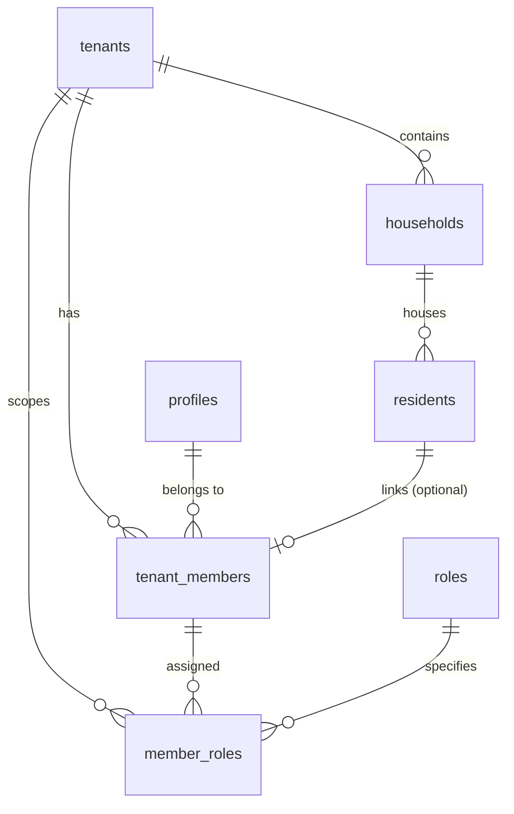
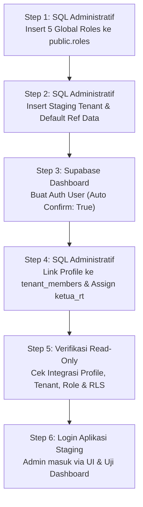

# Smart RT — Step 16.4.0: Staging Provisioning Preflight & Design Report

- **Date:** 2026-11-16
- **Target Project:** `smart-rt-staging`
- **Project Ref:** `szghujzhiyndeuhepsax`
- **Region:** `ap-southeast-1`
- **Database Engine:** `PostgreSQL 17.11` (`17.11.0.019`)
- **Status:** **PASS (READY FOR REVIEW — NO REMOTE MUTATIONS PERFORMED)**

---

## 1. Executive Summary & Objective

Tahap Step 16.3.3 berhasil menerapkan 23 migrasi database ke Supabase Cloud staging (`szghujzhiyndeuhepsax`). Seluruh 33 tabel publik berstatus aktif dengan RLS, 80 RLS policies, 96 functions, dan 6 private storage buckets terverifikasi aman. Saat ini database berada dalam kondisi **clean baseline** (seluruh tabel domain memiliki 0 baris data).

Tujuan Step 16.4.0 adalah melakukan **audit dan perancangan terkontrol (READ-ONLY)** untuk proses provisioning awal staging environment, meliputi:
1. Analisis skema katalog role global (`public.roles`).
2. Analisis bootstrap tenant pertama (`public.tenants`), keanggotaan (`tenant_members`), dan penugasan peran (`member_roles`).
3. Analisis mekanisme otentikasi Supabase Auth, trigger profil (`handle_new_user()`), dan batasan alur aktivasi undangan.
4. Perancangan urutan provisioning eksplisit yang memisahkan eksekusi SQL administratif, tindakan manual di Supabase Dashboard, dan aksi UI aplikasi.
5. Penyusunan rencana verifikasi read-only pasca-provisioning.

> [!IMPORTANT]
> **Safety Notice:** Seluruh pemeriksaan dalam laporan ini bersifat **READ-ONLY**. Tidak ada data yang dimasukkan, diubah, atau dihapus pada database remote Supabase Cloud staging. Tidak ada user Auth baru yang dibuat. Seluruh script SQL yang dicantumkan berstatus **PROPOSED (NOT EXECUTED)** untuk ditinjau oleh user.

---

## 2. Phase 1 — Roles Provisioning Audit

### 2.1 Skema & Constraint `public.roles`

Audit langsung terhadap katalog database PostgreSQL remote (`szghujzhiyndeuhepsax`) menunjukkan:

| Kolom | Tipe Data | Nullable | Default | Keterangan |
|---|---|---|---|---|
| `id` | `uuid` | NO | `gen_random_uuid()` | Primary Key |
| `code` | `text` | NO | *None* | Unique constraint (`roles_code_key`) |
| `name` | `text` | NO | *None* | Nama tampilan peran |
| `description` | `text` | YES | *None* | Deskripsi hak akses peran |
| `created_at` | `timestamptz` | NO | `now()` | Timestamp pembuatan |

**Constraints pada `public.roles`:**
- `roles_pkey`: `PRIMARY KEY (id)`
- `roles_code_key`: `UNIQUE (code)`
- `chk_roles_code`: `CHECK (code = ANY (ARRAY['ketua_rt', 'sekretaris', 'bendahara', 'pengurus', 'warga']))`

### 2.2 Foreign Keys yang Mereferensikan `public.roles`

| Tabel Referencing | Nama Constraint | Kolom | On Delete | Dampak Keamanan |
|---|---|---|---|---|
| `public.member_roles` | `member_roles_role_id_fkey` | `role_id -> roles(id)` | `RESTRICT` | Mencegah penghapusan peran yang sedang ditugaskan kepada anggota tenant. |
| `public.announcement_recipients` | `announcement_recipients_role_id_fkey` | `role_id -> roles(id)` | `CASCADE` | Membersihkan relasi audiens pengumuman bila role dihapus. |

### 2.3 Karakteristik & Ketergantungan Data Role
1. **Global Lookup vs Tenant-Specific:**
   Tabel `public.roles` adalah **global lookup table**. Tidak memiliki kolom `tenant_id`. Kebijakan RLS yang aktif adalah `roles_select_authenticated` (`FOR SELECT TO authenticated USING (true)`), sehingga seluruh user yang terotentikasi dapat membaca katalog peran.
2. **Kebutuhan Sebelum Provisioning Anggota/Tenant:**
   Baris peran dalam `public.roles` **wajib ada terlebih dahulu** sebelum seorang anggota dapat diberikan peran pada `public.member_roles`. Selain itu, RPC seperti `redeem_resident_invitation` secara eksplisit mengeksekusi `SELECT id FROM public.roles WHERE code = 'warga'`. Bila tabel kosong, transaksi aktivasi akan melempar exception `P0002: System role warga not configured`.
3. **Ketergantungan terhadap UUID Role:**
   Tidak ada migrasi, helper function, maupun RPC yang mengasumsikan UUID tertentu. Seluruh pemeriksaan logika RLS (misalnya `has_tenant_role()`) dan Server Actions melakukan query berdasarkan kode string (`r.code = ANY(p_roles)` atau `r.code = 'warga'`). Oleh karena itu, UUID yang dihasilkan oleh `gen_random_uuid()` valid sepenuhnya.

### 2.4 Lima Role Standar Aplikasi
Sesuai constraint `chk_roles_code` dan definisi domain Smart RT:
1. `ketua_rt`: Ketua RT — Penanggung jawab utama operasional dan persetujuan RT.
2. `sekretaris`: Sekretaris — Pengelola data kependudukan, pengumuman, dan surat pengantar.
3. `bendahara`: Bendahara — Pengelola iuran, verifikasi pembayaran, dan buku kas RT.
4. `pengurus`: Pengurus — Pengurus operasional lingkungan, pengaduan, dan kegiatan.
5. `warga`: Warga — Warga terdaftar pada lingkungan RT.

---

## 3. Phase 2 — Tenant Bootstrap Audit

### 3.1 Skema & Constraint Tabel Terkait



#### A. `public.tenants`
- **Primary Key:** `id (uuid, gen_random_uuid())`
- **Required Fields:** `code`, `name`, `rt_number`, `rw_number`, `kelurahan`, `kecamatan`, `city`, `province`, `status` (`'active'`, `'inactive'`, `'suspended'`), `settings` (`jsonb`).
- **Unique Constraint:** `uq_tenants_code UNIQUE (code) WHERE deleted_at IS NULL`.
- **Aturan Otorisasi RLS:**
  - `tenants_select_member_or_super`: `USING (is_super_admin() OR is_tenant_member(id))`
  - `tenants_insert_super`: `WITH CHECK (is_super_admin())`
  - *Temuan Kunci:* Client/browser biasa yang terotentikasi **tidak dapat** melakukan `INSERT` ke tabel `tenants` kecuali memiliki flag `profiles.is_super_admin = true`. Karena pada clean baseline belum ada super admin, pembuatan tenant pertama **harus dilakukan melalui jalur administratif (SQL postgres / service_role)**.

#### B. `public.tenant_members`
- **Foreign Keys:** `tenant_id -> tenants(id) ON DELETE CASCADE`, `user_id -> profiles(id) ON DELETE CASCADE`, `resident_id -> residents(tenant_id, id) ON DELETE SET NULL`.
- **Unique Constraints:** `(tenant_id, id)`, `(tenant_id, user_id)`, dan `(tenant_id, resident_id) WHERE resident_id IS NOT NULL`.
- **Status:** `'invited'`, `'active'`, `'inactive'`.
- *Temuan Kunci:* Kolom `resident_id` bersifat **NULLABLE**. Seorang administrator atau pengurus RT tidak wajib memiliki entri `residents` untuk dapat aktif mengelola tenant.

#### C. `public.member_roles`
- **Foreign Keys:** `(tenant_id, member_id) -> tenant_members(tenant_id, id) ON DELETE CASCADE`, `role_id -> roles(id) ON DELETE RESTRICT`, `assigned_by -> profiles(id) ON DELETE SET NULL`.
- **Unique Constraint:** `uq_member_roles_member_role UNIQUE (member_id, role_id)`.
- *Temuan Kunci:* Menghubungkan seorang anggota dengan satu atau lebih role (`ketua_rt`, `pengurus`, dll.).

#### D. Data Referensi Default Tenant
Untuk fungsionalitas penuh modul keuangan dan persuratan, setiap tenant baru membutuhkan kategori kas dan jenis surat bawaan:
- **`public.cash_categories`:** Kategori pemasukan (Iuran Bulanan, Sumbangan/Donasi) dan pengeluaran (Kebersihan/Sampah, Keamanan/Penerangan, Operasional RT, Refund).
- **`public.letter_types`:** Template surat bawaan (`DOMISILI`, `PENGANTAR_KTP`, `SKTM`).

---

## 4. Phase 3 — Auth Provisioning Audit

### 4.1 Mekanisme Trigger Profil (`handle_new_user`)
- Trigger `trg_auth_users_create_profile` terpasang pada `auth.users` (`AFTER INSERT`).
- Saat sebuah user dibuat di Supabase Auth:
  ```sql
  INSERT INTO public.profiles (id, full_name, phone)
  VALUES (
      NEW.id,
      COALESCE(
          NULLIF(trim(NEW.raw_user_meta_data ->> 'full_name'), ''),
          split_part(COALESCE(NEW.email, 'user@smartrt.local'), '@', 1)
      ),
      NEW.phone
  )
  ON CONFLICT (id) DO NOTHING;
  ```
- Profil langsung terbuat secara atomik dengan ID yang sama persis dengan `auth.users.id`.
- Kolom `active_tenant_id` bernilai `NULL` saat pertama kali dibuat.

### 4.2 Analisis Alur Undangan Warga (`resident_invitations`)
Audit terhadap RPC `create_resident_invitation` dan `redeem_resident_invitation` (Migration `0019`):
1. **Penerbitan Undangan (`create_resident_invitation`):**
   - Membutuhkan otorisasi: `has_tenant_role(tenant_id, ARRAY['ketua_rt', 'sekretaris'])`.
   - Membutuhkan entri `residents` yang aktif.
2. **Klaim Undangan (`redeem_resident_invitation`):**
   - Mengikat akun ke entri warga tertentu (`resident_id`).
   - Secara eksplisit **hanya memberikan role `'warga'`** (`chk_roles_code` / lines 908–917).
3. **Kesimpulan Audit Jalur Administrator:**
   > **Initial administrator (Ketua RT staging) TIDAK BISA dibuat melalui alur resident invitation.** Alur tersebut secara desain mensyaratkan adanya pengurus yang sudah aktif untuk mengundang, serta secara keras membatasi role yang diberikan hanya `'warga'`. Administrator pertama harus dibuat melalui pembuatan akun Auth terkonfirmasi dan linking keanggotaan administratif.

### 4.3 Kebutuhan Email Confirmation & Supabase Auth Staging
- Di staging environment, layanan SMTP kustom pihak ketiga (SendGrid/Resend) belum tentu terkonfigurasi.
- Jika user didaftarkan melalui form registrasi umum (`supabase.auth.signUp`), Supabase Auth secara default akan meminta konfirmasi email (`email_confirmed_at IS NULL`), yang menyebabkan login tertahan dengan pesan `"Akun Anda belum terverifikasi"`.
- **Rekomendasi Aman Staging:**
  Pembuatan akun administrator pertama dilakukan via **Supabase Dashboard -> Authentication -> Users -> Add User** dengan opsi **"Auto Confirm User" dicentang (checked)**. Hal ini memastikan `email_confirmed_at` langsung terisi dan user dapat segera login tanpa bergantung pada mail server.

### 4.4 Redirect & Callback URLs
- Route Next.js callback: `/auth/callback` (mendukung PKCE code exchange dan token OTP).
- Supabase Dashboard -> Authentication -> URL Configuration:
  - **Site URL:** URL staging aplikasi (contoh `https://smart-rt-staging.up.railway.app` atau `http://localhost:3000` saat pengujian staging lokal).
  - **Redirect URLs:** Wajib mendaftarkan `https://<staging-app-url>/auth/callback` dan `http://localhost:3000/auth/callback`.

---

## 5. Phase 4 — Provisioning Design

Berikut adalah rancangan urutan provisioning staging bertahap yang memisahkan tanggung jawab antara SQL administratif, konfigurasi Dashboard Supabase, dan interaksi aplikasi:



### 5.1 Urutan Rinci Tindakan

#### Tahap 1: SQL Administratif — Global Roles Lookup
Memasukkan 5 peran sistem ke dalam `public.roles`. Sifatnya idempoten (`ON CONFLICT (code) DO NOTHING`).

#### Tahap 2: SQL Administratif — Staging Tenant & Referensi Bawaan
Membuat tenant uji staging dengan data sintetis (bebas PII):
- **Kode:** `rt-01-rw-01-staging`
- **Nama:** `RT 01 / RW 01 Staging`
- **Wilayah:** Data sintetis (Kelurahan Simulasi, Kecamatan Simulasi, Kota Jakarta Selatan, DKI Jakarta).
- Menambahkan 6 default `cash_categories` dan 3 default `letter_types` terikat pada `tenant_id` staging.

#### Tahap 3: Tindakan Manual Supabase Dashboard — Initial Admin Auth User
1. Buka Supabase Dashboard project `smart-rt-staging` (`szghujzhiyndeuhepsax`).
2. Masuk ke **Authentication -> Users**.
3. Klik tombol **Add User -> Create user**.
4. Masukkan kredensial staging sintetis (misal `admin.staging@smartrt.internal` dan kata sandi yang kuat).
5. **Wajib centang: "Auto Confirm User"**.
6. Simpan user. Trigger `trg_auth_users_create_profile` akan otomatis membuat baris pada `public.profiles`.
7. Salin User UID yang terbuat (format UUID) untuk digunakan pada Tahap 4.

#### Tahap 4: SQL Administratif — Keanggotaan & Penugasan Role
Menghubungkan user Auth staging ke tenant staging:
1. Masukkan entri ke `public.tenant_members` dengan `tenant_id`, `user_id = '<AUTH_USER_UUID>'`, `status = 'active'`, dan `joined_at = now()`.
2. Masukkan entri ke `public.member_roles` dengan `role_id` milik `ketua_rt`.
3. Perbarui `public.profiles.active_tenant_id` mengarah ke ID tenant staging.

#### Tahap 5: Data Warga & Keluarga (Opsional / Terkendali)
Jika pengujian alur warga diperlukan:
- Dapat dibuat 1 Kartu Keluarga sintetis (`public.households`) dan 1 Warga sintetis (`public.residents`).
- Entri warga ini dapat dihubungkan ke `tenant_members.resident_id` milik admin, atau dibiarkan independen untuk diuji melalui alur undangan warga via UI.

---

## 6. Proposed SQL Scripts (FOR REVIEW ONLY — NOT EXECUTED)

> [!WARNING]
> Script SQL di bawah ini **TIDAK DIJALANKAN** pada step ini. Disiapkan hanya sebagai spesifikasi teknis untuk peninjauan user sebelum eksekusi resmi pada step berikutnya.

```sql
-- =============================================================================
-- SMART RT STAGING PROVISIONING SCRIPT (PROPOSED - NOT EXECUTED)
-- Target: smart-rt-staging (szghujzhiyndeuhepsax)
-- Execution Context: Supabase Dashboard SQL Editor / Admin CLI (postgres role)
-- =============================================================================

BEGIN;

-- -----------------------------------------------------------------------------
-- 1. Global Roles Provisioning
-- -----------------------------------------------------------------------------
INSERT INTO public.roles (code, name, description)
VALUES
    ('ketua_rt', 'Ketua RT', 'Penanggung jawab utama operasional dan persetujuan RT'),
    ('sekretaris', 'Sekretaris', 'Pengelola data kependudukan, pengumuman, dan surat pengantar'),
    ('bendahara', 'Bendahara', 'Pengelola iuran, verifikasi pembayaran, dan buku kas RT'),
    ('pengurus', 'Pengurus', 'Pengurus operasional lingkungan, pengaduan, dan kegiatan'),
    ('warga', 'Warga', 'Warga terdaftar pada lingkungan RT')
ON CONFLICT (code) DO NOTHING;

-- -----------------------------------------------------------------------------
-- 2. Staging Tenant Provisioning (Synthetic Data)
-- -----------------------------------------------------------------------------
INSERT INTO public.tenants (
    code,
    name,
    rt_number,
    rw_number,
    kelurahan,
    kecamatan,
    city,
    province,
    status,
    settings
)
SELECT
    'rt-01-rw-01-staging',
    'RT 01 / RW 01 Staging',
    '01',
    '01',
    'Kelurahan Simulasi',
    'Kecamatan Simulasi',
    'Kota Jakarta Selatan',
    'DKI Jakarta',
    'active',
    '{"letter_number_format": "{seq}/RT01-RW01/{month}/{year}"}'::jsonb
WHERE NOT EXISTS (
    SELECT 1 FROM public.tenants WHERE code = 'rt-01-rw-01-staging' AND deleted_at IS NULL
);

-- -----------------------------------------------------------------------------
-- 3. Tenant Reference Data (Categories & Letter Types)
-- -----------------------------------------------------------------------------
DO $$
DECLARE
    v_tenant_id uuid;
BEGIN
    SELECT id INTO v_tenant_id
    FROM public.tenants
    WHERE code = 'rt-01-rw-01-staging' AND deleted_at IS NULL
    LIMIT 1;

    IF v_tenant_id IS NOT NULL THEN
        -- Default Cash Categories
        INSERT INTO public.cash_categories (tenant_id, name, type)
        VALUES
            (v_tenant_id, 'Iuran Bulanan Warga', 'income'),
            (v_tenant_id, 'Sumbangan & Donasi', 'income'),
            (v_tenant_id, 'Kebersihan & Pengelolaan Sampah', 'expense'),
            (v_tenant_id, 'Keamanan & Penerangan', 'expense'),
            (v_tenant_id, 'Operasional & Kegiatan RT', 'expense'),
            (v_tenant_id, 'Pengembalian Dana (Refund)', 'expense')
        ON CONFLICT (tenant_id, name, type) DO NOTHING;

        -- Default Letter Types
        INSERT INTO public.letter_types (tenant_id, code, name, description, required_documents)
        VALUES
            (
                v_tenant_id,
                'DOMISILI',
                'Surat Pengantar Domisili',
                'Surat keterangan domisili warga di lingkungan RT staging',
                '["Fotokopi KTP", "Fotokopi KK"]'::jsonb
            ),
            (
                v_tenant_id,
                'PENGANTAR_KTP',
                'Surat Pengantar Pembuatan / Perpanjangan KTP',
                'Pengantar administrasi kependudukan ke kelurahan',
                '["Fotokopi KK"]'::jsonb
            ),
            (
                v_tenant_id,
                'SKTM',
                'Surat Keterangan Tidak Mampu',
                'Pengantar pengurusan keringanan pendidikan atau kesehatan',
                '["Fotokopi KTP", "Fotokopi KK"]'::jsonb
            )
        ON CONFLICT (tenant_id, code) DO NOTHING;
    END IF;
END $$;

-- -----------------------------------------------------------------------------
-- 4. Initial Administrator Linking (Requires AUTH_USER_ID from Dashboard)
-- Parameter pengganti: '<AUTH_USER_UUID>'
-- -----------------------------------------------------------------------------
-- Catatan: Bagian ini dijalankan setelah user Auth dibuat di Dashboard:
/*
DO $$
DECLARE
    v_user_id uuid := '<AUTH_USER_UUID>'::uuid;
    v_tenant_id uuid;
    v_member_id uuid;
    v_role_id uuid;
BEGIN
    SELECT id INTO v_tenant_id FROM public.tenants WHERE code = 'rt-01-rw-01-staging' LIMIT 1;
    SELECT id INTO v_role_id FROM public.roles WHERE code = 'ketua_rt';

    -- Pastikan profil terbarui
    UPDATE public.profiles
       SET active_tenant_id = v_tenant_id,
           full_name = 'Ketua RT Staging'
     WHERE id = v_user_id;

    -- Hubungkan sebagai active tenant member
    INSERT INTO public.tenant_members (tenant_id, user_id, status, joined_at)
    VALUES (v_tenant_id, v_user_id, 'active', now())
    ON CONFLICT (tenant_id, user_id) DO UPDATE SET status = 'active'
    RETURNING id INTO v_member_id;

    -- Tetapkan role ketua_rt
    INSERT INTO public.member_roles (tenant_id, member_id, role_id)
    VALUES (v_tenant_id, v_member_id, v_role_id)
    ON CONFLICT (member_id, role_id) DO NOTHING;
END $$;
*/

COMMIT;
```

---

## 7. Security Risks & Mitigations

| Risiko | Tingkat | Mitigasi yang Diterapkan |
|---|---|---|
| **Bocoran Kredensial / Secret** | TINGGI | Tidak ada password atau API key yang dimasukkan ke dalam repository atau log. Password akun staging ditentukan langsung oleh operator melalui UI Supabase Dashboard. |
| **Pencemaran Data Nyata (PII)** | TINGGI | Seluruh data staging menggunakan entitas sintetis (`rt-01-rw-01-staging`, `Kelurahan Simulasi`, email `@smartrt.internal`). Dilarang keras menggunakan NIK, nomor telepon, atau data warga nyata. |
| **Bypass RLS di Client** | KRITIS | Frontend dan SSR tetap hanya menggunakan `NEXT_PUBLIC_SUPABASE_ANON_KEY`. Tidak ada penempatan `SUPABASE_SERVICE_ROLE_KEY` pada frontend atau container web Railway. |
| **Email Confirmation Deadlock** | SEDANG | Pendaftaran admin via Dashboard wajib menggunakan opsi "Auto Confirm User" sehingga tidak terhenti oleh ketiadaan external SMTP server di staging. |
| **Multi-Tenant Leakage** | TINGGI | Seluruh query domain di `src/` menyertakan `tenant_id` dan divalidasi oleh helper RLS `has_tenant_role()` dan `is_tenant_member()`. Anggota tenant staging tidak dapat melihat data tenant lain bila di masa depan tenant kedua dibuat. |

---

## 8. Phase 5 — Post-Provisioning Verification Plan (READ-ONLY SQL)

Query verifikasi pasca-provisioning berikut telah disiapkan untuk dijalankan segera setelah tahap eksekusi disetujui:

```sql
-- Step 16.4 Post-Provisioning Verification Query (READ-ONLY)
SELECT jsonb_build_object(
  'roles_count', (SELECT count(*) FROM public.roles),
  'roles_list', (SELECT jsonb_agg(code ORDER BY code) FROM public.roles),
  'tenants_count', (SELECT count(*) FROM public.tenants WHERE deleted_at IS NULL),
  'tenant_sample', (
    SELECT jsonb_build_object(
      'id', id,
      'code', code,
      'name', name,
      'status', status
    )
    FROM public.tenants
    WHERE code = 'rt-01-rw-01-staging'
    LIMIT 1
  ),
  'cash_categories_count', (
    SELECT count(*)
    FROM public.cash_categories cc
    JOIN public.tenants t ON t.id = cc.tenant_id
    WHERE t.code = 'rt-01-rw-01-staging'
  ),
  'letter_types_count', (
    SELECT count(*)
    FROM public.letter_types lt
    JOIN public.tenants t ON t.id = lt.tenant_id
    WHERE t.code = 'rt-01-rw-01-staging'
  ),
  'admin_membership', (
    SELECT jsonb_build_object(
      'user_id', tm.user_id,
      'email', u.email,
      'member_status', tm.status,
      'roles', (
        SELECT jsonb_agg(r.code)
        FROM public.member_roles mr
        JOIN public.roles r ON r.id = mr.role_id
        WHERE mr.member_id = tm.id
      )
    )
    FROM public.tenant_members tm
    JOIN public.tenants t ON t.id = tm.tenant_id
    JOIN auth.users u ON u.id = tm.user_id
    WHERE t.code = 'rt-01-rw-01-staging'
    LIMIT 1
  ),
  'rls_enforced_check', (
    SELECT count(*)
    FROM pg_class c
    JOIN pg_namespace n ON n.oid = c.relnamespace
    WHERE n.nspname = 'public'
      AND c.relkind IN ('r', 'p')
      AND c.relrowsecurity IS NOT TRUE
  )
) AS staging_provision_verification;
```

**Kriteria Lulus Pasca-Provisioning:**
1. `roles_count = 5` dengan daftar `['bendahara', 'ketua_rt', 'pengurus', 'sekretaris', 'warga']`.
2. `tenants_count >= 1` dengan `code = 'rt-01-rw-01-staging'` dan `status = 'active'`.
3. `cash_categories_count = 6` dan `letter_types_count = 3`.
4. `admin_membership` memiliki `member_status = 'active'` dan `roles` berisi minimal `['ketua_rt']`.
5. `rls_enforced_check = 0` (seluruh tabel tetap 100% diproteksi RLS).

---

## 9. Final Decision & Status

- **Status:** **`PASS`**
- **Kondisi Database Remote:** Tetap murni dan tidak ada perubahan schema maupun data (`0` baris data domain).
- **Instruksi Penghentian Terpenuhi:**
  - Tidak ada data yang dimasukkan atau diubah.
  - Tidak ada user Auth yang dibuat.
  - Railway deployment, Edge Functions, dan background schedulers tetap dihentikan.
- **Rekomendasi Langkah Berikutnya (Menunggu Persetujuan Eksplisit User):**
  1. User meninjau rencana provisioning di atas.
  2. Setelah disetujui, jalankan eksekusi Tahap 1 & 2 (SQL provisioning untuk roles, staging tenant, dan data referensi).
  3. Buat user admin staging di Supabase Dashboard (Tahap 3).
  4. Jalankan Tahap 4 untuk linking keanggotaan dan penetapan role.
  5. Jalankan query verifikasi Bagian 8.

